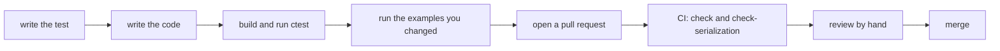

# Contributing to relearn

Thank you for helping! relearn is used for teaching as much as it is for building agents,
so the code is written to be **read**: by me, since I review every change by hand,
and by students who are meeting reinforcement learning for the first time.

## Ground rules

- **The library (`src/relearn.hpp` and `src/relearn/`) stays header-only, with no required dependencies.**
  It must build with nothing but a C++14 compiler, so that it runs on embedded boards,
  drones and robots. Optional features (such as Boost serialization) stay behind a macro.
- **Examples and games may use third-party libraries**, but only in their own optional
  CMake project, which is off by default. The default build must stay dependency-free.
- **Every change comes with a test**, and every learning test is checked against a known
  answer (an exact solution, or a result from the book), across several random seeds.
- **Keep pull requests small**, so that each one can be reviewed in one sitting.
- **AI-generated contributions are welcome**, as long as they have been reviewed and approved by a human.

## Where things are

```
.
├── src
|   ├── relearn.hpp           includes the whole library, and all you need to use it
|   └── relearn
|       ├── core.hpp          state, action, link and policy
|       ├── schedules.hpp     the schedules and the visit counter
|       ├── *.hpp             one header per algorithm (q_learning, sarsa, dyna, ...)
|       └── serialize.tpl     Boost serialization (only with USING_BOOST_SERIALIZATION)
├── docs                      one document per algorithm: formulas, pseudocode and usage
├── examples
|   ├── gridworld_*           the original gridworld examples
|   ├── *.cpp                 one program per game, each one learns and checks its result
|   └── games
|       ├── game.hpp          play, play_online, greedy and ε-Greedy, shared by all the games
|       └── *.hpp             one header per game, with its rules
└── tests
    ├── *_test.cpp            Catch2 tests, one file per topic
    └── solvers.hpp           exact solutions (value iteration, exact blackjack, breadth-first search) to test against
```

Do bear in mind that `examples/games` is not part of the library: the games only *use* `relearn.hpp`,
just like your own code would.

## How a change gets in



## Code style

The style below is the one used in the library (`src/relearn/`) and the gridworld examples.

### Layout

- Indent with 4 spaces, never tabs.
- Functions, classes, structs and namespaces open their brace on a **new line**.
  `if`, `for`, `while` and `switch` open it on the **same line**, and `else` starts a new line:

  ```cpp
  void walk(const world & w)
  {
      if (blocked) {
          turn();
      }
      else {
          step();
      }
  }
  ```

- Always use braces, even for a single statement, and put one statement on each line.
- Template parameters and long parameter lists go one per line, aligned:

  ```cpp
  template <class state_class,
            class action_class>
  std::deque<link<state_class,action_class>> explore(const world & w,
                                                     std::mt19937 & gen,
                                                     grid start);
  ```

- A `case` label goes on its own line, with its statements and `break` indented below it.
- Line up the `=` of related consecutive assignments when it helps reading.

### Names

- `snake_case` for everything: types, functions, variables and constants.
- Private and protected data members end with an underscore, e.g., `trait_` and `policies_`.
- Never use a name containing a double underscore (`__name__`), or starting with an
  underscore and a capital letter, since the C++ standard reserves them for the compiler.
- Template parameters describe what they are (`state_trait`, `action_class`),
  or are single capitals in short examples (`S`, `A`).

### Comments

- Every class and struct has a Doxygen block with `@brief` (and `@class` or `@struct`),
  explaining what it is for.
- Every function has a `///` line or a `/** */` block, using `@param`, `@return`,
  `@warning`, `@see` and `@note` where they help.
- Inside functions, a short plain-English `//` comment before each step says **what the
  step does and why**, so that a student can follow the algorithm without the book open.
- When code implements a formula, write the formula in the comment, in the notation of
  Sutton & Barto, and cite the section.

### Code

- Write it simply: prefer a named helper function to a long lambda, and a few clear lines
  to one clever line.
- Print with `std::cout` and `std::endl`, using `<iomanip>` for number formatting.
- Use `auto` when the type is obvious from the right-hand side, and `using` aliases for
  long types.
- Headers use include guards named after the path, e.g., `RELEARN_GAMES_GRID_HPP`.
- Example programs return `EXIT_SUCCESS` only if the agent learnt what it should,
  so that CI notices when an example stops working.

### Docs

- Each algorithm has its own document in `docs/`, in the same layout: what it is, the formulas,
  a diagram, the pseudocode, how to use it in relearn, an example with its results, and references.
- Formulas go in ```` ```math ```` blocks, and diagrams in ```` ```mermaid ```` blocks (GitHub draws both),
  or as ASCII art when it is a grid or a chart.
- Every number in a document comes from a program or a test you can run, so say which one.
- British spelling please (learnt, whilst, colour, behaviour), and no em dashes or en dashes.

## Building and testing

Simply do the following:

```bash
mkdir build && cd build
cmake .. -DBUILD_TESTS=On
make
ctest --output-on-failure
```

Then run the example programs you changed as well, since each one exits with a failure code when
its agent does not learn.
