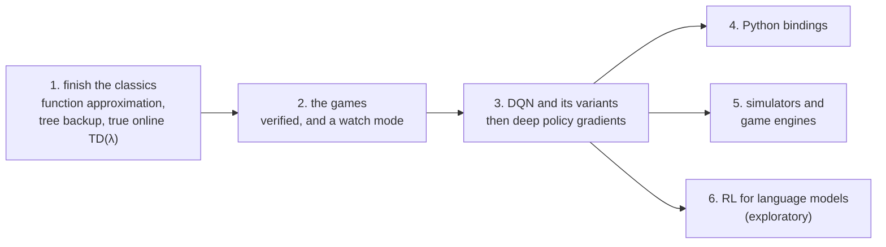

# Roadmap

relearn now has every tabular method of Sutton and Barto's book [1]: from bandits and dynamic programming, through
Monte Carlo, TD, n-step methods, planning and eligibility traces, to policy gradients, R-Learning and Monte Carlo
Tree Search. Each one is tested against hand-worked steps and against the book's own figures.

This page is where it goes next. It is a plan, not a promise: there are no dates, the order may change, and each
step is only done once it has been implemented, tested, documented and reviewed, like everything before it.

## What stays the same

Whatever gets added, a few things don't change:

- `relearn.hpp` stays **header-only C++14, with no required dependencies**, so that it keeps working on small boards,
  robots and drones. Boost serialization stays opt-in, as it is now.
- Everything that needs a third-party library (a neural network backend, a simulator, a game engine, Python) lives in
  its own optional CMake sub-project, **off by default**.
- Every algorithm comes with hand-worked tests, a test against a known answer (the book's figures, or an exact
  solution), a game that shows it, and a doc in `docs/`.

## 1. Finishing the classics

The book has a few classic methods that relearn doesn't have yet:

- **Function approximation** (Chapters 9 and 10). Instead of one value per state and action, the values come from a
  function q̂(s, a, **w**) whose weights **w** are learnt, so that what is learnt about one state carries over to the
  states near it. This is what makes continuous and very large state spaces possible:
  - tile coding (Section 9.5.4), and the polynomial and Fourier bases (Sections 9.5.1 and 9.5.2)
  - semi-gradient TD(0), on the 1000-state random walk (Example 9.1)
  - episodic semi-gradient Sarsa and its n-step version, on Mountain Car (Example 10.1), which the `mountain_car`
    example would then learn the book's way, next to the current one which cuts the state into boxes
  - Fitted Q Iteration [7], which learns from a batch of experience with any regressor (trees, for example)
- **Off-policy n-step methods**: tree backup and Q(σ) (Sections 7.5 and 7.6).
- **True online TD(λ)** (Section 12.5), which learns after every step with eligibility traces.

__note__: function approximation, bootstrapping and off-policy learning together can make the weights diverge (the
book calls it the *deadly triad*, Section 11.3), so the control examples will use Sarsa, as the book does, and the
docs will explain why.

## 2. The games

- Build and run every game on Linux and macOS, and check its output against the book again.
- A `--watch` mode, to see the agents play: one drawing hook per game, and two views of it.
  - in the terminal, as good old ASCII art, or as small pixels drawn with half-block characters in 24-bit colour
  - in a window, as retro pixel art, with [raylib](https://www.raylib.com) in an optional sub-project
  - the learning shown in the same style: a pixel learning curve, Q values as tile colours, and a status line

## 3. DQN and its variants

Deep Q-Networks [2] replace the table with a neural network, and add the two things that make that stable: a
**replay buffer**, which learns from random mini-batches of past steps, and a **target network**, a copy of the
network that is updated only every so often. Then the variants, each of which fixes one weakness:

| Variant | What it adds |
|---|---|
| Double DQN [3] | picks the next action with one network and values it with the other, as Double Q-Learning does |
| Dueling DQN | splits the network into the value of the state and the advantage of each action |
| Prioritised replay | replays more often the steps whose error is largest |
| n-step returns | learns from the next n rewards, as in Chapter 7 |
| Noisy Nets | explores by learning noise in the weights, instead of ε-Greedy |
| Distributional (C51, QR-DQN) | learns the whole distribution of the return, not just its mean |
| Rainbow [4] | all of the above together |

The plan is for relearn to own the algorithm (the replay buffer, the targets, the target network, the schedules),
and to leave the network itself to a **backend** behind a small interface, which works on batches:

- a small built-in network, header-only, for the tests and the small games (Cart-Pole, Mountain Car)
- [libtorch](https://pytorch.org/cppdocs/) (PyTorch's C++ API), as an optional backend
- our own CUDA kernels, as an optional backend for NVIDIA GPUs and Jetson boards

After DQN, the deep policy gradient methods follow the same pattern: A2C, PPO [5], DDPG, TD3 and SAC [6].

## 4. Python bindings

Most people train in Python, so relearn should be easy to reach from it, in both directions:

- relearn's learners and games callable from Python, with [pybind11](https://github.com/pybind/pybind11) (which works
  with C++11 and later, so the core can stay C++14), as an optional `pip` package
- relearn's games exposed as [Gymnasium](https://gymnasium.farama.org) environments, so that any Python library can
  train on them
- and Gymnasium's environments usable from C++, through a small bridge

Basically, you should be able to train in Python as you do today, and run the very same environment and policy in C++.

## 5. Simulators and game engines

Every simulator goes through the same environment interface the games already use (`reset`, `step` and `actions`),
so no algorithm ever depends on a particular simulator. Each one would be its own optional sub-project:

- **Gymnasium**, through the Python bridge above
- **the Arcade Learning Environment** [8] (Atari 2600 games), which has its own C++ interface
- **MuJoCo**, for physics and robotics
- **Gazebo and ROS 2**, for robots, and **PX4** or **ArduPilot** in simulation, for drones
- **game engines**: Unreal Engine, Unity and Godot, so that a game's own world can be the environment

## 6. RL for language models (exploratory)

Reinforcement learning is now part of how language models are trained, and the ideas behind it are the policy
gradients of Chapter 13 [1], applied to a policy that writes one token at a time:

- **RLHF** [9]: a reward model learnt from human preferences, and PPO with a penalty for moving too far from the
  original model
- **GRPO** [10]: PPO without a learnt critic, where each answer's advantage is its reward compared with the other
  answers to the same question
- **RL with verifiable rewards**: the reward comes from checking the answer (a test passing, a sum being right)
  instead of from a learnt model
- **DPO** [11] is a close relative, which learns from the preferences directly, without RL

This one is exploratory. The aim would be to implement these algorithms clearly, test them, and run them on small
models through the same backends as DQN, so that they can be studied and understood; not to train large models.

## References

1. Sutton, R.S. and Barto, A.G., 2018. [Reinforcement Learning: An Introduction](http://incompleteideas.net/book/the-book-2nd.html), 2nd edition. Cambridge, MA: MIT Press.
2. Mnih, V. et al., 2015. Human-level control through deep reinforcement learning. *Nature*, 518, pp. 529 to 533.
3. van Hasselt, H., Guez, A. and Silver, D., 2016. Deep reinforcement learning with double Q-learning. *AAAI*.
4. Hessel, M. et al., 2018. Rainbow: combining improvements in deep reinforcement learning. *AAAI*.
5. Schulman, J. et al., 2017. Proximal policy optimization algorithms. arXiv:1707.06347.
6. Haarnoja, T. et al., 2018. Soft actor-critic: off-policy maximum entropy deep reinforcement learning with a stochastic actor. *ICML*.
7. Ernst, D., Geurts, P. and Wehenkel, L., 2005. Tree-based batch mode reinforcement learning. *Journal of Machine Learning Research*, 6, pp. 503 to 556.
8. Bellemare, M.G. et al., 2013. The Arcade Learning Environment: an evaluation platform for general agents. *Journal of Artificial Intelligence Research*, 47, pp. 253 to 279.
9. Ouyang, L. et al., 2022. Training language models to follow instructions with human feedback. *NeurIPS*.
10. Shao, Z. et al., 2024. DeepSeekMath: pushing the limits of mathematical reasoning in open language models. arXiv:2402.03300.
11. Rafailov, R. et al., 2023. Direct preference optimization: your language model is secretly a reward model. *NeurIPS*.
