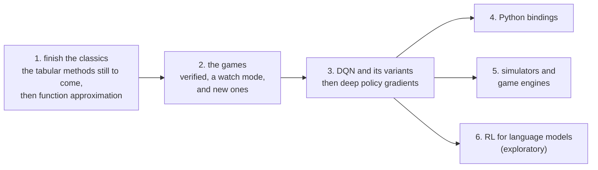

# Roadmap

relearn now has most of the tabular methods of Sutton and Barto's book [1]: from bandits and dynamic programming,
through Monte Carlo, TD, n-step methods, planning and eligibility traces, to policy gradients, R-Learning and Monte
Carlo Tree Search. Each one is tested against hand-worked steps and against the book's own figures. A few are still
to come (the off-policy n-step methods, tree backup and Q(σ), true online TD(λ) and a few more), and they are the
first part of this plan.

This page is where it goes next. It is a plan, not a promise: there are no dates, the order may change, and each
step is only done once it has been implemented, tested, documented and reviewed, like everything before it.

## What stays the same

Whatever gets added, a few things don't change:

- `relearn.hpp` stays **header-only C++14, with no required dependencies**, so that it keeps working on small boards,
  robots and drones. Boost serialization stays opt-in, as it is now.
- Everything that needs a third-party library (a neural network backend, a simulator, a game engine, Python) lives in
  its own optional CMake sub-project, **off by default**.
- Every algorithm comes with hand-worked tests, a test against a known answer (the book's figures, or an exact
  solution), a game that shows it, and a doc in `docs/`.

## 1. Finishing the classics

### The tabular methods still to come

The book has a few more tabular methods that relearn doesn't have yet. In the order they would be done:

1. **The rest of the n-step family** (Chapter 7), which shares the machinery of `n_step_sarsa`:
   - n-step Expected Sarsa (Section 7.2)
   - off-policy n-step Sarsa, which learns from another policy's play with importance sampling, and its
     per-decision version with control variates (Sections 7.3 and 7.4)
   - n-step tree backup, which learns off-policy without importance sampling (Section 7.5)
   - n-step Q(σ), which unifies them all: σ = 1 is Sarsa, σ = 0 is tree backup (Section 7.6)
2. **True online TD(λ) and true online Sarsa(λ)** (Sections 12.5 to 12.7), with Dutch traces. Today's TD(λ),
   SARSA(λ) and Watkins's Q(λ) learn one whole episode at a time; these learn after every step, and still match the
   λ-return exactly.
3. **Actor-Critic with eligibility traces**, and **Actor-Critic for tasks that never end** (Sections 13.5 and 13.6).
   Today's `actor_critic` is the one-step version, for episodes only.
4. **Off-policy Monte Carlo prediction** (Section 5.5): ordinary against weighted importance sampling, on the
   book's blackjack state (Example 5.4, Figure 5.3). Today's `off_policy_monte_carlo` is the weighted one, for
   control only.

And the smaller or rarer ones, after those:

- truncated TD(λ) and the online λ-return algorithm (Sections 12.3 and 12.4), which true online TD(λ) supersedes
- variable λ and γ, off-policy traces with control variates, and Tree-Backup(λ) (Sections 12.8 to 12.10)
- real-time dynamic programming (Section 8.7), and trajectory sampling, heuristic search and rollout algorithms
  (Sections 8.6, 8.9 and 8.10)
- discounting-aware and per-decision importance sampling (Sections 5.8 and 5.9)

### Function approximation

Chapters 9 and 10. Instead of one value per state and action, the values come from a function q̂(s, a, **w**) whose
weights **w** are learnt, so that what is learnt about one state carries over to the states near it. This is what
makes continuous and very large state spaces possible:

- tile coding (Section 9.5.4), and the polynomial and Fourier bases (Sections 9.5.1 and 9.5.2)
- semi-gradient TD(0), on the 1000-state random walk (Example 9.1)
- episodic semi-gradient Sarsa and its n-step version, on Mountain Car (Example 10.1), which the `mountain_car`
  example would then learn the book's way, next to the current one which cuts the state into boxes
- Fitted Q Iteration [7], which learns from a batch of experience with any regressor (trees, for example)
- Gaussian policies for continuous actions (Section 13.7)

Do bear in mind that a table is simply linear function approximation with one feature per state and action, all
of them 0 but one. So the book gives true online TD(λ) and Sarsa(λ) with linear function approximation, and once that
is in, they work with tables and with features alike.

__note__: function approximation, bootstrapping and off-policy learning together can make the weights diverge (the
book calls it the *deadly triad*, Section 11.3), so the control examples will use Sarsa, as the book does, and the
docs will explain why.

## 2. The games

- Build and run every game on Linux and macOS, and check its output against the book again.
- A `--watch` mode, to see the agents play: one drawing hook per game, and two views of it.
  - in the terminal, as good old ASCII art, or as small pixels drawn with half-block characters in 24-bit colour
  - in a window, as retro pixel art, with [raylib](https://www.raylib.com) in an optional sub-project
  - the learning shown in the same style: a pixel learning curve, Q values as tile colours, and a status line

### New games, to show each algorithm at its best

Every algorithm already has a game, but some of them deserve one that shows what they are really good at. These
would all be written from scratch in C++, header-only, in `examples/games/`, like the current ones (the ones that
come from Gymnasium included, as FrozenLake was), and drawable in the watch mode. In the order of the roadmap:

| Game | What it shows | Learnt with | Source |
|---|---|---|---|
| Drifting bandit | arms whose values drift over time: a constant step size against sample averages | ε-Greedy, UCB, gradient bandit | Exercise 2.5 [1] |
| Jack's car rental | dynamic programming on a model with thousands of transitions (Figure 4.2) | policy iteration, value iteration | Example 4.2 [1] |
| Racetrack | learning to drive round a bend from another policy's play, then planning it in real time | off-policy Monte Carlo, real-time DP | Exercise 5.12, Example 8.6 [1] |
| Taxi | a pick-up and a drop-off, with wrong moves punished: a small test bench for the whole n-step family | Q-Learning, Sarsa, tree backup, Q(σ) | [14] |
| Superoptimiser | writing the shortest program, below, step by step | MCTS, Q-Learning, linear function approximation | [12], [13] |
| Connect Four | a game too big for a table, played by planning alone | MCTS | |
| Mountain Car, the book's way | tile coding, and traces that make a slow task fast (Figures 10.1 and 12.10) | semi-gradient Sarsa, Sarsa(λ), true online Sarsa(λ) | Example 10.1 [1] |
| Acrobot | a harder swing-up, with four continuous variables | semi-gradient Sarsa, then DQN | Gymnasium |
| Pac-Man, small | a few hand-made features (the nearest ghost, the nearest pellet) instead of a table | linear function approximation | |
| Snake | learning from the whole grid, in retro pixels | DQN and its variants | |
| Lunar Lander | landing softly, with discrete then continuous thrust | DQN, then SAC | Gymnasium |
| Pendulum | a continuous action: how hard to push | Gaussian policies, DDPG, TD3, SAC | Gymnasium |
| Drone, in 2D | hovering and landing in random wind, so that the policy copes with a world it hasn't seen | PPO, SAC, domain randomisation | |
| Boat, in 2D | docking in a current, with noisy sensors | PPO, SAC | |
| Arithmetic | a tiny language model learning to add, rewarded only when it is right | GRPO, RL with verifiable rewards | [10] |

### The superoptimiser game

A game where the agent writes a program, one instruction at a time, and is rewarded for getting the answer right with
as few instructions as possible: an idea from *superoptimisation*, which AlphaDev [12] took to real sorting routines
with RL, and STOKE [13] with a random search.

- a toy processor: 4 registers, about 10 instructions (`mov`, `add`, `sub`, `cmp`, `cmov`, ...)
- a target, such as `abs(x)`, `max(a, b)`, or swapping two registers without a third
- the state: the program so far, and what it does to the registers on a few test inputs
- an action: the next instruction, with the impossible ones masked out
- the reward: how many test inputs give the right answer, minus 1 / (L + 1) for each instruction, L being the
  longest program allowed; so one more right answer always outweighs any difference in length, and among the
  programs that are right, the shortest wins

Basically it is a puzzle with a tiny model of the world (the processor), so MCTS can solve it by planning, Q-Learning
by trial and error on short programs, and linear function approximation once the programs get longer. Do bear in mind
that the features matter more than anything here: "instruction X at position i" can't tell that a register written at
one step is read at another, whereas features from the program's data flow (which registers are written, read, still
needed) can. Showing that difference is half the point of the game.

## 3. DQN and its variants

Deep Q-Networks [2] replace the table with a neural network, and add the two things that make that stable: a
**replay buffer**, which learns from random mini-batches of past steps, and a **target network**, a copy of the
network that is updated only every so often. Then the variants, each of which fixes one weakness:

| Variant | What it adds |
|---|---|
| Double DQN [3] | picks the next action with one network and values it with the other, as Double Q-Learning does |
| Dueling DQN | splits the network into the value of the state and the advantage of each action |
| Prioritised replay | replays more often the steps whose error is largest |
| n-step returns | learns from the next n rewards, as in Chapter 7 |
| Noisy Nets | explores by learning noise in the weights, instead of ε-Greedy |
| Distributional (C51, QR-DQN) | learns the whole distribution of the return, not just its mean |
| Rainbow [4] | Double DQN, Dueling, prioritised replay, n-step returns, Noisy Nets and C51, together |

The plan is for relearn to own the algorithm (the replay buffer, the targets, the target network, the schedules),
and to leave the network itself to a **backend** behind a small interface, which works on batches:

- a small built-in network, header-only, for the tests and the small games (Cart-Pole, Mountain Car)
- [libtorch](https://pytorch.org/cppdocs/) (PyTorch's C++ API), as an optional backend
- our own CUDA kernels, as an optional backend for NVIDIA GPUs and Jetson boards

After DQN, the deep policy gradient methods follow the same pattern: A2C, PPO [5], DDPG, TD3 and SAC [6].

## 4. Python bindings

Most people train in Python, so relearn should be easy to reach from it, in both directions:

- relearn's learners and games callable from Python, with [pybind11](https://github.com/pybind/pybind11) (which works
  with C++11 and later, so the core can stay C++14), as an optional `pip` package
- relearn's games exposed as [Gymnasium](https://gymnasium.farama.org) environments, so that any Python library can
  train on them
- and Gymnasium's environments usable from C++, through a small bridge

Basically, you should be able to train in Python as you do today, and run the very same environment and policy in C++.

## 5. Simulators and game engines

Every simulator goes through the same environment interface the games already use (`reset`, `step` and `actions`),
so no algorithm ever depends on a particular simulator. Each one would be its own optional sub-project:

- **Gymnasium**, through the Python bridge above
- **the Arcade Learning Environment** [8] (Atari 2600 games), which has its own C++ interface
- **MuJoCo**, for physics and robotics
- **Gazebo and ROS 2**, for robots, and **PX4** or **ArduPilot** in simulation, for drones
- **CARLA**, the open driving simulator built on Unreal Engine

### Game engines

A game engine's world can be the environment: the engine steps the physics, and relearn chooses the actions. Each
engine would get a thin adapter, run headless and faster than real time for training, and with graphics to watch
the agent play. In order:

| Engine | Why | How relearn would plug in |
|---|---|---|
| [Godot](https://godotengine.org) | open source (MIT), small, and extended in C++ | a GDExtension: relearn compiled straight into the game |
| [Unreal Engine](https://www.unrealengine.com) | C++ throughout, and the engine behind CARLA | a plugin module, next to its own Learning Agents plugin |
| [Unity](https://unity.com) | the most used, and home of ML-Agents | a native plugin (relearn behind a small C interface, called from C#) |
| [O3DE](https://o3de.org) | open source (Apache 2.0), C++, with ROS 2 support for robots | a Gem (O3DE's name for a module) |

The [raylib](https://www.raylib.com) window of the watch mode is not an engine, just a library for drawing, which is
why it is enough for relearn's own games.

## 6. RL for language models (exploratory)

Reinforcement learning is now part of how language models are trained, and the ideas behind it are the policy
gradients of Chapter 13 [1], applied to a policy that writes one token at a time:

- **RLHF** [9]: a reward model learnt from human preferences, and PPO with a penalty for moving too far from the
  original model
- **GRPO** [10]: PPO without a learnt critic, where each answer's advantage is its reward compared with the other
  answers to the same question
- **RL with verifiable rewards**: the reward comes from checking the answer (a test passing, a sum being right)
  instead of from a learnt model
- **DPO** [11] is a close relative, which learns from the preferences directly, without RL

This one is exploratory. The aim would be to implement these algorithms clearly, test them, and run them on small
models through the same backends as DQN, so that they can be studied and understood; not to train large models.

## References

1. Sutton, R.S. and Barto, A.G., 2018. [Reinforcement Learning: An Introduction](http://incompleteideas.net/book/the-book-2nd.html), 2nd edition. Cambridge, MA: MIT Press.
2. Mnih, V. et al., 2015. Human-level control through deep reinforcement learning. *Nature*, 518, pp. 529 to 533.
3. van Hasselt, H., Guez, A. and Silver, D., 2016. Deep reinforcement learning with double Q-learning. *AAAI*.
4. Hessel, M. et al., 2018. Rainbow: combining improvements in deep reinforcement learning. *AAAI*.
5. Schulman, J. et al., 2017. Proximal policy optimization algorithms. arXiv:1707.06347.
6. Haarnoja, T. et al., 2018. Soft actor-critic: off-policy maximum entropy deep reinforcement learning with a stochastic actor. *ICML*.
7. Ernst, D., Geurts, P. and Wehenkel, L., 2005. Tree-based batch mode reinforcement learning. *Journal of Machine Learning Research*, 6, pp. 503 to 556.
8. Bellemare, M.G. et al., 2013. The Arcade Learning Environment: an evaluation platform for general agents. *Journal of Artificial Intelligence Research*, 47, pp. 253 to 279.
9. Ouyang, L. et al., 2022. Training language models to follow instructions with human feedback. *NeurIPS*.
10. Shao, Z. et al., 2024. DeepSeekMath: pushing the limits of mathematical reasoning in open language models. arXiv:2402.03300.
11. Rafailov, R. et al., 2023. Direct preference optimization: your language model is secretly a reward model. *NeurIPS*.
12. Mankowitz, D.J. et al., 2023. Faster sorting algorithms discovered using deep reinforcement learning. *Nature*, 618, pp. 257 to 263.
13. Schkufza, E., Sharma, R. and Aiken, A., 2013. Stochastic superoptimization. *ASPLOS*.
14. Dietterich, T.G., 2000. Hierarchical reinforcement learning with the MAXQ value function decomposition. *Journal of Artificial Intelligence Research*, 13, pp. 227 to 303.
