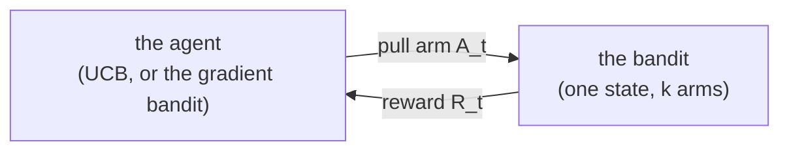
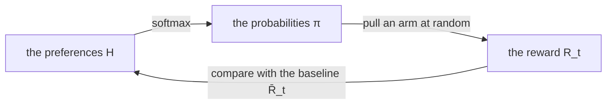

# Bandits: UCB and the gradient bandit

The *k-armed bandit*, described by Sutton and Barto [1] in Chapter 2, is the simplest problem in reinforcement learning:
a slot machine with `k` arms, each one paying a random reward around its own mean, which the agent does not know.
There is only one state, and every episode is a single pull. The agent wants to earn as much as it can,
so it must keep pulling the arm it believes is best (*exploiting*) whilst still trying the others,
in case one of them is better (*exploring*).



relearn deliberately leaves ε-Greedy to you, since it is a very simple rule which depends on your application
(the games show one way of writing it, `games::epsilon_greedy` in `examples/games/game.hpp`, and
`examples/bandit.cpp` uses it on the bandit). The two algorithms here are different: each one is a whole
way of choosing *and* learning, so they are in the library, in `relearn/bandits.hpp`:

- **UCB** (`ucb`), Upper-Confidence-Bound action selection (Section 2.7), which explores the arms it is
  least sure about, rather than at random
- the **gradient bandit** (`gradient_bandit`, Section 2.8), which learns no values at all, but a *preference*
  for each arm, and picks arms at random with the softmax of the preferences

Both use relearn's types: the bandit is a `state` (any one state will do), the arms are `action`s, and the
values or the preferences are kept in a `policy`. Each pull is one link of an episode, with its reward in
`s_t.reward()`, as usual (have a look at the [reward convention](q_learning.md#reward-convention)),
so `games::play(game, agent, 1)` gives a pull ready to learn.
Each state is its own bandit, so the same learner can also play several bandits at once.

## Upper-Confidence-Bound action selection

ε-Greedy explores at random: it is just as likely to try an arm it has tried a hundred times, and knows to be
bad, as one it has hardly tried. UCB explores where it is *uncertain*. The value of each arm is the sample average
of its rewards (Section 2.4), which is updated after each pull of arm `A`:

```math
N(A) \leftarrow N(A) + 1 \qquad Q(A) \leftarrow Q(A) + \frac{1}{N(A)} \left[ R - Q(A) \right]
```

and at step `t = 1, 2, ...` UCB pulls the arm with the highest *upper confidence bound* (equation 2.10):

```math
A_t = \underset{a}{\operatorname{argmax}} \left[ Q_t(a) + c \sqrt{\frac{\ln t}{N_t(a)}} \right]
```

where `N_t(a)` is the number of times `a` was pulled before step `t`, and `c > 0` is how much to explore.
The square root is a measure of how uncertain `Q_t(a)` still is: each pull of `a` makes it smaller,
whilst `ln t` makes it slowly grow for the arms that are *not* pulled, so that every arm is tried again in the end,
but less and less often if it is bad. An arm never pulled (`N_t(a) = 0`) counts as maximising, so the first `k` pulls
try every arm once, and ties are broken at random.

Basically UCB is *optimistic*: it treats each arm as if it were as good as it could plausibly be.

### By hand

Say there are three arms, `a` always pays 1, `b` always pays 0 and `c` always pays 0.5, and `c = 1`.
The first three pulls try each arm once, in a random order. From then on (the bounds of `a`, `b` and `c`):

```
t =  4:  1 + √(ln 4 / 1) = 2.177    0 + √(ln 4 / 1) = 1.177    0.5 + √(ln 4 / 1) = 1.677   → a
t =  5:  1 + √(ln 5 / 2) = 1.897    0 + √(ln 5 / 1) = 1.269    0.5 + √(ln 5 / 1) = 1.769   → a
t =  6:  1 + √(ln 6 / 3) = 1.773    0 + √(ln 6 / 1) = 1.339    0.5 + √(ln 6 / 1) = 1.839   → c
t =  7:  1.805    1.395    1.486   → a
  ...
t = 11:  1.585    1.549    1.595   → c
t = 12:  1.596    1.576    1.410   → a
t = 13:  1.566    1.602    1.425   → b
```

The best arm `a` is pulled most of the time, but `c`, and even `b`, which always pays 0, are tried again
as `ln t` grows. These are the choices `tests/bandits_test.cpp` checks.

### Pseudocode

```
UCB, with sample averages

parameters: the degree of exploration c > 0

start with Q(a) = 0 and N(a) = 0 for every arm a

for t = 1, 2, ...:
    if some arms have N(a) = 0:
        A ← one of them, at random
    else:
        A ← argmax over a of  Q(a) + c √( ln t / N(a) ),  ties broken at random
    pull A, and receive the reward R
    N(A) ← N(A) + 1
    Q(A) ← Q(A) + 1/N(A) [ R - Q(A) ]
```

### In relearn

```cpp
std::vector<action> arms = {action(0), action(1), action(2)};
relearn::policy<state,action> memory;     // the values Q
relearn::ucb<state,action> learner;
learner.c = 2;                            // the degree of exploration c (2 by default)
learner.prng.seed(42);                    // optional: the seed of the ties, to repeat a run

auto a = learner.choose(state(0), arms, memory);       // A_t
// ... pull a, and receive the reward r ...
learner(episode {{state(r, 0), a}}, memory);           // N(a) and Q(a)
```

or in short, `relearn::ucb<state,action> learner(2.0, 42);` (c and the seed).

- `choose` needs every arm, since the bound of an arm never pulled is infinite.
  `t` is worked out from the counts: one more than the pulls learnt so far in that state.
- The counts `N(s, a)` are kept in `learner.visits`, and `learner.bound(s, a, t, memory)` gives the bound of one arm.
- Learning is the plain sample average: the values in `memory` are exactly the average reward of each arm.
  Do bear in mind that `choose` reads them from the `policy` you pass, and the counts from the learner,
  so use the same learner and the same policy for both.

## The gradient bandit

The gradient bandit learns no values. Instead it learns a numerical *preference* `H(a)` for each arm,
and picks arm `a` with the probability given by the softmax of the preferences (equation 2.11):

```math
\pi_t(a) = \frac{e^{H_t(a)}}{\sum_{b=1}^{k} e^{H_t(b)}}
```

Only the differences between the preferences count: adding 1000 to every one of them gives the same probabilities.
All the preferences start at 0, so at first every arm is equally likely.
After pulling `A_t` and receiving `R_t`, every preference moves (equation 2.12):

```math
H_{t+1}(A_t) = H_t(A_t) + \alpha \left( R_t - \bar{R}_t \right) \left( 1 - \pi_t(A_t) \right)
```

```math
H_{t+1}(a) = H_t(a) - \alpha \left( R_t - \bar{R}_t \right) \pi_t(a) \qquad \text{for every } a \neq A_t
```

where `α` is the step size, and `R̄_t`, the *baseline*, is the average of the rewards so far.
If the reward beats the baseline, the arm pulled becomes more likely and every other arm less likely,
and if it falls short, the other way round. Sutton and Barto show that this is *stochastic gradient ascent*:
on average, each step moves the preferences in the direction that raises the expected reward the most.



### The baseline

The baseline is what makes a reward *good* or *bad*. Without one (`R̄_t = 0`), every positive reward makes the arm
pulled more likely. On a bandit whose arms all pay around +4, every arm is rewarded on almost every pull,
the bad ones too, and the agent takes far longer to tell them apart. With the average reward as the baseline,
only the arms that pay more than usual are rewarded. Figure 2.5 shows exactly this, and so does the example below.

Do bear in mind which average it is. In relearn, `R̄_t` is the average of the rewards **up to but not including**
step `t`, with `R̄_1 = R_1`, as the book's current text has it

```math
\bar{R}_1 = R_1 \qquad \bar{R}_t = \frac{1}{t-1} \sum_{i=1}^{t-1} R_i \quad \text{for } t > 1
```

so the very first pull changes nothing. Some copies of the book say "up through and including time t" instead,
which makes the baseline depend on the reward being judged; the derivation at the end of Section 2.8 needs a
baseline that does not depend on the arm pulled, which is what "not including" gives. Check your copy if they differ.
In practice the two hardly differ: on the Figure 2.5 testbed below (same bandits and seeds), a baseline that includes
`R_t` pulls the best arm in 84.4% (α = 0.1) and 71.9% (α = 0.4) of the pulls 901 to 1000, against 83.9% and 71.6% for relearn's.

### By hand

Three arms `a`, `b` and `c`, with `α = 0.1` and the baseline:

```
start:           H = (0, 0, 0)                          π = (1/3, 1/3, 1/3)
pull a, R = 1:   R̄ = R_1 = 1, so R - R̄ = 0, and nothing moves
pull b, R = 0:   R̄ = 1, R - R̄ = -1
                 H(b) = 0 + 0.1 × (-1) × (1 - 1/3) = -0.0667
                 H(a) = H(c) = 0 - 0.1 × (-1) × 1/3 = 0.0333
                 H = (0.0333, -0.0667, 0.0333)          π = (0.3443, 0.3115, 0.3443)
pull a, R = 2:   R̄ = (1 + 0) / 2 = 0.5, R - R̄ = 1.5
                 H(a) =  0.0333 + 0.1 × 1.5 × (1 - 0.3443) =  0.1317
                 H(b) = -0.0667 - 0.1 × 1.5 × 0.3115       = -0.1134
                 H(c) =  0.0333 - 0.1 × 1.5 × 0.3443       = -0.0183
                 H = (0.1317, -0.1134, -0.0183)         π = (0.3783, 0.2961, 0.3256)
```

The preferences always add up to 0, since what the arm pulled gains, the others lose.
Without the baseline the same pulls give `H = (0.0667, -0.0333, -0.0333)` after the first one,
nothing at all for the second (a reward of 0 is neither good nor bad), and `H = (0.1955, -0.0977, -0.0977)` after the third.

### Pseudocode

```
The gradient bandit

parameters: the step size α > 0, with or without the baseline

start with H(a) = 0 for every arm a

for t = 1, 2, ...:
    π(a) ← e^H(a) / Σ over b of e^H(b),  for every arm a
    A ← an arm drawn at random with the probabilities π
    pull A, and receive the reward R
    R̄ ← R if t = 1, else the average of the rewards before this one (or 0, without the baseline)
    for every arm a:
        if a = A:  H(a) ← H(a) + α (R - R̄) (1 - π(a))
        else:      H(a) ← H(a) - α (R - R̄) π(a)
```

### In relearn

```cpp
std::vector<action> arms = {action(0), action(1), action(2)};
relearn::policy<state,action> preferences;          // the preferences H
relearn::gradient_bandit<state,action> learner;
learner.alpha = 0.1;                                // the step size α (0.1 by default)
learner.baseline = true;                            // the average reward as the baseline (the default)
learner.prng.seed(42);                              // optional: the seed of the draws, to repeat a run

auto a = learner.choose(state(0), arms, preferences);          // A_t, drawn from π
// ... pull a, and receive the reward r ...
learner(episode {{state(r, 0), a}}, preferences, arms);        // every H(a) moves
```

or in short, `relearn::gradient_bandit<state,action> learner(0.1, true, 42);` (α, the baseline and the seed).

- The learner needs every arm, since every preference moves on every pull.
- `learner.probabilities(s, arms, preferences)` gives `π`, in the order of `arms`. The softmax is worked out as
  `e^(H(a) - max H)`, which gives the very same `π` but never overflows, even when the preferences are large.
- The average reward of each state is kept in `learner.rewards` (its `mean` and `count`), and it is kept
  even without the baseline, so you can switch the baseline on at any time.
- The `policy` holds preferences here, not values: `policy::best_action` still gives the most likely arm.

## Example: the 10-armed testbed (Figures 2.4 and 2.5)

`examples/bandit_ucb_gradient.cpp` reproduces both figures on the 10-armed testbed (Section 2.3, `games::bandit`):
2000 bandits, each one learnt from scratch for 1000 pulls, as in the book. Each arm's mean is drawn from a standard
normal distribution, and each reward from a normal distribution around its arm's mean, with variance 1.

### Figure 2.4: UCB against ε-Greedy

UCB with `c = 2`, against ε-Greedy with `ε = 0.1`, both with sample averages, on the same bandits. The average reward is:

| pull | 1 | 10 | 11 | 12 | 100 | 1000 | pulls 101 to 1000 |
|---|---|---|---|---|---|---|---|
| UCB, c = 2 | 0.057 | -0.009 | 1.101 | 0.909 | 1.210 | 1.427 | 1.410 |
| ε-Greedy, ε = 0.1 | -0.011 | 0.780 | 0.840 | 0.810 | 1.142 | 1.314 | 1.316 |

and the first 40 pulls look like this (`o` UCB, `+` ε-Greedy, `#` both):

```
 1.2 |
     |          o                           +
 1.0 |                        +  ++++##+++#+o#
     |           oo +++++++++#o##oooo  ooo o
 0.8 |         ++++#ooooooooo
     |      +++
 0.6 |    ++
     |   +
 0.4 |  +
     | +
 0.2 |
     |o     o
 0.0 |+ooooo ooo
     +----------------------------------------
      1        10        20        30        40   pull
```

For its first 10 pulls UCB tries every arm once, in a random order, so it earns about 0, the average mean of an arm.
Then comes the spike at pull 11 (Exercise 2.8 in the book): every arm has been pulled once, so every bonus is the same,
`c √(ln 11 / 1)`, and UCB pulls the arm that paid the most, which is likely to be a good one.
At pull 12 that arm's bonus has shrunk (it has been pulled twice), and the other arms' bonuses have grown,
so UCB goes back to exploring, and the reward drops.
ε-Greedy starts off faster, since it exploits from the very first pull, but UCB catches up after about 50 pulls
(averaging the pulls 10 at a time), and from then on it earns more, about 0.09 more per pull from pull 101 on.

### Figure 2.5: the gradient bandit, with and without the baseline

The same testbed, but with every mean shifted by +4 (`games::bandit(10, seed, 4.0)`), which makes no difference
to which arm is best, nor to an algorithm with the baseline, which only compares rewards with each other.
The share of runs pulling the best arm is:

| pull | 10 | 100 | 250 | 500 | 1000 | pulls 901 to 1000 |
|---|---|---|---|---|---|---|
| α = 0.1, with baseline | 12.0% | 45.4% | 73.5% | 80.6% | 84.0% | 83.9% |
| α = 0.4, with baseline | 19.1% | 61.0% | 66.9% | 69.5% | 71.7% | 71.6% |
| α = 0.1, without baseline | 12.4% | 31.2% | 40.2% | 44.3% | 46.5% | 46.1% |
| α = 0.4, without baseline | 16.7% | 22.2% | 24.9% | 25.5% | 26.6% | 26.5% |

With the baseline the gradient bandit finds the best arm in most runs, and without it far less often: every reward is
around +4, so every arm pulled is made more likely, the bad ones too. A larger step size learns faster at first,
but settles more often on an arm that is not the best, as in the book.

The program returns `EXIT_SUCCESS` only if UCB earns more than ε-Greedy from pull 101 on, the reward at pull 11 is
above those at pulls 10 and 12, and with both step sizes the baseline is worth more than 20 points.
It takes about 8 to 11 seconds (GCC and Clang, -O3).

__note__: the numbers above are from GCC (libstdc++). With Clang and libc++ the bandits and the random choices are
different, since the standard libraries draw random numbers in different ways, so the numbers differ a little
(the seed sweeps in the tests give the range).

## Tests

`tests/bandits_test.cpp` checks:

- UCB's sample averages and counts, its bounds, and its choices on the three arms above, worked out by hand
- that the arms never pulled are pulled first, that ties are broken at random, and that the same seed makes the same choices
- the gradient bandit's preferences and probabilities, worked out by hand, with and without the baseline (as above),
  that the preferences add up to 0, that the softmax does not overflow with preferences of 1000 or -2000,
  and that the arms are drawn with the probabilities `π`
- that `games::bandit(10, seed, 4.0)` has the same means as `games::bandit(10, seed)`, plus 4
- Figure 2.4, over 200 bandits: UCB earns more than ε-Greedy over the pulls 101 to 1000 (by at least 0.04). Over 10 seeds,
  with GCC's and with Clang's standard library, it earned 0.086 to 0.113 more
- the spike at pull 11, over 2000 bandits: over 10 seeds and both standard libraries, pull 10 earned -0.08 to 0.06,
  pull 11 earned 1.03 to 1.14, and pull 12 earned 0.11 to 0.22 less than pull 11
- Figure 2.5, over 200 bandits, the share of the pulls 901 to 1000 that pull the best arm: over 10 seeds and both standard
  libraries, with the baseline 0.80 to 0.87 (α = 0.1) and 0.65 to 0.76 (α = 0.4), without it 0.45 to 0.56 and 0.23 to 0.33,
  so the baseline was worth 0.31 to 0.39 (α = 0.1) and 0.36 to 0.50 (α = 0.4)

## References

1. Sutton, R.S. and Barto, A.G., 2018. [Reinforcement Learning: An Introduction](http://incompleteideas.net/book/the-book-2nd.html), 2nd edition. Cambridge, MA: MIT Press.
   Section 2.3 (the 10-armed testbed), Section 2.4 (sample averages), Section 2.7 (UCB), Section 2.8 (the gradient bandit),
   Figures 2.4 and 2.5, Exercise 2.8.
