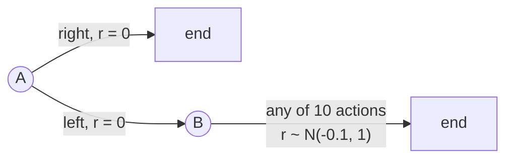
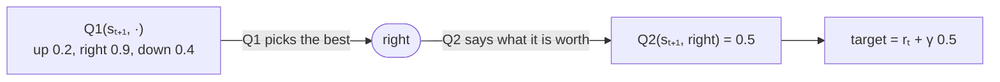

# Double Q-Learning

Double Q-Learning, described by Sutton and Barto [1] in Section 6.7 (after van Hasselt, 2010 [2]),
is Q-Learning with two sets of values instead of one.
It fixes a flaw of Q-Learning called the *maximization bias*: when the values are uncertain, Q-Learning overestimates them.

## The maximization bias

Q-Learning learns from the best value of the next state:

```math
Q(s_t,a_t) \leftarrow Q(s_t,a_t) + \alpha \left[ r_t + \gamma \max_a Q(s_{t+1},a) - Q(s_t,a_t) \right]
```

The `max` does two jobs at once: it **picks** the action which looks best, and it **values** that
action with the same estimate. When the estimates are noisy, some of them are too high by chance,
the `max` picks one of those, and then believes it.
This simply states that the maximum of noisy estimates is, on average, higher than the true maximum.

Sutton and Barto's Example 6.7 shows it with two states:



From `A`, `right` ends the episode with reward 0, and `left` moves to `B` with reward 0.
From `B`, any of 10 actions ends the episode with a reward drawn from a normal distribution
with mean -0.1 and variance 1.
Going left is worse on average, so the best ε-Greedy agent (ε = 0.1) goes left only 5% of the time.
But the best of `B`'s 10 noisy estimates is usually above 0, so Q-Learning believes `left` is worth more than `right`,
and goes left far more often, for hundreds of episodes.

## Double Q-Learning

Double Q-Learning keeps two independent estimates, `Q1` and `Q2`, and separates the two jobs:
one estimate picks the best next action, and the **other** says what it is worth.
Each update flips a coin. On heads it updates `Q1`:

```math
Q_1(s_t,a_t) \leftarrow Q_1(s_t,a_t) + \alpha \left[ r_t + \gamma \, Q_2\!\left(s_{t+1}, \arg\max_a Q_1(s_{t+1},a)\right) - Q_1(s_t,a_t) \right]
```

and on tails it updates `Q2` the same way, with `Q1` and `Q2` swapped.
For the last step of an episode, which has no next state:

```math
Q_1(s_t,a_t) \leftarrow Q_1(s_t,a_t) + \alpha \left[ r_t - Q_1(s_t,a_t) \right]
```

For example, say `Q1` has the values below for the next state, and the coin says to update `Q1`:



Q-Learning would have used 0.9 here, which may well be a lucky overestimate.
`Q2` (with, say, up 0.3, right 0.5, down 0.6) learnt from other steps, so it does not share `Q1`'s luck.
Do bear in mind that `Q2` only values the action `Q1` picked: its own best (`down`, 0.6) plays no part.
An action that `Q1` overestimates by chance is unlikely to be overestimated by `Q2` as well,
so the value used in the target is no longer biased upwards.

The agent acts on both estimates, e.g., ε-Greedy on `Q1 + Q2`.
Each estimate learns from about half of the steps, so it learns a little more slowly than one
Q-Learning table would, but in exchange it is not fooled by noise.

### Pseudocode

```
Double Q-Learning

parameters: learning rate α, discount rate γ, exploration rate ε

start with Q1(s, a) = 0 and Q2(s, a) = 0 for every state s and action a

for each episode:
    s ← the start state
    repeat until the episode ends:
        a ← an action for s, chosen ε-greedy on Q1 + Q2
        take action a, and observe the reward r and the next state s'
        flip a coin:
        on heads (update Q1):
            if s' ends the episode:
                Q1(s, a) ← Q1(s, a) + α [ r - Q1(s, a) ]
            else:
                b ← the action of highest Q1(s', ·)
                Q1(s, a) ← Q1(s, a) + α [ r + γ Q2(s', b) - Q1(s, a) ]
        on tails (update Q2):
            the same, with Q1 and Q2 swapped
        s ← s'
```

### In relearn

```cpp
relearn::double_q_learning<state,action> learner;
learner.alpha = 0.1;      // learning rate α
learner.gamma = 1.0;      // discount rate γ
learner.coin.seed(42);    // optional: the coin's seed, to repeat a run exactly
learner(episode, policy);
```

It is used just like the other learners: `learner(episode, policy, terminated)`, with the same episodes,
and with `games::play` or `games::play_online`.

- The two estimates are kept inside the learner, in `learner.first` (`Q1`) and `learner.second` (`Q2`).
- To pick the best next action, the estimate being updated looks at every action known in the
  next state (stored in either estimate, or taken there in the episode), counting 0 for those it
  has not stored itself. Each update fills in only one estimate, so early on each one knows only
  part of the actions.
- The `policy` you pass receives their **average**, `(Q1 + Q2) / 2`, for every pair learnt.
  Being greedy on it is the same as being greedy on `Q1 + Q2`, as in the pseudocode, and its values keep
  the usual scale.
- The coin is a `std::mt19937` named `coin`, and its seed is the constructor's third argument:
  `double_q_learning<state,action>(alpha, gamma, seed)`.
- With a per-visit learning rate (have a look at [schedules.md](schedules.md)), each estimate counts its
  own updates, in `learner.first_visits` and `learner.second_visits`. With `α = 1/n`, each estimate
  is then the plain average of its own targets. On the convergence test's MDP B (worst error over
  10 runs), `α = 1/k` per episode gave 0.125, and `α = 1/n` with a count per estimate 0.0023.

## Example 6.7: the maximization bias

`examples/maximization_bias.cpp` reproduces Sutton & Barto's Figure 6.5: ε-Greedy (ε = 0.1),
α = 0.1, γ = 1, 10 actions in `B`, 2000 runs of 300 episodes.
The share of episodes going left from `A`, where the best possible is 5%, is:

| episodes | Q-Learning | Double Q-Learning |
|---|---|---|
| 1 to 25 | 41.8% | 46.0% |
| 26 to 50 | 48.4% | 21.5% |
| 76 to 100 | 52.5% | 10.6% |
| 151 to 175 | 33.8% | 7.7% |
| 276 to 300 | 15.9% | 6.4% |

and all twelve blocks of 25 episodes which the example prints, drawn as a chart:

```
  55% |        o                                    o  Q-Learning
      |     o     o                                 x  Double Q-Learning
  45% |  x           o                              .  the best possible, 5%
      |  o              o
  35% |                    o
      |                       o
  25% |                          o
      |     x                       o  o
  15% |        x                          o
      |           x  x  x  x
   5% |  .  .  .  .  .  .  .  x  x  x  x  x
   0% |
      +-------------------------------------
        25    75    125   175   225   275    episodes (blocks of 25)
```

Q-Learning's overestimate makes `left` look good for hundreds of episodes.
Double Q-Learning settles close to the 5% of the best ε-Greedy agent within about 100 episodes.
In the first episodes it goes left as often as Q-Learning, since both estimates still know nothing.

`tests/double_q_learning_test.cpp` checks this over 1000 runs: in episodes 201 to 300,
across 6 groups of 1000 runs, Double Q-Learning went left 6.7% to 7.2% of the time,
and Q-Learning 18.4% to 20.5%.
It also checks single updates worked out by hand (one estimate picks, the other values,
including when the estimate being updated knows nothing of the next state yet),
that the coin chooses each estimate about half the time, and, in `tests/convergence_test.cpp`,
that Double Q-Learning converges to the exact values of two small random MDPs.

## References

1. Sutton, R.S. and Barto, A.G., 2018. [Reinforcement Learning: An Introduction](http://incompleteideas.net/book/the-book-2nd.html), 2nd edition. Cambridge, MA: MIT Press.
   Section 6.7 (maximization bias and Double Q-Learning), Example 6.7 and Figure 6.5.
2. van Hasselt, H., 2010. Double Q-learning. *Advances in Neural Information Processing Systems* 23.
