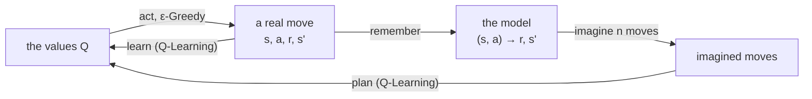

# Dyna-Q and Dyna-Q+

Dyna-Q, described by Sutton and Barto [1] in Chapter 8 (after Sutton, 1990 [2]), is Q-Learning with a memory.
Every time the agent makes a move, it learns from it as Q-Learning does, but it also *remembers* what happened,
and then replays moves from that memory, imagining them, and learns from them too.
Basically the agent keeps thinking about what it has seen whilst it plays, so it learns far more from the same experience.
Dyna-Q+ adds one more idea: moves the agent has not made for a long time might have changed,
so it is worth going back to check them.

## Learning, and planning

Sutton and Barto use two words for what an agent does with its experience:

- **learning** is updating the values `Q` from real moves, as Q-Learning, SARSA and the rest do
- **planning** is updating the values `Q` from moves that are only *imagined*, using a model of the world

The model here is very simple: for every state and action the agent has tried, it remembers the reward it received
and the state it ended up in. This is Dyna's loop:



Learning and planning use the very same update, the only difference is where the move comes from.

## Dyna-Q

After each real move `(s_t, a_t, r_t, s_{t+1})`, Dyna-Q does three things. First, it learns from it, as Q-Learning does:

```math
Q(s_t,a_t) \leftarrow Q(s_t,a_t) + \alpha \left[ r_t + \gamma \max_a Q(s_{t+1},a) - Q(s_t,a_t) \right]
```

Then it remembers it, replacing whatever it remembered before for that state and action:

```math
\text{Model}(s_t,a_t) \leftarrow r_t,\; s_{t+1}
```

Then it plans, `n` times: it picks a state `S` it has seen and an action `A` it has taken there, at random,
asks the model what happened, `R, S' = Model(S, A)`, and learns from it as if it had just happened:

```math
Q(S,A) \leftarrow Q(S,A) + \alpha \left[ R + \gamma \max_a Q(S',a) - Q(S,A) \right]
```

As always, a move that ended the episode has no next state, so its target is simply `R`.
With `n = 0` there is no planning, and Dyna-Q is Q-Learning.

This is why planning helps so much. Say the agent walks once along a corridor, `s0 → s1 → s2 → s3`,
and only the last move earns a reward (γ = 0.9, α = 1):

```
             s0 ──→ s1 ──→ s2 ──→ s3 ──→ end, r = 1
Q-Learning:  0      0      0      1
Dyna-Q:      0.729  0.81   0.9    1
```

Q-Learning learns only the last move, since when it learnt the earlier ones it did not know yet that they led anywhere good.
It needs to walk the corridor again (and again) to carry the reward back to the start, one move per walk.
Dyna-Q replays the remembered moves straight away, so the reward reaches the start in a single walk.

### Pseudocode

This is Sutton and Barto's *Tabular Dyna-Q*:

```
Dyna-Q

parameters: learning rate α, discount rate γ, exploration rate ε, planning steps n

start with Q(s, a) = 0 for every state s and action a, and an empty model

for each episode:
    s ← the start state
    repeat until the episode ends:
        a ← an action for s, chosen ε-greedy on Q
        take action a, and observe the reward r and the next state s'
        learn:    Q(s, a) ← Q(s, a) + α [ r + γ max over b of Q(s', b) - Q(s, a) ]
        remember: Model(s, a) ← r, s'
        plan, n times:
            S ← a state seen before, at random
            A ← an action taken in S before, at random
            R, S' ← Model(S, A)
            Q(S, A) ← Q(S, A) + α [ R + γ max over b of Q(S', b) - Q(S, A) ]
        s ← s'
```

(for a move that ends the episode, drop the `γ max Q` term, in both updates)

### In relearn

```cpp
relearn::dyna_q<state,action> learner;
learner.alpha = 0.1;            // learning rate α
learner.gamma = 0.95;           // discount rate γ
learner.planning_steps = 50;    // n, the imagined moves after each real one
learner.prng.seed(42);          // optional: the seed of the imagined moves, to repeat a run
learner(episode, policy);
```

or in short, `auto learner = relearn::dyna_q<state,action>{0.1, 0.95, 50, 42};` (α, γ, n and the seed).

It is used just like the other learners, `learner(episode, policy, terminated)`, and each real move it learns
is followed by `planning_steps` imagined ones. Do bear in mind that Dyna-Q is meant to plan **after every move**,
so that what it plans changes how it plays straight away: use it with `games::play_online` (have a look at
[sarsa.md](sarsa.md#learning-after-every-step)).

- The model is kept inside the learner. `learner.remembers(s, a)` says whether it has tried `a` in `s`,
  and `learner.plan(policy)` runs `planning_steps` imagined moves on their own.
- `learner.steps()` is the number of real moves learnt so far.
- The model remembers the **last** outcome of each move, so it assumes the world is deterministic,
  and the learning rate is a constant `alpha` (it has no `learning_rate` schedule).
  For a world where the same move can end differently, `q_probabilistic` keeps counts of every outcome,
  which is a model too, have a look at [q_learning.md](q_learning.md).
- `max_a Q(s', a)` counts only the actions stored for `s'`, as in `q_learning` (have a look at
  [q_learning.md](q_learning.md#in-relearn)). Dyna-Q+, given `legal_actions`, plans the actions not tried yet,
  so they soon have values of their own.

## Dyna-Q+

A model can be wrong. If the world changes, the model still describes the old one, and planning keeps
learning from moves that no longer happen. Dyna-Q only finds out when it makes those moves again for real.

Dyna-Q+ makes the agent curious: it adds a bonus to the reward of every imagined move, which grows with the time
since the move was last made for real:

```math
R + \kappa \sqrt{\tau}
```

where `τ` is the number of real moves since `(S, A)` was last tried, and `κ` is a small constant.
A move not made for a long time looks better and better in planning, until the agent goes and makes it,
and finds out whether the world has changed. The bonus is only used in planning, never in the real update.

There is one more detail, in a footnote of Sutton and Barto's Section 8.3: Dyna-Q+ also plans with the actions it has
**never** tried in a state it has seen, imagining that they lead back to the same state with a reward of 0.
Their `τ` grows from the very start, so the bonus sends the agent to try them.
Without this, the bonus only ever favours moves already made, and the agent explores *less* than Dyna-Q.

### Choosing κ

An untried move is imagined to lead back to the same state, so planning keeps adding its bonus around that loop,
and the move ends up worth about:

```math
Q \approx \frac{\kappa \sqrt{\tau}}{1 - \gamma}
```

With γ = 0.95 this is 20 times the bonus. After 3000 moves (`√τ ≈ 55`), κ = 0.001 makes it worth about 1.1,
as much as reaching the goal, and κ = 0.003 about 3.3, three times more. So keep κ small: if the bonuses are worth
more than the rewards, the agent spends its time chasing them instead of reaching the goal.
The examples below use κ = 0.001.

### Pseudocode

The same as Dyna-Q, with two changes:

```
Dyna-Q+

parameters: as Dyna-Q, and the bonus κ

remember, the first time a state s is seen:
    for every action b of s:  Model(s, b) ← 0, s   (back to s, with a reward of 0, never tried)

plan, n times:
    S, A, R, S' as in Dyna-Q
    τ ← the real moves since A was last tried in S
    Q(S, A) ← Q(S, A) + α [ R + κ √τ + γ max over b of Q(S', b) - Q(S, A) ]
```

### In relearn

```cpp
relearn::dyna_q<state,action> learner(1.0, 0.95, 50);
learner.kappa = 0.001;    // κ: Dyna-Q+'s bonus (0, the default, is Dyna-Q)
// every action of a state, so that Dyna-Q+ can imagine the ones it has not tried
learner.legal_actions = [&](const state & s) {
    std::vector<action> moves;
    for (const auto & a : my_game.actions(s.trait())) {
        moves.push_back(action(a));
    }
    return moves;
};
```

relearn does not know which actions are legal in your problem, so you give them with `legal_actions`,
just like Expected SARSA's `probabilities`. If it is not set, Dyna-Q+ only plans with the moves it has made.
With `kappa = 0` it is not used at all.

## Example 8.1: the Dyna maze

`examples/dyna_maze.cpp` reproduces Sutton & Barto's Figure 8.2. The agent starts at `S` and must reach `G`;
reaching it is worth 1, and every other move 0, so the discount (γ = 0.95) is what makes shorter paths better.
The shortest path takes 14 moves.

```
. . . . . . . # G
. . # . . . . # .
S . # . . . . # .
. . # . . . . . .
. . . . . # . . .
. . . . . . . . .
```

With ε-Greedy (ε = 0.1), α = 0.1 and n = 0, 5 and 50 imagined moves after each real one, the moves per episode,
averaged over 30 runs, are:

| episode | 1 | 2 | 3 | 4 | 5 | 10 | 20 | 30 | 50 |
|---|---|---|---|---|---|---|---|---|---|
| n = 0 (Q-Learning) | 737.6 | 725.0 | 422.1 | 307.8 | 268.6 | 144.7 | 44.9 | 17.7 | 18.5 |
| n = 5 | 737.6 | 151.2 | 57.6 | 33.9 | 20.8 | 17.6 | 16.5 | 16.7 | 16.9 |
| n = 50 | 737.6 | 39.6 | 19.2 | 18.0 | 16.9 | 16.9 | 17.4 | 16.5 | 16.6 |

The first episode is the same for all three: until the goal is reached, every value is 0, and there is nothing to plan with.
After that, with n = 50 the agent knows its way by the third episode, with n = 5 by the fifth,
and without planning only after about 30 episodes. With ε = 0.1 the agent still explores,
so the shortest path costs about 17 moves on average.

After 50 episodes, the greedy policy (no exploring) takes:

| | 14 moves | 16 moves | 18 moves | 20 moves |
|---|---|---|---|---|
| n = 0 | 11 runs | 17 runs | 2 runs | |
| n = 5 | 18 runs | 11 runs | | 1 run |
| n = 50 | 20 runs | 8 runs | | 2 runs |

__note__: planning does not always find the shortest path. Dyna-Q only plans with moves it has made, and a run that never
made the moves of a shorter path cannot know it is shorter. Its values are still exact for what it knows:
the value of the start is `γ^13 = 0.513` after a 14-move path, and `γ^15 = 0.463` after a 16-move one.

## Example 8.2: the blocking maze

The short way, on the right, is blocked after 1000 moves, and a longer one opens on the left
(ε-Greedy with ε = 0.1, α = 1 since the maze is deterministic, n = 50, κ = 0.001, over 20 runs):

```
before       after
........G    ........G
.........    .........
.........    .........
########.    .########
.........    .........
...S.....    ...S.....
```

The goals reached so far, every 100 moves (`o` Dyna-Q, `+` Dyna-Q+, `|` the moment the wall moves):

```
  160 |         |                   +
      |         |                 ++
  140 |         |               ++
      |         |             ++
  120 |         |           ++
      |         |         ++
  100 |         |       ++
      |         |     ++
   80 |         |   ++
      |         ++++
   60 |        +ooooooooooooooooooooo
      |       +o|
   40 |      +o |
      |    +#o  |
   20 |   +o    |
      |  #o     |
    0 |##       |
      +------------------------------
             1000      2000      3000   moves
```

| moves | 500 | 1000 | 1500 | 2000 | 2500 | 3000 |
|---|---|---|---|---|---|---|
| Dyna-Q | 18.3 | 58.4 | 59.2 | 60.6 | 61.9 | 63.7 |
| Dyna-Q+ | 25.6 | 68.2 | 84.4 | 107.4 | 132.6 | 156.0 |

When the wall moves, both stop reaching the goal for a while (the line goes flat).
Dyna-Q soon bumps into the new wall, and its model learns that the gap on the right is closed.
But the values of the moves leading there only fade slowly, they are still worth more than every move on the left
it has not tried (0), and its random moves rarely make the long way round.
Dyna-Q+'s bonus sends it to try the moves it has not made for a long time, and it finds the new way.

## Example 8.3: the shortcut maze

Now the long way, on the left, stays open, and after 3000 moves a shortcut opens on the right
(10 moves instead of 16; the same settings, over 20 runs):

```
before       after
........G    ........G
.........    .........
.........    .........
.########    .#######.
.........    .........
...S.....    ...S.....
```

The goals reached so far, every 200 moves:

```
  360 |              |              +
      |              |            ++
  300 |              |          ++ oo
      |              |        ++ oo
  240 |              |      ++ooo
      |              |    +#oo
  180 |              |   #o
      |              |###
  120 |            ###
      |         ###  |
   60 |      +##     |
      |  ++##o       |
    0 |##oo          |
      +------------------------------
                  3000           6000   moves
```

| moves | 1000 | 2000 | 3000 | 4000 | 5000 | 6000 |
|---|---|---|---|---|---|---|
| Dyna-Q | 24.2 | 76.5 | 130.9 | 186.1 | 241.1 | 296.1 |
| Dyna-Q+ | 34.8 | 81.0 | 128.9 | 196.5 | 274.9 | 353.5 |

This one is harder. Nothing goes wrong for Dyna-Q: the long way still works, its model says so,
and so it never looks for anything better: it only finds the shortcut if its random moves happen to stumble on it,
which is rare. Dyna-Q+ goes back to check the wall on the right,
finds the shortcut, and reaches the goal more and more often.

## Tests

`tests/dyna_q_test.cpp` checks:

- single updates worked out by hand: one real move followed by imagined ones,
  the corridor above, and the model replacing an outcome when the world changes
- that with `planning_steps = 0` Dyna-Q learns exactly what Q-Learning learns, on the same episodes
- Dyna-Q+'s bonus, `κ √τ`, and its untried actions, which settle at `κ √τ / (1 - γ)` as above
- Figure 8.2 over 10 runs: n = 50 learns the maze in fewer episodes than n = 5, and n = 5 than n = 0
- Figure 8.4 over 10 runs: Dyna-Q+ finds the new way in every run, and reaches the goal more often than Dyna-Q
- Figure 8.5 over 10 runs: Dyna-Q takes the shortcut in at most 2 runs (only by chance, whilst exploring),
  and Dyna-Q+ in at least half of them

## References

1. Sutton, R.S. and Barto, A.G., 2018. [Reinforcement Learning: An Introduction](http://incompleteideas.net/book/the-book-2nd.html), 2nd edition. Cambridge, MA: MIT Press.
   Section 8.2 (Dyna-Q), Section 8.3 (Dyna-Q+), Examples 8.1 to 8.3 and Figures 8.2, 8.4 and 8.5.
2. Sutton, R.S., 1990. Integrated architectures for learning, planning, and reacting based on approximating dynamic programming.
   In *Proceedings of the Seventh International Conference on Machine Learning*, pp. 216-224.
