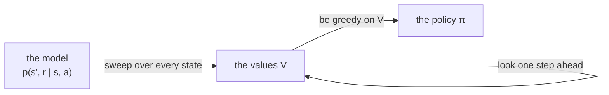
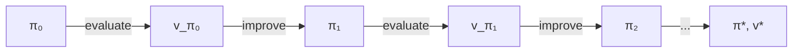

# Dynamic programming

Dynamic programming, described by Sutton and Barto [1] in Chapter 4 (after Bellman, 1957 [2], and Howard, 1960 [3]),
is what you can do when you know the rules of the world *exactly*: for every state and every action,
which states can follow, with what reward, and how likely each one is.
Then you do not need to play at all. You simply sweep over every state, again and again,
working out how much each one is worth from the states that can follow it, until the values stop changing.

Basically every learner in relearn (Q-Learning, SARSA, Monte Carlo, ...) is a way of getting to the same answer
*without* the rules, from the moves an agent makes. Dynamic programming is the answer they are all chasing,
so it is also the best way to check them: `tests/solvers.hpp` uses it to work out the exact values the tests compare against.



## The model

Sutton and Barto write the rules of a finite MDP as one function, `p(s', r | s, a)`: the probability that taking
action `a` in state `s` gives the reward `r` and leads to the state `s'`. In relearn it is a `finite_mdp`, which holds:

- `states`: every state, terminal ones included
- `actions(s)`: the actions of state `s`, none for a terminal state (whose value is always 0)
- `outcomes(s, a)`: every `(s', r)` that `a` can lead to from `s`, each with its probability

For example, a small MDP of two states, `A` and `B`, and the terminal state `T`
(it is the one worked out by hand in the tests):

```
A --left-->  T, r = 1
A --right--> B, r = 0
B --left-->  A, r = 0
B --right--> T, r = 2  (half the time)
          or B, r = 0  (the other half)
```

```cpp
using state  = relearn::state<std::string>;
using action = relearn::action<std::string>;
using model  = relearn::finite_mdp<state,action>;
using outcome = model::outcome;   // {s', r, p(s', r | s, a)}

model m;
m.states = {state("A"), state("B"), state("T")};
m.actions = [](const state & s) {
    if (s == state("T")) {
        return std::vector<action> {};
    }
    return std::vector<action> {action("left"), action("right")};
};
m.outcomes = [](const state & s, const action & a) {
    if (s == state("A")) {
        return a == action("left") ? std::vector<outcome> { {state("T"), 1, 1} }
                                   : std::vector<outcome> { {state("B"), 0, 1} };
    }
    return a == action("left") ? std::vector<outcome> { {state("A"), 0, 1} }
                               : std::vector<outcome> { {state("T"), 2, 0.5}, {state("B"), 0, 0.5} };
};
```

The games `small_gridworld` and `gamblers_problem` give their rules this way, with `game.model()`.

## Looking one step ahead

Everything in this chapter is built from one idea: the value of taking action `a` in state `s` is the reward
it gives, plus the (discounted) value of the state it leads to, averaged over everything that can happen:

```math
q(s,a) = \sum_{s',r} p(s',r \mid s,a) \left[ r + \gamma V(s') \right]
```

This is how dynamic programming looks one step ahead. The three algorithms below only differ in what they do with it.

### Policy evaluation

The value of a policy `π` is the average of `q(s, a)` over the actions `π` takes (Sutton and Barto's equation 4.5):

```math
V(s) \leftarrow \sum_a \pi(a \mid s) \sum_{s',r} p(s',r \mid s,a) \left[ r + \gamma V(s') \right]
```

Sweeping over every state with this update, again and again, the values converge to `v_π`.
The book updates the values **in place**: each update uses the newest values, some of them from this very sweep.
The **two-array** version keeps the values of the sweep before, and every update of a sweep uses those.
Both converge to the same values, in place usually in fewer sweeps.

### Policy improvement

Being greedy on the values of a policy gives a policy at least as good (the *policy improvement theorem*):

```math
\pi'(s) = \arg\max_a \sum_{s',r} p(s',r \mid s,a) \left[ r + \gamma V(s') \right]
```

### Policy iteration

Evaluate the policy, improve it, evaluate the new one, improve it, ..., until it does not change any more.
There are only so many policies, and each one is better than the one before, so this ends, and it ends optimal:



### Value iteration

Policy iteration evaluates every policy to the end, which takes many sweeps.
Value iteration does a single sweep of evaluation and improvement in one, taking the best action rather than the policy's:

```math
V(s) \leftarrow \max_a \sum_{s',r} p(s',r \mid s,a) \left[ r + \gamma V(s') \right]
```

and once the values stop changing, the optimal policy is the greedy one on them.

### Pseudocode

These are Sutton and Barto's boxes of Sections 4.1, 4.3 and 4.4:

```
Iterative policy evaluation

parameters: the policy π to evaluate, discount rate γ, accuracy θ

start with V(s) = 0 for every state s (V(terminal) stays 0)

repeat:
    Δ ← 0
    for each state s:
        v ← V(s)
        V(s) ← Σ over a of π(a | s) Σ over s', r of p(s', r | s, a) [ r + γ V(s') ]
        Δ ← max(Δ, |v - V(s)|)
until Δ < θ
```

```
Policy iteration

parameters: discount rate γ, accuracy θ

1. start with V(s) = 0, and any action π(s) for every state s

2. policy evaluation: as above, for the policy π

3. policy improvement:
    policy-stable ← true
    for each state s:
        old-action ← π(s)
        π(s) ← argmax over a of Σ over s', r of p(s', r | s, a) [ r + γ V(s') ]
        if old-action ≠ π(s): policy-stable ← false
    if policy-stable: stop, V and π are optimal; otherwise go back to 2
```

```
Value iteration

parameters: discount rate γ, accuracy θ

start with V(s) = 0 for every state s (V(terminal) stays 0)

repeat:
    Δ ← 0
    for each state s:
        v ← V(s)
        V(s) ← max over a of Σ over s', r of p(s', r | s, a) [ r + γ V(s') ]
        Δ ← max(Δ, |v - V(s)|)
until Δ < θ

π(s) = argmax over a of Σ over s', r of p(s', r | s, a) [ r + γ V(s') ]
```

## In relearn

```cpp
relearn::dynamic_programming<state,action> dp;
dp.gamma = 0.9;        // discount rate γ
dp.theta = 1e-9;       // accuracy θ: the sweeps stop once no value changes by θ or more

// policy evaluation of a stochastic policy, π(a | s), here the random policy
dp.evaluate(m, [](const state & s, const action & a) {
    return 0.5;
});
double v = dp.value(state("A"));            // V(A)

// policy iteration and value iteration: both return the optimal policy, π(s)
auto pi = dp.policy_iteration(m);
auto pi_too = dp.value_iteration(m);
action best = pi.at(state("A"));             // π(A)
```

or in short, `relearn::dynamic_programming<state,action> dp(0.9, 1e-9);` (γ and θ).

- The values are in `dp.values` (a `std::unordered_map` of state to value), and `dp.value(s)` reads one,
  0 for a state not valued yet. Every method starts from the values already there, so you can set them
  to start elsewhere, and policy iteration starts each evaluation from the values of the policy before.
- A deterministic policy, `π(s)`, is a `dynamic_programming<state,action>::policy_type`, a `std::unordered_map`
  of state to action. `dp.evaluate(m, pi)` evaluates one, `dp.improve(m, pi)` makes it greedy (and returns true
  if no action changed), and `dp.greedy(m)` returns the greedy policy on the values.
- `dp.q_value(m, s, a)` is the one-step look ahead, `q(s, a)`, and `dp.action_values(m, policy_map)` writes it,
  for every state and action, into a relearn `policy`, so that `policy_map.best_action(s)` is greedy, and the
  games' `games::greedy` and `games::evaluate` can play it.
- `dp.in_place = false` gives the two-array version; `dp.sweeps()` is the number of sweeps of the last call
  (of all its evaluations, for policy iteration) and `dp.iterations()` the evaluations of the last policy iteration.

There are two departures from the book's boxes, both to keep it safe to use:

- **ties**: many actions can be equally good, and rounding makes their values differ in the last digits.
  So actions within `dp.ties` (1e-9) of the best one are all taken as best: the policy's current action is kept
  if it is one of them, otherwise the first of them in `actions(s)`. Without this, policy iteration as written
  in the box can switch between equally good actions for ever (Sutton and Barto, Exercise 4.4).
- **max_sweeps**: an evaluation, or value iteration, stops after `dp.max_sweeps` (100000) sweeps, even if the
  values still change by more than θ. Do bear in mind that with γ = 1, a policy that never ends an episode has
  values that fall for ever: in the gridworld below, a policy that always moves up never leaves the top row.
  With the cap, policy iteration still gets there (a test checks it), but every evaluation of such a policy runs
  all `max_sweeps` sweeps, so with γ = 1 start it from a policy that ends every episode, or use γ < 1.

## Example 4.1: the 4 x 4 gridworld (Figure 4.1)

`examples/dynamic_programming.cpp` starts with Sutton and Barto's small gridworld: 14 cells, and two terminal corners.
Every move costs -1 and a move off the grid stays put, so with γ = 1 the value of a cell is minus the number of moves
it takes to reach a corner. The random policy (each move with probability 1/4) is evaluated with two arrays,
as in Figure 4.1; next to the values is the greedy policy on them (ties go to the first move, up):

```
k = 1:
      0.00  -1.00  -1.00  -1.00       T < ^ ^
     -1.00  -1.00  -1.00  -1.00       ^ ^ ^ ^
     -1.00  -1.00  -1.00  -1.00       ^ ^ ^ v
     -1.00  -1.00  -1.00   0.00       ^ ^ > T
k = 2:
      0.00  -1.75  -2.00  -2.00       T < < ^
     -1.75  -2.00  -2.00  -2.00       ^ ^ ^ v
     -2.00  -2.00  -2.00  -1.75       ^ ^ > v
     -2.00  -2.00  -1.75   0.00       ^ > > T
k = 3:
      0.00  -2.44  -2.94  -3.00       T < < v
     -2.44  -2.88  -3.00  -2.94       ^ ^ v v
     -2.94  -3.00  -2.88  -2.44       ^ ^ > v
     -3.00  -2.94  -2.44   0.00       ^ > > T
k = 10:
      0.00  -6.14  -8.35  -8.97       T < < v
     -6.14  -7.74  -8.43  -8.35       ^ ^ v v
     -8.35  -8.43  -7.74  -6.14       ^ ^ > v
     -8.97  -8.35  -6.14   0.00       ^ > > T
k = infinity (384 sweeps until no value changes by 1e-9):
      0.00 -14.00 -20.00 -22.00       T < < v
    -14.00 -18.00 -20.00 -20.00       ^ ^ v v
    -20.00 -20.00 -18.00 -14.00       ^ ^ > v
    -22.00 -20.00 -14.00   0.00       ^ > > T
in place, the same values settle in 246 sweeps
```

These are the book's values (it prints them to one decimal: -1.7, -2.4, -2.9, ... and -14, -20, -22 at the end).
For example after two sweeps, cell 1 (next to the top-left corner) is worth
`-1 + 1/4 (0 - 1 - 1 - 1) = -1.75`: one move, then either the corner or another cell still worth -1.
The random policy takes 14 to 22 moves to reach a corner, but the greedy policy on its values is already the best
one from `k = 3` onwards. Policy iteration started from it stops after one evaluation, and value iteration gets
there in 4 sweeps (3 to settle, and 1 to see that nothing changes):

```
policy iteration, from the greedy policy above (evaluations: 1, sweeps: 4)
      0.00  -1.00  -2.00  -3.00       T < < v
     -1.00  -2.00  -3.00  -2.00       ^ ^ ^ v
     -2.00  -3.00  -2.00  -1.00       ^ ^ > v
     -3.00  -2.00  -1.00   0.00       ^ > > T
value iteration (sweeps: 4)
      (the same)
```

## Example 4.3: the gambler's problem (Figure 4.3)

A gambler bets on coin flips. With a capital of `s`, she can stake from 1 to `min(s, 100 - s)`;
heads (probability 0.4) wins the stake, tails loses it, and she stops at 0 or at 100.
Reaching 100 is worth 1, and nothing else is worth anything, so with γ = 1 the value of a capital is the
probability of reaching 100 from it. The same program solves it by value iteration:

```
    capital:           1     10     25     40     50     60     75     90     99
    sweep  1:      0.0000 0.0000 0.0000 0.0000 0.4000 0.4000 0.6400 0.7840 0.9533
    sweep  2:      0.0000 0.0000 0.1600 0.2560 0.4000 0.4442 0.6400 0.7999 0.9638
    sweep  3:      0.0000 0.0000 0.1600 0.2666 0.4000 0.4614 0.6400 0.8061 0.9643
    sweep 10:      0.0021 0.0435 0.1600 0.2716 0.4000 0.4652 0.6400 0.8075 0.9643
    final:         0.0021 0.0435 0.1600 0.2716 0.4000 0.4652 0.6400 0.8075 0.9643
    (17 sweeps until no value changes by 1e-9)
```

The book works out three of them: all in at 50 wins with probability `V(50) = 0.4`, from 25 she must win twice,
`V(25) = 0.4^2 = 0.16`, and from 75 she wins at once, or loses back to 50, `V(75) = 0.4 + 0.6 × 0.4 = 0.64`.
In place, the values reach far in one sweep: the capitals are swept from 0 up, so by the time the sweep reaches 75,
`V(50)` is already 0.4.

Many stakes are equally good, so the optimal policy is not unique. Taking the smallest of the best stakes gives
the policy of Figure 4.3:

```
    50 |                                                 #
    45 |                                                 #
    40 |                                                 #
    35 |                                                 #
    30 |                                                 #
    25 |                        #                        #                        #
    20 |                        #                        #                        #
    15 |          ####          #          ####          #          ####          #          ####
    10 |     ##############     #     ##############     #     ##############     #     ##############
     5 |###################################################################################################
       +---------------------------------------------------------------------------------------------------
        1                       25                       50                       75                      99   capital
```

All in at 25, 50 and 75, and in between stakes that rise from 1 to 12 and fall back to 1.
Policy iteration (5 evaluations, 560 sweeps) finds the same values, to within 2.1e-10, but other stakes at 49 of
the 99 capitals: it keeps any stake that is as good as the best one, and there are plenty of them.

__note__: the "smallest of the best stakes" depends on what *equally good* means once the values are rounded, so
with a much smaller `dp.ties` (or a much larger θ) some tied stakes look a little better than others, and the policy
changes, whilst staying just as good.

## Tests

`tests/dynamic_programming_test.cpp` checks:

- policy evaluation, value iteration and policy iteration on the small MDP above, worked out by hand sweep by sweep,
  in place and with two arrays (the random policy is worth `V(A) = 9/13` and `V(B) = 10/13`)
- that equally good actions keep the policy's current one, so that policy iteration stops (Exercise 4.4)
- Figure 4.1: the values after 1, 2, 3 and 10 sweeps as the book prints them, the exact values of the random policy,
  and that the greedy policy on them is optimal
- the gridworld's optimal values by both policy iteration and value iteration, also from a policy that never ends
  an episode (with γ = 1), and with γ = 0.9, and that each evaluation starts from the values already there
  (from the optimal values, a single sweep)
- Example 4.3: `V(25) = 0.16`, `V(50) = 0.4`, `V(75) = 0.64`, every value against the independent value iteration of
  `tests/solvers.hpp`, that the policy is optimal (following it, evaluated by `tests/solvers.hpp`, is worth the
  optimal values), that it is the policy of Figure 4.3, and that policy iteration agrees
- 20 random MDPs: value iteration and policy iteration (in place and with two arrays), and the evaluation of a random
  stochastic policy, all against `tests/solvers.hpp`, to within 1e-9

`tests/games_test.cpp` checks that the models of `small_gridworld` and `gamblers_problem` follow the games' rules.

__note__: Jack's car rental (Example 4.2) is not here. Its model has 441 states, with 441 outcomes for every move,
which is fine for `dynamic_programming`, but the book gives its answer only as a picture (Figure 4.2), which is hard
to check cell by cell.

## References

1. Sutton, R.S. and Barto, A.G., 2018. [Reinforcement Learning: An Introduction](http://incompleteideas.net/book/the-book-2nd.html), 2nd edition. Cambridge, MA: MIT Press.
   Chapter 4: Section 4.1 (policy evaluation), Section 4.2 (policy improvement), Section 4.3 (policy iteration, and Exercise 4.4),
   Section 4.4 (value iteration), Examples 4.1 and 4.3, Figures 4.1 and 4.3.
2. Bellman, R., 1957. *Dynamic Programming*. Princeton, NJ: Princeton University Press.
3. Howard, R.A., 1960. *Dynamic Programming and Markov Processes*. Cambridge, MA: MIT Press.
