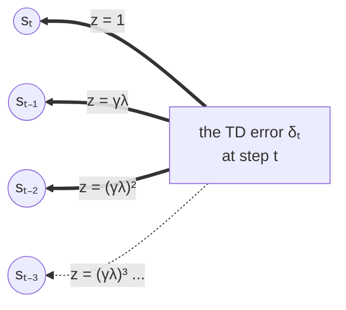
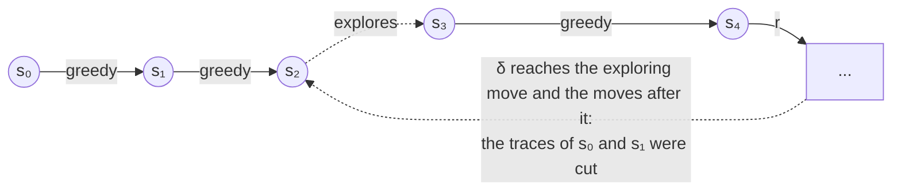
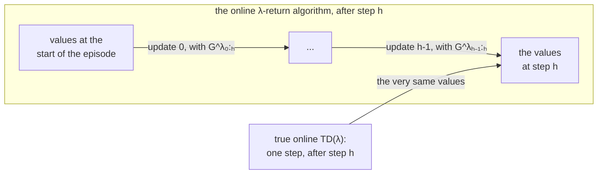

# Eligibility traces: TD(λ), SARSA(λ), Watkins's Q(λ), and true online TD(λ)

n-step methods (have a look at [n_step.md](n_step.md)) learn each step from the next `n` rewards,
so they have to wait `n` steps before they can learn it. *Eligibility traces*, described by Sutton and Barto [1]
in Chapter 12, get much the same effect without waiting: every step keeps a *trace*, a short memory that it
happened recently, and every new TD error is shared out at once among the steps that came before it,
according to their traces. The parameter `λ` sets how fast the traces fade: with `λ = 0` only the last step
learns (one-step TD, or SARSA), and with `λ = 1` every step of the episode does, which is close to Monte Carlo.



Each earlier state learns `α δ_t z`, where its trace `z` is smaller the longer ago it was visited.

## The λ-return

Sutton and Barto start with the *forward view* (Section 12.1). Instead of picking one `n`, average them all:
the *λ-return* weights the n-step return `G_{t:t+n}` by `(1 - λ) λ^{n-1}`, and gives the rest of the weight to
the return to the end of the episode, `G_t`:

```math
G^\lambda_t = (1 - \lambda) \sum_{n=1}^{T-t-1} \lambda^{n-1} \, G_{t:t+n} + \lambda^{T-t-1} \, G_t
```

The weights add up to 1, and they fall off by `λ` with each step: `λ = 0` gives the one-step return, `λ = 1` the
Monte Carlo return. Learning towards `G^λ_t` means waiting for the end of the episode, though. The *backward view*,
with traces, gets there one step at a time.

## TD(λ)

TD(λ) (Section 12.2) keeps a trace `z(s)` for every state, 0 at the start of each episode. At every step it fades
every trace by `γλ`, bumps up the trace of the state it is in, and gives the TD error to every state by its trace:

```math
\delta_t = r_t + \gamma \, V(s_{t+1}) - V(s_t)
```

```math
z(s) \leftarrow \gamma \lambda \, z(s) + \begin{cases} 1 & \text{if } s = s_t \\ 0 & \text{otherwise} \end{cases} \qquad V(s) \leftarrow V(s) + \alpha \, \delta_t \, z(s) \quad \text{for every } s
```

where, as always, `r_t` is the reward received after leaving `s_t` (have a look at the
[reward convention](q_learning.md#reward-convention)), and the end of the episode is worth 0.

### Pseudocode

```
TD(λ), for estimating V of a policy π

parameters: learning rate α, discount rate γ, trace decay λ

start with V(s) = 0 for every state s

for each episode:
    z(s) ← 0 for every state s
    s ← the start state
    repeat until the episode ends:
        take the action π chooses in s, and observe the reward r and the next state s'
        δ ← r + γ V(s') - V(s)                 (δ ← r - V(s) if s' ends the episode)
        z(x) ← γλ z(x) for every state x
        z(s) ← z(s) + 1
        V(x) ← V(x) + α δ z(x) for every state x
        s ← s'
```

### Offline, it is the λ-return

If the values are not changed during the episode (every `δ` worked out with the values from before it, and the
changes added up at its end), TD(λ) with these traces makes *exactly* the changes of the λ-return:
every `V(s_t)` moving by `α (G^λ_t - V(s_t))`. This is the equivalence of the forward and the backward views,
proved in the first edition of the book (Section 7.4), and relearn checks it to within `10⁻⁹` (have a look at the
[tests](#tests)). Online, changing the values as it goes, TD(λ) is only close to it (true online TD(λ),
[below](#true-online-tdλ-and-sarsaλ), is exact online).

__note__: the second edition's *offline λ-return algorithm* (equation 12.4) makes the same updates one after the other,
each one seeing the ones before it, so a state visited twice in an episode learns a little differently from TD(λ) offline.

## Accumulating and replacing traces

The trace above is an *accumulating* trace: a state visited again before its trace has faded gets another `+1`
on top. In a task that goes round in circles, a state visited many times builds up a large trace, larger than 1,
and gets far more of the blame (or the credit) than it deserves. A *replacing* trace (Section 12.7) is simply
set back to 1 on a visit:

```math
z(s_t) \leftarrow \gamma \lambda \, z(s_t) + 1 \quad \text{(accumulating)} \qquad\qquad z(s_t) \leftarrow 1 \quad \text{(replacing)}
```

For example, with `γλ = 0.25`, an episode visiting `x`, then `y`, then `x` again:

| step | visits | z(x), accumulating | z(x), replacing | z(y) |
|---|---|---|---|---|
| 0 | x | 1 | 1 | 0 |
| 1 | y | 0.25 | 0.25 | 1 |
| 2 | x | 0.0625 + 1 = 1.0625 | 1 | 0.25 |

(the traces of `tests/eligibility_traces_test.cpp`'s first test, which also works out the values). The two are
the same when no state is visited twice in an episode.

## SARSA(λ)

For control, SARSA(λ) (Section 12.7) keeps a trace for every state/action pair, and learns from SARSA's TD error,
the value of the pair the agent moved to next:

```math
\delta_t = r_t + \gamma \, Q(s_{t+1}, a_{t+1}) - Q(s_t, a_t)
```

```math
z(s,a) \leftarrow \gamma \lambda \, z(s,a), \quad z(s_t,a_t) \leftarrow z(s_t,a_t) + 1 \;\text{(or 1)}, \quad Q(s,a) \leftarrow Q(s,a) + \alpha \, \delta_t \, z(s,a) \quad \text{for every pair}
```

```
SARSA(λ)

parameters: learning rate α, discount rate γ, trace decay λ, exploration rate ε

start with Q(s, a) = 0 for every state s and action a

for each episode:
    z(s, a) ← 0 for every pair
    s ← the start state
    a ← an action for s, chosen ε-greedy on Q
    repeat until the episode ends:
        take action a, and observe the reward r and the next state s'
        if s' ends the episode:
            δ ← r - Q(s, a)
        else:
            a' ← an action for s', chosen ε-greedy on Q
            δ ← r + γ Q(s', a') - Q(s, a)
        z(x, b) ← γλ z(x, b) for every pair
        z(s, a) ← z(s, a) + 1                  (accumulating), or 1 (replacing)
        Q(x, b) ← Q(x, b) + α δ z(x, b) for every pair
        s ← s', a ← a'
```

With `λ = 0` this is SARSA. And with a single action in every state, as in a prediction task, it is TD(λ).

## Watkins's Q(λ)

Q-learning learns the values of the *greedy* policy, whatever the agent actually does (it is off-policy).
Watkins's Q(λ) (Section 12.10) adds traces to it, with a catch: the earlier steps may share in what follows
only as long as the agent keeps doing what the greedy policy would. After a move that is *not* greedy, an
exploring move, what follows tells nothing about the greedy policy before it, so every trace is cut to 0
(the exploring move itself is still learnt, from the greedy value of the state it led to, as Q-learning learns it):

```math
\delta_t = r_t + \gamma \max_a Q(s_{t+1}, a) - Q(s_t, a_t)
```

```math
z(s,a) \leftarrow \begin{cases} \gamma \lambda \, z(s,a) & \text{if } a_t \text{ was greedy} \\ 0 & \text{otherwise} \end{cases}, \quad z(s_t,a_t) \leftarrow z(s_t,a_t) + 1 \;\text{(or 1)}, \quad Q(s,a) \leftarrow Q(s,a) + \alpha \, \delta_t \, z(s,a)
```



```
Watkins's Q(λ)

parameters: learning rate α, discount rate γ, trace decay λ, exploration rate ε

start with Q(s, a) = 0 for every state s and action a

for each episode:
    z(s, a) ← 0 for every pair
    s ← the start state
    a ← an action for s, chosen ε-greedy on Q
    repeat until the episode ends:
        take action a, and observe the reward r and the next state s'
        if s' ends the episode:
            δ ← r - Q(s, a)
        else:
            a' ← an action for s', chosen ε-greedy on Q
            greedy ← Q(s', a') is the highest value of s'   (ties count as greedy)
            δ ← r + γ max over b of Q(s', b) - Q(s, a)
        z(s, a) ← z(s, a) + 1                  (accumulating), or 1 (replacing)
        Q(x, b) ← Q(x, b) + α δ z(x, b) for every pair
        if greedy:
            z(x, b) ← γλ z(x, b) for every pair
        else:
            z(x, b) ← 0 for every pair
        s ← s', a ← a'
```

Do bear in mind that whether `a'` is greedy is decided with the values from before this step's update,
as in the book's pseudocode (its first edition, Figure 7.14). With `λ = 0` this is Q-learning.
When the agent explores a lot, the traces are cut often, and Q(λ) learns little more than Q-learning
(the book's Section 12.10 discusses this, and other off-policy traces that avoid it).

## True online TD(λ) and Sarsa(λ)

TD(λ) learns online, after every step, but it only learns exactly what the λ-return algorithm learns offline, when the
values do not change during the episode. Sutton and Barto's Section 12.4 asks what the λ-return *should* be online.
After step `h`, the rewards known so far stop at `h`, so the λ-return can only be *truncated* at `h`:

```math
G^\lambda_{t:h} = (1 - \lambda) \sum_{n=1}^{h-t-1} \lambda^{n-1} \, G_{t:t+n} + \lambda^{h-t-1} \, G_{t:h}
```

where each n-step return `G_{t:t+n}` ends with the value of `s_{t+n}` as it was at step `t+n-1`. The *online λ-return
algorithm* then works out, after every step `h`, every update of the episode so far again, from its start, each one with
the λ-return truncated at `h`; the values after step `h` are those of the last of them. It is the ideal, but it costs
more and more with every step: the whole episode so far, again, after each one.



*True online* TD(λ) (Section 12.5, from van Seijen and Sutton [2]) gets the very same values, after every step, at the cost
of one step of TD(λ). It needs two changes to TD(λ). The trace is a *Dutch* trace, between accumulating and replacing:

```math
z(s_t) \leftarrow \gamma \lambda \, z(s_t) + 1 - \alpha \gamma \lambda \, z(s_t) \qquad \text{(the traces of the other states fade by } \gamma\lambda \text{, as before)}
```

and the update corrects for how much the value of the state reached changed in the step before:

```math
\delta_t = r_t + \gamma \, V' - V \qquad V(s) \leftarrow V(s) + \alpha \, (\delta_t + V - V_{old}) \, z(s) \quad \text{for every } s, \qquad V(s_t) \leftarrow V(s_t) - \alpha \, (V - V_{old})
```

with `V = V(s_t)` and `V' = V(s_{t+1})` read before the step changes anything, and `V_old`, the `V'` of the step before
(0 at the start of an episode). For the example above, with `α = 0.5` as well (so `αγλ = 0.125`), the Dutch trace of `x`
on its second visit is `0.0625 + 1 - 0.125 * 0.25 = 1.03125`, between the replacing trace, 1, and the accumulating one,
1.0625. With `λ = 0` it is TD(0) again, and the exact equivalence holds for any `α`, `γ` and `λ`, which van Seijen et
al [3] prove for linear function approximation; a table of values, as relearn's, is the case of one feature per state.

True online *Sarsa(λ)* (Section 12.7) is the same, for state/action pairs, with SARSA's `Q(s_{t+1}, a_{t+1})`:

```
True online Sarsa(λ), for estimating Q of a policy (a table of values)

parameters: learning rate α, discount rate γ, trace decay λ

start with Q(s, a) = 0 for every pair

for each episode:
    z(s, a) ← 0 for every pair, and Q_old ← 0
    s ← the start state, and a ← the action chosen in s (ε-greedy on Q, for instance)
    repeat until the episode ends:
        take a, and observe the reward r and the next state s'
        choose a' in s' (ε-greedy on Q, for instance)
        Q ← Q(s, a), and Q' ← Q(s', a')         (Q' ← 0 if s' ends the episode)
        δ ← r + γ Q' - Q
        z_old ← z(s, a)
        z(x, b) ← γλ z(x, b) for every pair, then z(s, a) ← z(s, a) + 1 - αγλ z_old
        Q(x, b) ← Q(x, b) + α (δ + Q - Q_old) z(x, b) for every pair
        Q(s, a) ← Q(s, a) - α (Q - Q_old)
        Q_old ← Q'
        s ← s', and a ← a'
```

Learning online matters most for control, where what the agent learns during an episode changes how it plays the
rest of it: have a look at the [mountain car](#example-mountain-car-learning-after-every-step) below.

## In relearn

```cpp
// TD(λ): prediction, one action per state
relearn::td_lambda<state,action> td(0.1, 1.0, 0.8);            // α, γ and λ
// SARSA(λ)
relearn::sarsa_lambda<state,action> sarsa;
sarsa.alpha = 0.1;          // learning rate α
sarsa.gamma = 0.95;         // discount rate γ
sarsa.lambda = 0.9;         // trace decay λ
sarsa.replacing = true;     // replacing traces (false, the default, is accumulating)
sarsa(episode, policy);
// Watkins's Q(λ)
relearn::watkins_q_lambda<state,action> q(0.1, 0.95, 0.9, true);  // α, γ, λ and replacing
q(episode, policy);
// true online Sarsa(λ), learning after every step
relearn::true_online_sarsa_lambda<state,action> learner(0.5, 1.0, 0.9);  // α, γ and λ
auto r = games::play_online(game, agent, learner, memory, 1000);
// true online TD(λ): prediction, one action per state
relearn::true_online_td_lambda<state,action> true_td(0.4, 1.0, 0.8);
```

- As with the n-step learners, `td_lambda` is simply `sarsa_lambda` under the name of prediction: relearn keeps
  values for state/action pairs, so a prediction task has one action per state, and `V(s)` is the value of `(s, a)`.
- **Each call of `td_lambda`, `sarsa_lambda` and `watkins_q_lambda` learns one whole episode.** The traces start at 0, and every step of the episode is learnt in order,
  exactly as the pseudocode does whilst the episode is played. So play the episode with `games::play`, then give it
  to the learner. Do not use `games::play_online`: it gives the learner one step at a time, and the traces would start
  again at every step, which is one-step SARSA. For prediction this makes no difference at all, since the agent's moves
  do not depend on the values; for control, the agent plays each episode with the values it had at its start.
- An episode cut short (`terminated = false`) ends with the state reached and the action chosen next: it is not learnt
  as a step, and only gives the next state and action of the step before it, as for `sarsa`.
- `learner.traces` keeps the traces of the last episode learnt, so you can have a look at them:
  `learner.traces.trace(s, a)`, or every pair that still has a trace with `learner.traces.entries()`.
  Do bear in mind that a trace which falls to exactly 0 (with `λ = 0`, or after Q(λ) cuts the traces) is dropped,
  since it can never change a value again; otherwise every step would go over every pair seen so far.
- `sarsa_lambda` (and so `td_lambda`) can learn offline, `learner.offline = true`: every `δ` of an episode is then
  worked out with the values from before it. The values still change at every step, but no `δ` sees those changes,
  so by the end of the episode they have moved by the sum of them, exactly as the λ-return would move them.
- The greedy action of Q(λ) is the action of highest value among those stored for the state, and the maximum is 0
  if none is stored, exactly as in `q_learning`.
- There is no `learning_rate` schedule: every pair learns with the same `α δ`, scaled by its trace.

`true_online_sarsa_lambda` (and so `true_online_td_lambda`, the same struct under the name of prediction) is different:

- **It learns after every step**, with `games::play_online` (its window is 1, the default). `play_online` calls
  `learner.start_episode()` before every game, and from then on the traces and `Q_old` are *kept* from one call to the
  next, until the call that ends the episode (`terminated = true`). Each call gives it a step with the next state and
  action, and it learns that step, exactly as the pseudocode above does.
- It can also learn a whole episode at a time, after `games::play`. For prediction the values are then the very same,
  to the last bit, as learning after every step; for control, the agent plays each episode with the values it had at
  its start, so learning after every step is what you want.
- Any call made without `start_episode()` first is a whole episode on its own, its traces and `Q_old` at 0, as for
  `sarsa_lambda`, even after an episode cut short. So to learn an episode a step at a time without `play_online`, call
  `learner.start_episode()` before its first step yourself. Do bear in mind that an episode learnt a step at a time and
  cut short is still open until the next `start_episode()`: if you then give the same learner whole episodes, call
  `learner.start_episode()` and end that episode first, or simply use another learner.
- `learner.traces` has the Dutch traces of the episode being learnt, and `learner.q_old` its `Q_old`.

__note__: `games::play_online` calls `start_episode()` on any learner that has one, so `actor_critic` (whose `I` it sets
back to 1) is told too; the other learners start every call afresh, and have nothing to be told.

## Example: the random walk (Figure 12.6)

`examples/random_walk_lambda.cpp` learns the 19-state random walk (Example 7.1, see `examples/games/random_walk.hpp`)
with TD(λ): leaving on the left is worth -1, on the right +1, γ = 1, and every value starts at 0. As for n-step TD in
[n_step.md](n_step.md), the error is averaged over the first 10 walks and over 100 runs, for each λ and α:

```
        α   λ =  0.000  0.400  0.800  0.900  0.950  0.975  0.990  1.000
     0.05        0.53   0.51   0.46   0.42   0.39   0.38   0.43   0.59
     0.10        0.51   0.48   0.39   0.34   0.33   0.38   0.54   0.76
     0.20        0.47   0.42   0.29   0.28   0.37   0.57   0.82   0.93
     0.30        0.44   0.37   0.25   0.32   0.50   0.80   0.95   0.98
     0.40        0.41   0.33   0.26   0.39   0.67   0.95   0.98   0.99
     0.60        0.37   0.27   0.35   0.60   0.95   0.99   0.99   0.99
     0.80        0.34   0.27   0.46   0.91   0.99   1.00   1.00   1.00
     1.00        0.38   0.31   0.69   0.96   1.00   1.00   1.00   1.00
    lowest      0.341  0.264  0.253  0.280  0.326  0.384  0.430  0.591
    the best λ is 0.800
```

(the program prints every α from 0.05 to 1 in steps of 0.05, and an error is counted as 1 once the values blow up).
This is Figure 12.6: an intermediate λ is best, `λ = 0.8` with an error of 0.25, about as good as the best n-step TD
(`n = 4`, 0.253). TD(0) is the same as one-step TD (0.341), and with λ close to 1, TD(λ) can only use a small α:
online, a state's trace keeps growing whilst the walk goes round it, and a large α overshoots. With λ = 1 every α tried
does worse than not learning at all (0.55).

The second part learns 10 walks with offline TD(λ) (α = 0.1, λ = 0.8) and, next to it, the λ-return algorithm worked
out from its definition, `G^λ_t` and all. They learn the very same values, to within rounding:

```
    state   TD(λ)   λ-return    true
        1 -0.3906    -0.3906 -0.9000
        2 -0.3260    -0.3260 -0.8000
      ...
       18  0.5568     0.5568  0.8000
       19  0.5720     0.5720  0.9000
    the largest difference is 1.7e-16
```

The third part is the same as the first, with true online TD(λ):

```
        α   λ =  0.000  0.400  0.800  0.900  0.950  0.975  0.990  1.000
     0.05        0.53   0.51   0.47   0.42   0.39   0.39   0.41   0.50
     0.10        0.51   0.48   0.40   0.35   0.33   0.35   0.41   0.55
     0.20        0.47   0.43   0.31   0.27   0.30   0.37   0.47   0.63
     0.30        0.44   0.38   0.26   0.27   0.32   0.40   0.51   0.67
     0.40        0.41   0.34   0.24   0.28   0.35   0.44   0.55   0.70
     0.60        0.37   0.28   0.27   0.32   0.40   0.49   0.59   0.74
     0.80        0.34   0.27   0.31   0.37   0.44   0.52   0.63   0.77
     1.00        0.38   0.30   0.36   0.41   0.48   0.56   0.66   0.79
    lowest      0.341  0.264  0.243  0.265  0.303  0.350  0.410  0.498
```

At its best α every λ learns at least as well as with TD(λ) (`λ = 0` is TD(0) for both), and the larger λ, the larger
the difference: 0.243 against 0.253 for `λ = 0.8`, and 0.498 against 0.591 for `λ = 1`, which now does better than not
learning at all. Above all, nothing blows up: with `α = 1` and `λ = 0.95`, TD(λ)'s error is 1.00 and true online TD(λ)'s
0.48. The program checks both, for every λ at its best α, and at `α = 1` for `λ` of 0.9 and above.

The random walk's numbers are the same with GCC's and Clang's standard libraries.

## Example: mountain car, learning after every step

`examples/mountain_car_lambda.cpp` drives the mountain car (Example 10.1, with Gymnasium's physics, see
`examples/games/mountain_car.hpp`), its position and velocity cut into a 20 x 20 grid, as in `examples/mountain_car.cpp`.
Every step costs -1 until the car reaches the flag, with no step limit, and γ = 1. The agent is greedy, without random
moves: every value starts at 0, so a move it has not tried looks better than any it has, and it explores by itself.
It learns after every step with true online Sarsa(λ), α = 0.5, in 20 runs of 20 episodes:

```
    the steps to reach the flag, per episode:
    λ                 first   2 to 20    all 20
    0 (SARSA)         4040       951      1106
    0.5               3324       884      1006
    0.9               4185       669       845
    0.95              4395       556       748
```

The first episode takes thousands of steps whatever λ is: the car has to find out, by trying, that rocking back and forth
gets it up the hill. From then on, the longer the traces, the fewer the steps, with `λ = 0.95` taking little more than half
of SARSA's. The program checks that `λ = 0.9` and `λ = 0.95` take fewer steps than SARSA, over all 20 episodes.

Learning after every step is what makes this work. Learning after each episode instead (`sarsa_lambda` after `games::play`),
the first episode is played with every value at 0, by an agent that picks at random between them, and nothing it does
changes its mind until the episode is over: in a quick test (replacing traces, λ = 0 to 0.9, α = 0.1 to 0.5, and a cap of
100000 steps), the first 20 episodes took over 60000 steps each on average.

__note__: the numbers above are GCC's; with Clang's standard library (libc++), whose random numbers differ, the first
episode takes 3467, 3311, 3932 and 4836 steps, episodes 2 to 20 take 986, 879, 684 and 511, and all 20 take 1110, 1001,
846 and 727, in the same order.

## Example: the Dyna maze

`examples/dyna_maze_lambda.cpp` learns the Dyna maze (Example 8.1, see `examples/games/dyna_maze.hpp`): reaching `G`
is worth 1, every other move 0, γ = 0.95, and the shortest path takes 14 moves. The agent explores ε-Greedy (ε = 0.1),
and each episode is learnt once it has ended (α = 0.1).

First, the first episode (200 moves here, with the same seed as Figure 7.4 in [n_step.md](n_step.md)). Every value is 0
until the goal, so the only TD error is the very last one, and each move made learns `α (γλ)^k`, `k` being the steps since
it was last made. One-step SARSA learns the last move only; SARSA(λ) learns every move of the episode, and in every cell the
best move is the one the agent last left it by:

```
    SARSA        SARSA(λ = 0.9)
    .......#G    ...>v<<#G
    ..#....#^    ..#v<^^#^
    S.#....#.    >v#v>>v#^
    ..#......    vv#>>^>v^
    .....#...    >v.>^#>>^
    .........    ^>>>^<^^^
```

Following those moves, each cell is left later in the episode than the cell before it, so the path cannot go round in a
circle, and it must end at the goal: here the greedy policy learnt from one random episode of 200 moves reaches the goal
in 20. That needs replacing traces (with accumulating ones, a move made often can beat the one made last), and values
that have not become so small that they round to 0. Averaged over 30 runs, the moves per episode are:

```
    episode:                        1      2      3      5     10     20     30     50   2 to 10
    SARSA                       737.6  725.0  423.2  274.1  146.1   48.5   19.3   17.7     307.2
    SARSA(0.9) accumulating     737.6  129.0  170.0  126.9   73.4   29.8   23.0   23.9     111.4
    SARSA(0.9) replacing        737.6   22.8   21.8   23.3   21.7   22.5   22.4   23.0      22.2
    Q-learning                  737.6  725.0  422.1  267.4  150.0   44.0   18.3   18.3     294.7
    Q(0.9) accumulating         737.6  129.0   50.0   24.9   26.5   29.8   21.8   21.6      38.1
    Q(0.9) replacing            737.6   22.8   22.0   23.5   22.1   22.1   22.1   22.2      22.2
```

With replacing traces, the second episode already takes about 23 moves, against 725 for one-step SARSA and Q-learning.
Accumulating traces do much worse on this maze, since the first episode goes round in circles a lot, and the large
traces of the moves it kept repeating send the agent round them again (129 moves in the second episode, for both).
From then on Q(λ) does better than SARSA(λ), since it cuts its traces after every exploring move, which keeps them
smaller (in the first episode nothing is cut: every value is 0, so every move is greedy). After 50 episodes, the greedy paths learnt take, in moves:

```
    SARSA                     mean 15.3, from 14 to 18
    SARSA(0.9) accumulating   mean 18.8, from 16 to 24
    SARSA(0.9) replacing      mean 18.9, from 16 to 26
    Q-learning                mean 15.3, from 14 to 18
    Q(0.9) accumulating       mean 18.7, from 14 to 24
    Q(0.9) replacing          mean 18.9, from 14 to 28
```

Every run reaches the goal, and the one-step methods end up with slightly shorter paths: the traces settle the agent on
the first path it finds straight away, whereas the one-step learners take longer, and find better paths whilst they do.
So basically traces learn far faster at first, but are no guarantee of the best path.

__note__: the maze's numbers differ with Clang's standard library (libc++), since `games::epsilon_greedy` draws its random
moves with `std::uniform_int_distribution`, whose numbers differ between the two.

## Tests

`tests/eligibility_traces_test.cpp` checks:

- traces and values worked out by hand: SARSA(λ) with accumulating and with replacing traces on an episode that visits a
  pair twice (the table above), and Watkins's Q(λ) cutting its traces after a move that is not greedy, next to SARSA(λ)
  on the same episode, whose traces are not cut; and an episode cut short, whose last link is not a step
- that with λ = 0, SARSA(λ) is SARSA, Q(λ) is Q-learning and TD(λ) is TD(0) (to within `10⁻¹²`), and that offline TD(λ)
  makes exactly the changes of the λ-return algorithm, written from its definition, for γ = 1 and 0.8 and λ = 0, 0.5, 0.9 and 1
- Figure 12.6: over 10 seeds, λ = 0.8 was always the best, with an error of 0.253 to 0.270, against 0.341 to 0.348 for λ = 0
  and 0.58 to 0.64 for λ = 1
- control, against exact answers from `tests/solvers.hpp`, in a slippery corridor: SARSA(λ) with ε = 0.1 learns the values of the
  ε-greedy policy (worst error 0.012 to 0.121 over 10 seeds), and Q(λ) learns the optimal values `q*`, from ε-greedy play
  and from random play (worst error 0.014 to 0.072)
- true online Sarsa(λ): its Dutch traces and values worked out by hand, on the same episode; and that after *every step*
  it has exactly the values of the online λ-return algorithm, written from its definition (to within `10⁻¹²`, on 200
  random episodes that come back to the same pairs, with random α, γ and λ, γ = 1 and λ = 1 too, a third of them cut short),
  learning the episode at once giving the very same values, to the last bit
- that with λ = 0, true online Sarsa(λ) is SARSA and true online TD(λ) is TD(0) (to within `10⁻¹²`); that an episode goes
  on from one call to the next only after `start_episode()`, until it ends, and that any other call is a new episode, even
  one starting with the very link an episode cut short ended with; and that `games::play_online` calls `start_episode()`
  before every game, even after one cut short
- the random walk: at its best α true online TD(λ) was better than TD(λ) on each of 10 seeds, by 0.007 to 0.010 (λ = 0.8)
  and 0.012 to 0.016 (λ = 0.9); with α = 1, its error was 0.353 to 0.371 and 0.406 to 0.428, against 0.656 to 0.705 and
  0.962 to 0.968 for TD(λ)
- control: online, true online Sarsa(λ) with ε = 0.1 learns the values of the ε-greedy policy in the corridor (worst error
  0.023 to 0.123 over 10 seeds)
- every one of 15 mutations of true online Sarsa(λ) (accumulating or replacing traces instead of Dutch ones, the trace read
  after it fades, the `Q - Q_old` correction left out, `Q_old` not kept, a new episode started at every call, or an episode
  cut short going on into the next call, and so on) makes at least one of these tests fail
- the Dyna maze: after one episode with replacing traces, the greedy path reaches the goal without a loop, for both learners,
  and in episodes 2 to 10, λ = 0.9 with replacing traces needs 20.6 to 23.0 moves, against 263 to 350 for λ = 0,
  and 82 to 132 for SARSA(λ) with accumulating traces (over 10 seeds)

Each threshold was set from 10 seeds, with GCC's standard library and with Clang's (libc++).

## References

1. Sutton, R.S. and Barto, A.G., 2018. [Reinforcement Learning: An Introduction](http://incompleteideas.net/book/the-book-2nd.html), 2nd edition. Cambridge, MA: MIT Press.
   Section 12.1 (the λ-return), Section 12.2 (TD(λ), Figure 12.6), Section 12.7 (SARSA(λ), and accumulating and replacing traces),
   Section 12.4 (the online λ-return algorithm), Section 12.5 (true online TD(λ), and Dutch traces), Section 12.7 (true online
   Sarsa(λ)), Section 12.10 (Watkins's Q(λ)), Example 7.1 (the 19-state random walk), Example 8.1 (the Dyna maze),
   Example 10.1 (mountain car).
   The first edition (1998) proves the equivalence of offline TD(λ) and the λ-return in Section 7.4, and gives Watkins's Q(λ)
   in Figure 7.14.
2. van Seijen, H. and Sutton, R.S., 2014. True online TD(λ). In *Proceedings of the 31st International Conference on Machine
   Learning (ICML)*.
3. van Seijen, H., Mahmood, A.R., Pilarski, P.M., Machado, M.C. and Sutton, R.S., 2016. True online temporal-difference learning.
   *Journal of Machine Learning Research*, 17.
