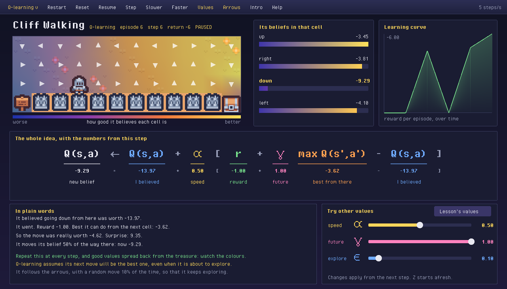

# Cliff Walking: a lesson



```bash
brew install raylib                   # macOS; for Linux, have a look at docs/watch.md
cmake .. -DBUILD_WINDOW=On
make lesson_cliff_walking
./lesson_cliff_walking
```

## The task

A walker must cross a grid of 12 by 4 cells, from the signpost at the bottom left to the treasure at the bottom right
(Sutton and Barto, Example 6.6). The spikes along the bottom are the cliff.

- A **state** `s` is the cell the walker is in: 48 of them.
- An **action** `a` is a move: up, right, down or left. A move into the border stays put.
- The **reward** `r` is -1 for every step, so shorter is better, and -100 for stepping onto the cliff, which also sends
  the walker back to the start. Reaching the treasure ends the episode.

The shortest path runs along the very edge of the cliff: 13 steps, a total reward of -13.

## What the walker knows

Nothing, at first. It keeps a table `Q(s, a)`: how much it believes taking move `a` in cell `s` is worth, counting all
the rewards from then on. Every entry starts at 0. Its **policy** is to take the move with the highest `Q` in its cell
(the arrows on the board), except for one move in ten, which is random, so that it keeps exploring. This is
ε-greedy, with ε = 0.1.

## The one formula

After every step, it compares what it believed with what really happened, and corrects the belief:

```math
Q(s, a) \leftarrow Q(s, a) + \alpha \left[ r + \gamma \max_{a'} Q(s', a') - Q(s, a) \right]
```

| Term | On the screen | Meaning |
|---|---|---|
| `Q(s, a)` on the right | I believed | what it thought this move was worth |
| `α` | speed | how far a belief moves at each correction: 0.5 here |
| `r` | reward | what the step just paid |
| `γ` | future | how much later rewards count: 1 here, all of them |
| `max Q(s', a')` | best from there | the best it believes it can do from the cell it reached |
| the whole bracket | surprise | what the move turned out to be worth, minus what it believed |
| `Q(s, a)` on the left | new belief | the corrected value |

## The three learners

They differ in one term only, the value of what comes next. The top bar and the Tab key switch between them; each
learns on its own.

| Learner | What comes next | So |
|---|---|---|
| **Q-learning** | `max Q(s', a')`, the best move from there | it learns the best path, along the edge, as if it never slipped; and it falls off while exploring |
| **SARSA** | `Q(s', a')`, the move it has actually chosen | its random moves count, so it learns that the edge is dangerous, and takes a safer path |
| **Expected SARSA** | `E[Q(s', a')]`, the average over the moves it might make | the same safety, with less noise, since one unlucky choice counts for less |

## What is on the screen

- **The board**: the game. The colours run from blue, where the walker expects to do badly, to gold, where it expects
  to do well; they are the best `Q` of each cell, smoothed between cells. Only cells it has visited are coloured.
- **Its beliefs in that cell**: the four `Q` values of the cell the last step started from. The move it took is in gold.
- **Learning curve**: the total reward of each episode, with the episode under way moving at its end, so that it
  starts at the first step. The first episodes, far below the rest, are cut off at -300.
- **The whole idea**: the formula, each term over its value at this step. The numbers are read from the update the
  library really made.
- **In plain words**: the same step as sentences.

## Controls

Rest the mouse on anything for a moment and a bubble says what it is: each term of the formula, each move's bar, each
cell of the board with what the walker believes there, the colour scale, the curve, and each entry of the top bar.
Every entry of the top bar can be clicked, and has a key:

| Key | |
|---|---|
| Space | pause and resume |
| N or Right | one step (pauses first) |
| - and = | slower and faster, from 1 to 3000 steps a second |
| R | restart: a new episode, keeping what was learnt |
| Z | reset: forget everything |
| Tab | the next learner |
| V and A | the colours and the arrows, on or off |
| I | the intro again |
| S | save a screenshot |
| H | the help |
| Q | quit |

`--no-intro` starts on the main screen, and `--capture folder` writes the intro, the main screen and the help to that
folder, without opening a window.

## Try other values

Three sliders change how it learns, from the next step on: each learner keeps its own.

- **α (speed)**: high, and it learns fast but jumps about; low, and it is slow and steady; at 0 it never learns.
- **γ (future)**: how much later rewards count. Lower it and values fade with distance from the treasure, so a walker
  far away hardly feels it. γ is the discount: the two names are one thing.
- **ε (explore)**: how often it moves at random. At 0 it never tries anything new; at 1 it ignores what it has learnt.

Changing them part way through is sound: the learner simply carries on from what it believes. But the old values were
learnt under the old settings, and take a while to catch up; Z starts afresh, and keeps the settings you chose.

## What to try

1. Pause at the start and press N a few times. Every `Q` is 0, so only the reward moves it: a belief becomes -0.5.
2. Run it at 5 steps a second, and watch the first value reach the treasure and then spread back, a little further
   with each episode.
3. Go faster until the curve flattens, then Tab to SARSA and compare the arrows along the edge of the cliff.
4. Press Z and lower the speed to see it all again.

## How it is made, and tested

`examples/window/lesson.hpp` holds everything that is said and decided, with no graphics in it: the numbers of an
update, the formula's columns, the plain words, the rules of the three learners, the session that plays and learns
one step at a time, and the controls. `examples/window/studio.hpp` draws it with raylib, and
`examples/lesson_cliff_walking.cpp` is this lesson's board and text.

`tests/lesson_test.cpp` checks that at every step, for each learner, the numbers shown satisfy the formula exactly
against the value the library wrote; that a session plays and learns exactly what `games::play_online` does from the
same seed; and the words, the columns, the controls, the top bar's clicks and the colours, worked out by hand. The
drawing itself cannot be tested without a display.

The art is [Kenney](https://www.kenney.nl)'s and the font Jayvee Enaguas's, both CC0: have a look at
`examples/window/assets/CREDITS.md`.

## References

1. Sutton, R.S. and Barto, A.G., 2018. [Reinforcement Learning: An Introduction](http://incompleteideas.net/book/the-book-2nd.html), 2nd edition, Example 6.6 and Sections 6.4 to 6.6. Cambridge, MA: MIT Press.
