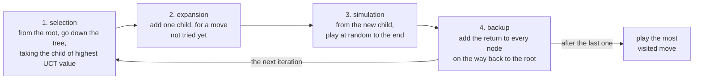
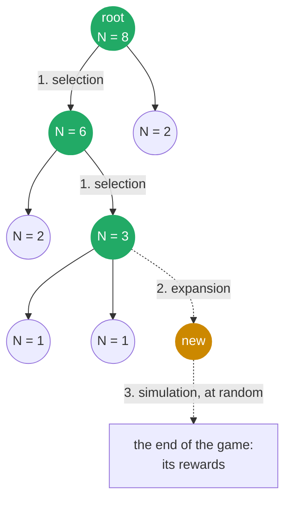

# Monte Carlo Tree Search

Monte Carlo Tree Search (MCTS), described by Sutton and Barto [1] in Section 8.11, is *planning* at the moment of
deciding. Every time the agent has to move, it plays thousands of quick games in its head, starting from where it is,
and keeps a tree of the positions those games went through. Then it makes the move that its imagined games
liked best, and throws the tree away. Basically it learns nothing that lasts: it thinks hard about the one position
in front of it.

Two ideas make it work. The imagined games are not all random: near the root, where the tree already knows something,
they follow the moves that look best, with a little exploration (this is the *tree policy*, UCT [2]). And beyond the
tree, where nothing is known yet, they are finished off with random moves (the *rollout*, or *default policy*), which
is cheap and still says something about the position. MCTS is also at the heart of AlphaGo [4], which guided its
search with a learnt policy, and judged positions with a learnt value as well as with rollouts.

It needs a **model** of the game: something that can say which moves are legal, and what happens after a move,
from any position. Unlike Q-Learning or Monte Carlo control, it needs no values stored between moves at all.

## The four phases

Each iteration (one imagined game) has four phases, after Figure 8.10 of the book:



and this is one iteration, in the tree:



Selection walks down the green nodes, choosing by UCT at each one, until it reaches a node with a move not tried yet.
Expansion adds that move as a new node (orange), the simulation plays at random from it to the end of the game,
and the backup adds the return to the new node and to every green one, on the way back up: each of them gets
one more visit. So a node's `N` is the sum of its children's, plus one for the iteration that added it,
and the root's is simply the sum of its children's.

## The formulas

Each node remembers how many iterations went through it, `N`, and the sum of their returns, `W`.
Its value is their average:

```math
Q = \frac{W}{N}
```

**Selection.** At a node `s` whose moves have all been tried, UCT goes down to the child of highest value,
plus a bonus for children tried less often:

```math
a = \arg\max_{a} \left[ Q(s,a) + c \sqrt{\frac{\ln N(s)}{N(s,a)}} \right]
```

where `N(s)` counts the visits of the node, `N(s,a)` those of the child, and `c` is the exploration constant.
This is UCB1 [3], the same idea as UCB in the bandits of Section 2.7: every node is a little bandit,
and its arms are its moves. The bonus grows slowly whilst the other moves are tried, so a move that looked
bad is still tried again, now and then, in case it was unlucky.

**Simulation.** From the new node, moves are picked at random until the game ends, which gives the
rewards `r_t` of the rest of the game.

**Backup.** Walking back up, the return of each node is worked out as in Monte Carlo
(have a look at [monte_carlo.md](monte_carlo.md#learning-from-returns)), backwards:

```math
G_t = r_t + \gamma \, G_{t+1}
```

and every node on the way gets one more visit and one more return:

```math
N \leftarrow N + 1 \qquad W \leftarrow W + G_t
```

### Two players: whose return?

In a game of two players, a win for one is a loss for the other, so a value only means something from someone's
point of view. relearn keeps every node's value from the point of view of **the player who made the move into it**,
which is the player who chose it from among its siblings. So at every node, the player to move simply takes the
child of highest value, whoever they are (this is called *negamax*). The backup then changes the sign of the return every time
the player changes:

```math
G_t = r_t + \gamma \, G_{t+1} \quad \text{if the same player moves at } t+1
\qquad\qquad
G_t = r_t - \gamma \, G_{t+1} \quad \text{if the other player does}
```

where `r_t` is the reward received by the player who moved at `t`. In tic-tac-toe, for example, the move that wins
earns its player 1, and every other move 0: when X wins, X's winning move is worth 1 to X, the move O made before
it is worth -1 to O, X's move before that +1 to X, and so on, back up the tree.

For a one-player task the player never changes, and the backup is plain Monte Carlo.

### Choosing the move

Once the iterations are done, MCTS plays the move of the root's **most visited** child (the *robust child* of
Browne et al.'s survey [5]), rather than the one of highest value. Sutton and Barto mention both; the visits are
the safer choice, for two reasons:

- UCT spends its iterations on the moves it believes are best, so the visits already say which move the search
  trusts most, and they are what all its exploring has converged to
- a value resting on a few games can be high by luck. A child visited a handful of times, whose first rollouts
  happened to win, can have the highest value whilst being a bad move; the most visited child's value rests on
  the most games

Between children visited as often, the one of higher value is played. The test `the move played is the most visited`
shows both rules, worked out by hand: after 7 iterations, one move has the higher value (2/3) from 3 visits and the
other the most visits (4), which is played; one iteration later both have 4 visits, and the first one, now worth 3/4,
is played.

### Choosing c

UCB1's `c = √2` is for returns between 0 and 1. The bonus is meant to be of the size of the returns, so for
returns over a range `R` it should be `R` times larger: in tic-tac-toe the returns go from -1 to 1, so `c = 2√2`.
With `√2` the search explores half as much as it should. Against the perfect opponent, over 10 seeds of
300 games as X and 300 as O (6000 games), the games lost were (libstdc++ / libc++):

| iterations per move | c = √2 | c = 2√2 |
|---|---|---|
| 1600 | 19 / 13 | 37 / 34 |
| 3200 | 4 / 1 | 0 / 0 |
| 6400 | 1 / 0 | 0 / 0 |

With few iterations the smaller `c` loses fewer games, since it spends them on the moves that look best,
but its losses have a long tail. In another run of 3000 games as O, with `c = √2` and 1600 iterations
(libstdc++), it lost 12, and every one of them started the same way: X on an edge, and O in one of the two
corners away from it. That reply loses, but only after a forced line several moves deep, and until the tree has
found it, the random rollouts (which play X badly) make it look as good as any other. A search that explores too little keeps trusting it. Do bear in mind this
is the classic weakness of MCTS: a trap a few moves deep, which random games do not see.

## Pseudocode

```
Monte Carlo Tree Search, with UCT

parameters: the exploration constant c, the discount rate γ, the number of iterations
needs:      a model of the game: its legal moves, the result of a move, and the player to move

to choose a move in state s0:
    the tree ← a single node, the root, for s0

    repeat for every iteration:
        # 1. selection
        node ← the root
        while every move of node has been tried, and the game is not over at node:
            node ← the child of node of highest  Q(child) + c sqrt( ln N(node) / N(child) )

        # 2. expansion
        if the game is not over at node:
            a ← the first move of node not tried yet
            r, s' ← the model's result of a, from the state of node
            node ← a new child of node, for a: its state s', its reward r, N = 0, W = 0

        # 3. simulation
        G ← 0 if the game is over at node, otherwise:
            play at random from the state of node to the end of the game, and
            G ← its return, from the point of view of the player to move at node

        # 4. backup
        while node is not the root:
            if the player to move at node is the one who moved into it:
                G ← r(node) + γ G
            else:
                G ← r(node) - γ G
            N(node) ← N(node) + 1
            W(node) ← W(node) + G
            node ← the parent of node
        N(root) ← N(root) + 1

    play the move of the root's child of highest N
```

where `Q(child) = W(child) / N(child)`. The rollout's return is worked out with the same rule, backwards, the sign
changing whenever the player does.

### The choices relearn makes

Sutton and Barto describe MCTS for one agent, and leave several details open. relearn's choices are:

- the tree policy is UCT, and the default policy picks moves uniformly at random
- each iteration adds **one** node (the book allows one or more), for the first move not tried yet, in the
  order the model lists them, so every move of a node is tried once before UCT chooses between them
- two players are handled by negamax, as above; the book's description has a single agent
- the move played is the most visited, ties going to the higher value (the book mentions this, or the highest value)
- the tree is thrown away after each move (the book mentions keeping the subtree of the move played)

## In relearn

MCTS plans with a model, a class of your own with these members (it is a convention, like the games', not a base class):

```cpp
struct my_model
{
    using state_type  = ...;                                  // copyable
    using action_type = ...;                                  // copyable
    std::vector<action_type> actions(const state_type & s);   // the legal moves in s
    result step(const state_type & s, const action_type & a); // result.next, result.reward, result.terminated
    unsigned int player(const state_type & s);                // the player to move in s
};
```

- `step` gives the state reached, the reward received by the player who moved, and whether the game ended.
  `games::step_result` has exactly those members, but any struct with them will do.
- `player` says whose turn it is, e.g. 1 for X and 2 for O. For a one-player task, simply return 0.
- a state with no legal moves counts as the end of the game.
- the model must be **deterministic**: the same `step(s, a)` must always give the same next state, reward and end.
  Do bear in mind that each edge of the tree calls `step` once, when it is expanded, and every later visit reuses that
  outcome, so a game of chance (dice, cards) would keep its first draw for ever. Rollouts call `step` afresh.

Then:

```cpp
relearn::mcts<my_model> planner(my_model(), 10000);   // the model, and the iterations per move
planner.exploration = 2 * std::sqrt(2.0);             // c, for returns between -1 and 1
planner.gamma = 1.0;                                  // discount rate γ (1 by default)
planner.prng.seed(42);                                // the seed of the rollouts, to repeat a search
auto move = planner(state);                           // search from state, and return the move
```

or in short, `relearn::mcts<my_model> planner(my_model(), 10000, 2 * std::sqrt(2.0), 42);`
(the model, the iterations, c and the seed).

- `planner(state)` is `planner.search(state)` then `planner.best_action()`. After a search, `planner.tree()`
  holds every node (`tree()[0]` is the root): its `state`, `player`, `reward`, `actions`, `children`,
  `visits` and `value()`. `children[i]` is the index, in the tree, of the node reached with `actions[i]`.
- Each search builds a new tree. Sutton and Barto mention keeping the subtree of the move played, for the next
  search; relearn does not, so that each search stands on its own.
- The moves of a node are tried in the order `actions` gives them, one per iteration, before UCT picks between them.
- `rollout_limit` (1000 by default) cuts the rollouts of a task that may never end; a rollout cut short counts
  only the rewards it received. With `rollout_limit = 0` there are no rollouts at all.
- The tree is a tree: the same position reached by two orders of moves is two nodes.
- The default `exploration` is `√2`, UCB1's for returns between 0 and 1: do scale it by the range of your
  returns, as in [choosing c](#choosing-c).
- MCTS stores no `policy`, and does not take episodes: it is not a learner, but a way to choose each move.

For tic-tac-toe, `examples/games/tic_tac_toe_model.hpp` is such a model, of both players: X is to move when both
have marked as many cells, and the move that wins earns its player 1. It also gives the perfect (minimax) moves
of any board, `games::perfect_moves`, from the game's own minimax.

## Example: tic-tac-toe

`examples/tic_tac_toe_mcts.cpp` lets MCTS play tic-tac-toe (Section 1.5), with `c = 2√2` and random rollouts.
First, its search from the empty board, with 5000 iterations: how often each first move was tried
(on the left, laid out as the board), and its value for X (on the right):

```
   507  239  433          0.32  0.15  0.29
   236 1883  309          0.15  0.50  0.22
   495  219  679          0.32  0.13  0.37
```

It plays the centre, the most visited. Do bear in mind that these values are not the minimax values (with perfect
play every first move draws, a value of 0): they are averages over games that are still partly random, and
random games favour X, and the centre most of all.

Then four positions, where it must win at once (rather than block) or block the opponent's win, as X and as O:

```
  XX.                    X.O                  XX.                  XX.
  OO.  X wins at 2       .O.  X blocks at 6   .O.  O blocks at 2   OO.  O wins at 5
  ...  (not block 5)     ..X  (then forks)    ...                  ..X  (not block 2)
```

and it plays each of them. Finally, 100 games as X and 100 as O, against the perfect opponent (one of its best moves,
at random, so that the games are not all the same) and against a random one (wins / draws / losses):

```
iterations     perfect, as X      perfect, as O       random, as X       random, as O
        10      0 /  43 /  57      0 /  11 /  89     90 /   5 /   5     77 /  10 /  13
       100      0 / 100 /   0      0 /  48 /  52     99 /   1 /   0     93 /   6 /   1
      1000      0 / 100 /   0      0 /  96 /   4    100 /   0 /   0     91 /   9 /   0
      5000      0 / 100 /   0      0 / 100 /   0     97 /   3 /   0     92 /   8 /   0
```

Against the perfect opponent the best possible is a draw, and with 5000 iterations MCTS gets it in every game.
Playing O is much harder than playing X: X can set traps from the first move, and O has to see them.
Against the random opponent it wins almost every game as X; as O it wins fewer, since X moves first and a random X
sometimes stumbles into a draw. The program fails unless, with 5000 iterations, it plays every position right,
loses no game, and wins at least 95 games as X and 80 as O against the random opponent.

__note__: the exact numbers differ a little between libstdc++ and libc++, whose random distributions give other
numbers for the same seeds. These are libstdc++'s (GCC).

## Tests

`tests/mcts_test.cpp` checks:

- tiny hand-made games, with every visit count and value worked out by hand in the comments:
  UCT's choices on a game of one move, discounting in the tree and in the rollouts, rollouts cut short,
  the sign of the values with two players (each one is the mover's), in the tree and in the rollouts,
  and that the move played is the most visited, ties going to the higher value
- the four tic-tac-toe positions above, for 10 seeds with 200 iterations. Over those seeds, with libstdc++ and
  with libc++, every seed found every move from 100 iterations on (with 70, one move was missed, with 50, four)
- that it never loses to the perfect opponent, with 10000 iterations: 25 games as X and 25 as O, and 5 games as X
  against `games::tic_tac_toe`'s own perfect opponent (the one that answers inside `step()`), which must all be draws
- that it never loses to the random opponent, with 5000 iterations, and wins at least 90 of 100 games as X
  and 80 of 100 as O. Over 10 seeds, with both standard libraries, it won 97 to 100 as X and 87 to 95 as O

The numbers of iterations come from a sweep: 10 seeds, each playing 300 games as X and 300 as O against the perfect
opponent, and as many against the random one, with libstdc++ and with libc++. The games lost against the perfect
opponent (of all 6000), and the most lost against the random one by any seed (of its 600), were:

| iterations per move | 400 | 800 | 1600 | 2400 | 3200 | 6400 | 10000 |
|---|---|---|---|---|---|---|---|
| perfect opponent, libstdc++ | 671 | 260 | 37 | 6 | 0 | 0 | 0 |
| perfect opponent, libc++ | 671 | 254 | 34 | 5 | 0 | 0 | 0 |
| random opponent, libstdc++ | 3 | 2 | 1 | 0 | 0 | 0 | 0 |
| random opponent, libc++ | 4 | 2 | 0 | 0 | 0 | 0 | 0 |

so the test against the perfect opponent uses about three times the first count without a loss (3200),
and the one against the random opponent about twice its own (2400). The whole test file takes under 3 seconds at `-O3`.

## References

1. Sutton, R.S. and Barto, A.G., 2018. [Reinforcement Learning: An Introduction](http://incompleteideas.net/book/the-book-2nd.html), 2nd edition. Cambridge, MA: MIT Press.
   Section 8.11 (Monte Carlo Tree Search, and Figure 8.10), Section 2.7 (UCB), Section 1.5 (tic-tac-toe).
2. Kocsis, L. and Szepesvári, C., 2006. Bandit based Monte-Carlo planning.
   In *European Conference on Machine Learning (ECML)*, pp. 282-293. Springer.
3. Auer, P., Cesa-Bianchi, N. and Fischer, P., 2002. Finite-time analysis of the multiarmed bandit problem.
   *Machine Learning*, 47(2), pp. 235-256.
4. Silver, D. et al., 2016. Mastering the game of Go with deep neural networks and tree search.
   *Nature*, 529, pp. 484-489.
5. Browne, C.B. et al., 2012. A survey of Monte Carlo tree search methods.
   *IEEE Transactions on Computational Intelligence and AI in Games*, 4(1), pp. 1-43.
