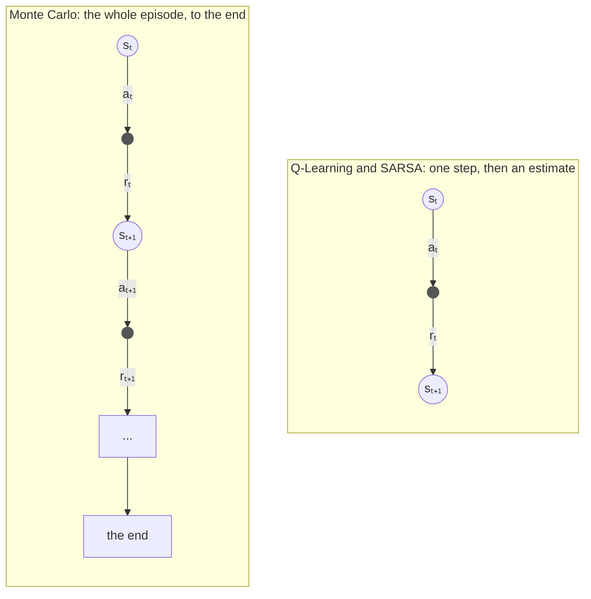
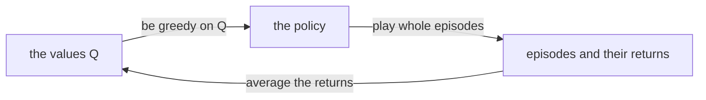
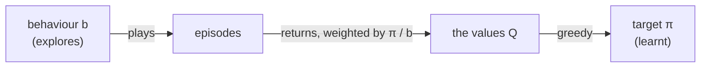

# Monte Carlo methods

Monte Carlo methods, described by Sutton and Barto [1] in Chapter 5, learn from **whole episodes**.
The agent plays a game to the end, and only then looks back: the value of each move it made is
simply the average of what actually followed it, every time it was made.

Basically, where Q-Learning and SARSA learn from one step and their *estimate* of the next state
(this is called *bootstrapping*), Monte Carlo learns from the real outcome, and nothing else.
It needs no model of the game, and it does not care whether the states are Markovian, but it has to
wait for each episode to end, so it only suits games that do end.



## Learning from returns

The *return* `G_t` is everything the agent received from step `t` to the end of the episode,
discounted by `γ`:

```math
G_t = r_t + \gamma \, r_{t+1} + \gamma^2 \, r_{t+2} + \dots + \gamma^{T-t} \, r_T
```

and it is easiest to work out backwards, from the end of the episode:

```math
G_T = r_T \qquad G_t = r_t + \gamma \, G_{t+1}
```

The value of a move is the average of the returns that followed it.
Rather than keeping every return, the average is updated each time a new one arrives:

```math
Q(s_t,a_t) \leftarrow Q(s_t,a_t) + \frac{1}{n} \left[ G_t - Q(s_t,a_t) \right]
```

where `n` is the number of returns averaged so far for `(s_t, a_t)`.
This simply states that after `n` returns, `Q` is exactly their average.
For a world that changes over time, a constant rate `α` instead of `1/n` keeps forgetting the old returns.

### First-visit and every-visit

A move can be made more than once in the same episode. *First-visit* Monte Carlo averages only the
return after the first time it was made in each episode, whereas *every-visit* Monte Carlo averages
the returns after every time. Both converge to the true values.

For example, with `γ = 1`, say `(s0, a)` earns 1, then `(s1, b)` earns 0, then `(s0, a)` again earns 2.
The returns are 3 after the first `(s0, a)` and 2 after the second one, so first-visit learns
`Q(s0, a) = 3`, and every-visit learns their average, 2.5.

## Monte Carlo control

To learn the best policy, rather than the value of a given one, Monte Carlo goes round in a loop
(Sutton and Barto call it *generalised policy iteration*):



There is one catch: a greedy agent never tries the moves it thinks are worse, so it never finds out
whether they are better. Sutton and Barto give three ways out of this, and relearn has all three.

### 1. Exploring starts

Every episode starts from a random state, with a random first move; after that, the agent is greedy.
Since every state and move can be the start, every one of them keeps being tried.

```
Monte Carlo with exploring starts

parameters: discount rate γ

start with Q(s, a) = 0 and n(s, a) = 0 for every state s and action a

for each episode:
    pick a start state s0 and a first action a0 at random, all of them with some chance
    play an episode from s0, a0, then greedy on Q:  s0, a0, r0, s1, a1, r1, ..., sT, aT, rT
    G ← 0
    for t = T, T-1, ..., 0:
        G ← γ G + r_t
        if (s_t, a_t) does not appear earlier in the episode:
            n(s_t, a_t) ← n(s_t, a_t) + 1
            Q(s_t, a_t) ← Q(s_t, a_t) + 1/n(s_t, a_t) [ G - Q(s_t, a_t) ]
```

Do bear in mind that *every* state and move must be able to start an episode.
When I first wrote the Blackjack example, its random starts never began with a natural (an Ace and a ten
on the deal). So the agent never learnt that decision, and in real games it hit on a natural half the time,
throwing away games it should have won. The game's exploring starts now begin with a natural half the time
that they pick 21 with a usable Ace.

### 2. On-policy, ε-soft

Exploring starts are often impossible: you cannot start a real robot, or a real game of cards, from any
state you like. Instead, the agent explores as it plays, ε-Greedy for example, and Monte Carlo learns the
values of the policy it follows. It learns the best ε-Greedy policy, which explores and so is not quite
the best policy, but the greedy policy read from its values is usually very close.

```
On-policy first-visit Monte Carlo control

parameters: discount rate γ, exploration rate ε

start with Q(s, a) = 0 and n(s, a) = 0 for every state s and action a

for each episode:
    play an episode, ε-greedy on Q:  s0, a0, r0, ..., sT, aT, rT
    G ← 0
    for t = T, T-1, ..., 0:
        G ← γ G + r_t
        if (s_t, a_t) does not appear earlier in the episode:
            n(s_t, a_t) ← n(s_t, a_t) + 1
            Q(s_t, a_t) ← Q(s_t, a_t) + 1/n(s_t, a_t) [ G - Q(s_t, a_t) ]
```

### In relearn

```cpp
relearn::monte_carlo<state,action> learner;
learner.gamma = 1.0;          // discount rate γ
learner.first_visit = true;   // first-visit (the default), or false for every-visit
learner(episode, policy);
```

or in short, `auto learner = relearn::monte_carlo<state,action>{1.0, true};`.

- The learner counts the returns of each pair in `learner.visits`, and by default each value is their
  plain average. Set `learning_rate` (have a look at [schedules.md](schedules.md)) to use another rate,
  e.g. a constant one for a world that changes.
- **Only episodes that ended are learnt.** Monte Carlo needs the real return, which an episode cut short
  by a step limit does not have yet, so `learner(episode, policy, false)` learns nothing.
- Learn once the episode has ended: `games::play` then the learner, not `games::play_online`.
- Exploring starts and ε-Greedy are up to your agent, the learner is the same. The Blackjack game has
  exploring starts built in, `game.exploring_starts(true)`.

## Off-policy Monte Carlo

Exploring ε-Greedy means learning a policy that explores. *Off-policy* learning separates the two:
the agent plays by a *behaviour* policy `b`, which explores (even completely at random), whilst the
learner learns a different *target* policy `π`, greedy on `Q`, which never explores.

The returns that follow a move were earned by `b`, not by `π`, so each one is weighted by how much
more likely `π` was than `b` to make the moves that earned it (the *importance sampling ratio*):

```math
W_t = \prod_{k=t+1}^{T} \frac{\pi(a_k \mid s_k)}{b(a_k \mid s_k)}
```

and `Q` is the *weighted* average of the returns, `Σ W G / Σ W`. As before, it is updated one return
at a time, with `C`, the sum of the weights so far:

```math
C(s_t,a_t) \leftarrow C(s_t,a_t) + W \qquad Q(s_t,a_t) \leftarrow Q(s_t,a_t) + \frac{W}{C(s_t,a_t)} \left[ G - Q(s_t,a_t) \right]
```

The target policy is greedy, so `π(a | s)` is 1 for the greedy action and 0 for the others.
That makes the ratio simple: walking back from the end, each greedy move multiplies `W` by `1 / b(a | s)`,
and at the first move that is *not* greedy, `π` could never have made it, `W` becomes 0, and the walk stops.



### Pseudocode

```
Off-policy Monte Carlo control, with weighted importance sampling

parameters: discount rate γ, a behaviour policy b that tries every action

start with Q(s, a) = 0 and C(s, a) = 0 for every state s and action a

for each episode:
    play an episode by b:  s0, a0, r0, ..., sT, aT, rT
    G ← 0
    W ← 1
    for t = T, T-1, ..., 0:
        G ← γ G + r_t
        C(s_t, a_t) ← C(s_t, a_t) + W
        Q(s_t, a_t) ← Q(s_t, a_t) + W / C(s_t, a_t) [ G - Q(s_t, a_t) ]
        if a_t is not the greedy action of s_t:
            stop this episode
        W ← W / b(a_t | s_t)
```

### In relearn

relearn does not know how your agent plays, so you give the learner `b`: a function which returns
the probability that the behaviour policy takes action `a` in state `s`.

```cpp
relearn::off_policy_monte_carlo<state,action> learner;
learner.gamma = 1.0;
// b(a | s): here, a player who picks one of two actions at random
learner.behaviour = [](const state & s, const action & a) {
    return 0.5;
};
learner(episode, policy);
```

or in short, `relearn::off_policy_monte_carlo<state,action> learner(1.0, b)`.

- The greedy action of a state is the one of highest value among those stored for it, so actions
  never tried there do not count. The sums of the weights `C` are kept in `learner.weights`.
- As with `monte_carlo`, only episodes that ended are learnt.
- Off-policy Monte Carlo only learns from the *end* of each episode, back to the last move the greedy
  policy would not have made. When episodes are long and `b` is very different from `π`, that can be
  very little, and learning is slow. Blackjack's games are short, so it works well there.

## Example: Blackjack (Figure 5.2)

`examples/blackjack_monte_carlo.cpp` learns Blackjack (Example 5.1) in all three ways, from 500000 games each
(γ = 1), then each greedy policy plays the same 200000 ordinary games. The average reward per game is:

| learnt with | reward per game |
|---|---|
| exploring starts | -0.0453 |
| on-policy, ε = 0.1 | -0.0491 |
| off-policy, from random play | -0.0435 |

For comparison, the optimal strategy earns about -0.043 per game, and playing at random about -0.4:
Blackjack favours the dealer. The strategy learnt with exploring starts, in the layout of Figure 5.2, is:

```
With usable ace  (S = stick, H = hit)        No usable ace
player \ dealer:  A  2  3  4  5  6  7  8  9 10       A  2  3  4  5  6  7  8  9 10
             21:  S  S  S  S  S  S  S  S  S  S       S  S  S  S  S  S  S  S  S  S
             20:  S  S  S  S  S  S  S  S  S  S       S  S  S  S  S  S  S  S  S  S
             19:  S  S  S  S  S  S  S  S  S  S       S  S  S  S  S  S  S  S  S  S
             18:  S  S  S  S  S  S  S  S  H  H       S  S  S  S  S  S  S  S  S  S
             17:  H  H  H  H  H  H  H  H  H  H       S  S  S  S  S  S  S  S  S  S
             16:  H  H  H  H  H  H  H  H  H  H       H  S  S  S  S  S  H  H  H  S
             15:  H  H  H  H  H  H  H  H  H  H       H  S  S  S  S  S  H  H  H  H
             14:  H  H  H  H  H  H  H  H  H  H       H  S  S  S  S  S  H  H  H  H
             13:  H  H  H  H  H  H  H  H  H  H       H  H  S  S  S  S  H  H  H  H
             12:  H  H  H  H  H  H  H  H  H  H       H  H  H  S  S  H  H  H  H  H
```

It is the optimal strategy (the one of Figure 5.2) in all but four cells: soft 18 against an Ace,
16 against a 10, 13 against a 2, and 12 against a 6. All four are cases where both moves are worth almost
the same, their exact values (worked out with the exact solver in `tests/solvers.hpp`) differing by less
than 0.04, so a few hundred thousand noisy games are not enough to tell them apart.

__note__: the exact numbers can differ a little from one compiler to another. Some compilers round the
last bit of a value differently, so a near-tie can go the other way, and from there the run takes another path.

## Tests

`tests/monte_carlo_test.cpp` checks:

- returns and averages worked out by hand, including first-visit against every-visit, a constant
  learning rate, and that an episode cut short is not learnt
- the importance weights of off-policy Monte Carlo, worked out by hand, and that the walk back stops
  at the first move the greedy policy would not make
- Blackjack, against the exact solution in `tests/solvers.hpp`: with exploring starts and off-policy,
  the learnt strategy disagrees with the optimal one in at most 15 of the 200 states, and all three
  earn within 0.01 (0.015 for on-policy) of what the optimal strategy earns. Over 10 seeds, with
  GCC's and with Clang's standard library, the shortfall was at most 0.0031 (exploring starts),
  0.0057 (on-policy) and 0.0027 (off-policy)

## References

1. Sutton, R.S. and Barto, A.G., 2018. [Reinforcement Learning: An Introduction](http://incompleteideas.net/book/the-book-2nd.html), 2nd edition. Cambridge, MA: MIT Press.
   Section 5.1 (first-visit and every-visit), Section 5.3 (exploring starts), Section 5.4 (on-policy control),
   Sections 5.5 to 5.7 (importance sampling and off-policy control), Examples 5.1 and 5.3, Figure 5.2.
