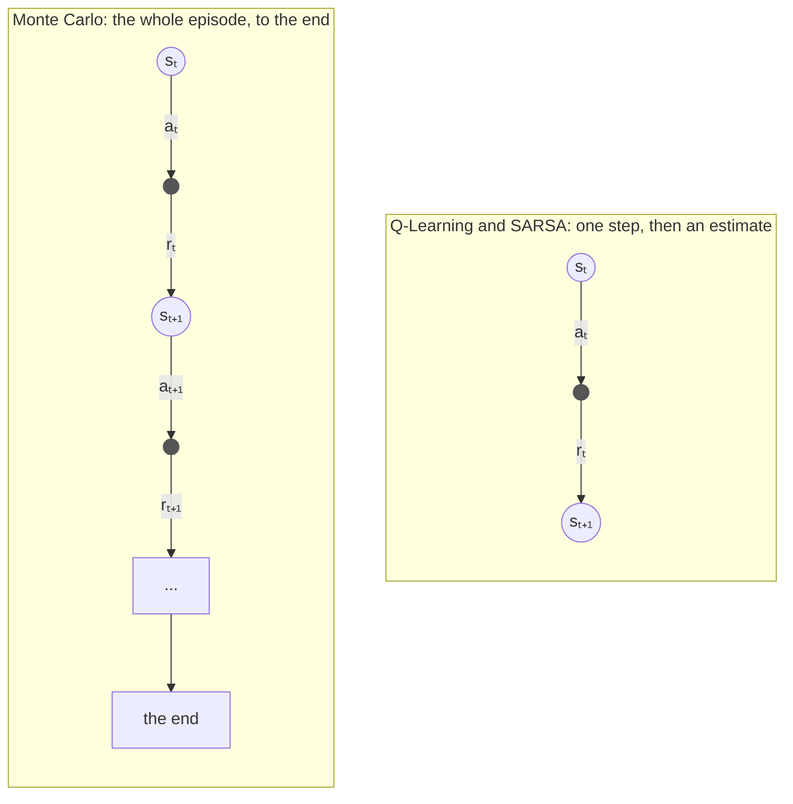
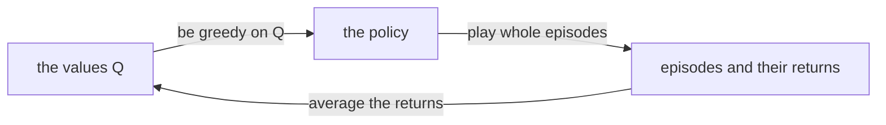
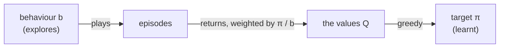
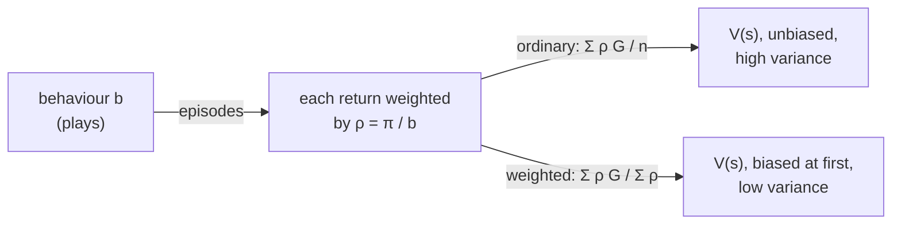

# Monte Carlo methods

Monte Carlo methods, described by Sutton and Barto [1] in Chapter 5, learn from **whole episodes**.
The agent plays a game to the end, and only then looks back: the value of each move it made is
simply the average of what actually followed it, every time it was made.

Basically, where Q-Learning and SARSA learn from one step and their *estimate* of the next state
(this is called *bootstrapping*), Monte Carlo learns from the real outcome, and nothing else.
It needs no model of the game, and it does not care whether the states are Markovian, but it has to
wait for each episode to end, so it only suits games that do end.



## Learning from returns

The *return* `G_t` is everything the agent received from step `t` to the end of the episode,
discounted by `γ`:

```math
G_t = r_t + \gamma \, r_{t+1} + \gamma^2 \, r_{t+2} + \dots + \gamma^{T-t} \, r_T
```

and it is easiest to work out backwards, from the end of the episode:

```math
G_T = r_T \qquad G_t = r_t + \gamma \, G_{t+1}
```

The value of a move is the average of the returns that followed it.
Rather than keeping every return, the average is updated each time a new one arrives:

```math
Q(s_t,a_t) \leftarrow Q(s_t,a_t) + \frac{1}{n} \left[ G_t - Q(s_t,a_t) \right]
```

where `n` is the number of returns averaged so far for `(s_t, a_t)`.
This simply states that after `n` returns, `Q` is exactly their average.
For a world that changes over time, a constant rate `α` instead of `1/n` keeps forgetting the old returns.

### First-visit and every-visit

A move can be made more than once in the same episode. *First-visit* Monte Carlo averages only the
return after the first time it was made in each episode, whereas *every-visit* Monte Carlo averages
the returns after every time. Both converge to the true values.

For example, with `γ = 1`, say `(s0, a)` earns 1, then `(s1, b)` earns 0, then `(s0, a)` again earns 2.
The returns are 3 after the first `(s0, a)` and 2 after the second one, so first-visit learns
`Q(s0, a) = 3`, and every-visit learns their average, 2.5.

## Monte Carlo control

To learn the best policy, rather than the value of a given one, Monte Carlo goes round in a loop
(Sutton and Barto call it *generalised policy iteration*):



There is one catch: a greedy agent never tries the moves it thinks are worse, so it never finds out
whether they are better. Sutton and Barto give three ways out of this, and relearn has all three.

### 1. Exploring starts

Every episode starts from a random state, with a random first move; after that, the agent is greedy.
Since every state and move can be the start, every one of them keeps being tried.

```
Monte Carlo with exploring starts

parameters: discount rate γ

start with Q(s, a) = 0 and n(s, a) = 0 for every state s and action a

for each episode:
    pick a start state s0 and a first action a0 at random, all of them with some chance
    play an episode from s0, a0, then greedy on Q:  s0, a0, r0, s1, a1, r1, ..., sT, aT, rT
    G ← 0
    for t = T, T-1, ..., 0:
        G ← γ G + r_t
        if (s_t, a_t) does not appear earlier in the episode:
            n(s_t, a_t) ← n(s_t, a_t) + 1
            Q(s_t, a_t) ← Q(s_t, a_t) + 1/n(s_t, a_t) [ G - Q(s_t, a_t) ]
```

Do bear in mind that *every* state and move must be able to start an episode.
When I first wrote the Blackjack example, its random starts never began with a natural (an Ace and a ten
on the deal). So the agent never learnt that decision, and in real games it hit on a natural half the time,
throwing away games it should have won. The game's exploring starts now begin with a natural half the time
that they pick 21 with a usable Ace.

### 2. On-policy, ε-soft

Exploring starts are often impossible: you cannot start a real robot, or a real game of cards, from any
state you like. Instead, the agent explores as it plays, ε-Greedy for example, and Monte Carlo learns the
values of the policy it follows. It learns the best ε-Greedy policy, which explores and so is not quite
the best policy, but the greedy policy read from its values is usually very close.

```
On-policy first-visit Monte Carlo control

parameters: discount rate γ, exploration rate ε

start with Q(s, a) = 0 and n(s, a) = 0 for every state s and action a

for each episode:
    play an episode, ε-greedy on Q:  s0, a0, r0, ..., sT, aT, rT
    G ← 0
    for t = T, T-1, ..., 0:
        G ← γ G + r_t
        if (s_t, a_t) does not appear earlier in the episode:
            n(s_t, a_t) ← n(s_t, a_t) + 1
            Q(s_t, a_t) ← Q(s_t, a_t) + 1/n(s_t, a_t) [ G - Q(s_t, a_t) ]
```

### In relearn

```cpp
relearn::monte_carlo<state,action> learner;
learner.gamma = 1.0;          // discount rate γ
learner.first_visit = true;   // first-visit (the default), or false for every-visit
learner(episode, policy);
```

or in short, `auto learner = relearn::monte_carlo<state,action>{1.0, true};`.

- The learner counts the returns of each pair in `learner.visits`, and by default each value is their
  plain average. Set `learning_rate` (have a look at [schedules.md](schedules.md)) to use another rate,
  e.g. a constant one for a world that changes.
- **Only episodes that ended are learnt.** Monte Carlo needs the real return, which an episode cut short
  by a step limit does not have yet, so `learner(episode, policy, false)` learns nothing.
- Learn once the episode has ended: `games::play` then the learner, not `games::play_online`.
- Exploring starts and ε-Greedy are up to your agent, the learner is the same. The Blackjack game has
  exploring starts built in, `game.exploring_starts(true)`.

## Off-policy Monte Carlo

Exploring ε-Greedy means learning a policy that explores. *Off-policy* learning separates the two:
the agent plays by a *behaviour* policy `b`, which explores (even completely at random), whilst the
learner learns a different *target* policy `π`, greedy on `Q`, which never explores.

The returns that follow a move were earned by `b`, not by `π`, so each one is weighted by how much
more likely `π` was than `b` to make the moves that earned it (the *importance sampling ratio*):

```math
W_t = \prod_{k=t+1}^{T} \frac{\pi(a_k \mid s_k)}{b(a_k \mid s_k)}
```

and `Q` is the *weighted* average of the returns, `Σ W G / Σ W`. As before, it is updated one return
at a time, with `C`, the sum of the weights so far:

```math
C(s_t,a_t) \leftarrow C(s_t,a_t) + W \qquad Q(s_t,a_t) \leftarrow Q(s_t,a_t) + \frac{W}{C(s_t,a_t)} \left[ G - Q(s_t,a_t) \right]
```

The target policy is greedy, so `π(a | s)` is 1 for the greedy action and 0 for the others.
That makes the ratio simple: walking back from the end, each greedy move multiplies `W` by `1 / b(a | s)`,
and at the first move that is *not* greedy, `π` could never have made it, `W` becomes 0, and the walk stops.



### Pseudocode

```
Off-policy Monte Carlo control, with weighted importance sampling

parameters: discount rate γ, a behaviour policy b that tries every action

start with Q(s, a) = 0 and C(s, a) = 0 for every state s and action a

for each episode:
    play an episode by b:  s0, a0, r0, ..., sT, aT, rT
    G ← 0
    W ← 1
    for t = T, T-1, ..., 0:
        G ← γ G + r_t
        C(s_t, a_t) ← C(s_t, a_t) + W
        Q(s_t, a_t) ← Q(s_t, a_t) + W / C(s_t, a_t) [ G - Q(s_t, a_t) ]
        if a_t is not the greedy action of s_t:
            stop this episode
        W ← W / b(a_t | s_t)
```

### In relearn

relearn does not know how your agent plays, so you give the learner `b`: a function which returns
the probability that the behaviour policy takes action `a` in state `s`.

```cpp
relearn::off_policy_monte_carlo<state,action> learner;
learner.gamma = 1.0;
// b(a | s): here, a player who picks one of two actions at random
learner.behaviour = [](const state & s, const action & a) {
    return 0.5;
};
learner(episode, policy);
```

or in short, `relearn::off_policy_monte_carlo<state,action> learner(1.0, b)`.

- The greedy action of a state is the one of highest value among those stored for it, so actions
  never tried there do not count. The sums of the weights `C` are kept in `learner.weights`.
- As with `monte_carlo`, only episodes that ended are learnt.
- `b` may depend on the values being learnt, e.g., ε-Greedy on `policy`. Do bear in mind that the learner
  reads `b(a | s)` for every step of the episode *before* it changes any value, so that the probabilities
  it uses are the ones the episode was played with.
- Off-policy Monte Carlo only learns from the *end* of each episode, back to the last move the greedy
  policy would not have made. When episodes are long and `b` is very different from `π`, that can be
  very little, and learning is slow. Blackjack's games are short, so it works well there.

## Off-policy Monte Carlo prediction

Off-policy *control* learns the greedy policy. Off-policy *prediction* (Sections 5.5 and 5.6) answers a different
question: given a policy `π`, any policy, how much is it worth, learnt from episodes played by another one, `b`?
The same ratio turns `b`'s returns into `π`'s, this time with `π`'s own probabilities:

```math
\rho_{t:h} = \prod_{k=t}^{h} \frac{\pi(a_k \mid s_k)}{b(a_k \mid s_k)}
```

and there are two ways to average the weighted returns. With `T(s)` the steps at which `s` was visited, and `T`
the end of each of their episodes:

```math
\text{ordinary:} \quad V(s) = \frac{\sum_{t \in \mathcal{T}(s)} \rho_{t:T-1} \, G_t}{|\mathcal{T}(s)|}
\qquad\qquad
\text{weighted:} \quad V(s) = \frac{\sum_{t \in \mathcal{T}(s)} \rho_{t:T-1} \, G_t}{\sum_{t \in \mathcal{T}(s)} \rho_{t:T-1}}
```

**Ordinary** importance sampling is unbiased: on average, it is exactly `v_π(s)`. But a single return can be
weighted by a huge ratio, and its variance can be huge too, even infinite. **Weighted** importance sampling is
biased (after a single episode, it is simply that episode's return, if `π` could have played it), but the bias
fades as the episodes add up, and its variance is far smaller. In practice it is usually the better one.

Two more refine ordinary importance sampling when the rewards come during the episode, not only at its end:

- **Discounting-aware** importance sampling (Section 5.8): with `γ < 1`, a return is a mix of *flat partial returns*
  `Ḡ_{t:h} = r_t + ... + r_{h-1}`, without discounting, `Ḡ_{t:h}` weighted by `(1 - γ) γ^{h-t-1}` and the whole
  `Ḡ_{t:T}` by `γ^{T-t-1}`. Each partial return only needs the ratios of the actions before `h`, so the ratios of
  the later actions no longer multiply it. There is a discounting-aware weighted version too.
- **Per-decision** importance sampling (Section 5.9): each reward is weighted only by the ratios of the actions
  before it, `G̃_t = ρ_{t:t} r_t + γ ρ_{t:t+1} r_{t+1} + ... + γ^{T-1-t} ρ_{t:T-1} r_{T-1}`. The book gives no weighted
  version of it.

With `γ = 1`, discounting-aware importance sampling is plain ordinary or weighted importance sampling; with a reward
only at the end of each episode, per-decision is ordinary; and when `π = b`, every ratio is 1 and all of them are
plain Monte Carlo.



### In relearn

```cpp
relearn::off_policy_monte_carlo_prediction<state,action> learner(gamma, pi, b, relearn::importance_sampling::weighted);
learner(episode, q);                  // q gets the action values q_π(s, a)
double v = learner.value(s);          // the state value v_π(s)
```

- `pi(s, a)` is `π(a | s)`, the policy being evaluated, and `b(s, a)` is `b(a | s)`, the one that played. `π` may give
  an action no chance at all; `b` must give every action it takes some.
- `sampling` is one of `importance_sampling::ordinary`, `weighted` (the default), `discounting_aware_ordinary`,
  `discounting_aware_weighted` and `per_decision`.
- It learns both kinds of value from each episode: the state values, in the learner (`learner.value(s)`), with the
  ratios from the action taken in `s` on, and the action values, in the `policy` given, with the ratios from the
  *next* action on (the action of `q(s, a)` is given, so its own ratio is left out), as in the book's box of Section 5.6.
- Every visit counts, as in the book's box; `learner.first_visit = true` counts only the first visit of each state
  (and of each state/action pair) in an episode, as Example 5.5 does.
- Every value is worked out from its sums: the sum of its weighted returns, divided by the sum of its weights (or by
  its number of visits). Do bear in mind that ordinary importance sampling counts the episodes `π` would never have
  played, with a ratio of 0, whereas weighted importance sampling adds nothing for them; a weighted value whose
  weights are all 0 so far is 0.
- As with `monte_carlo`, only episodes that ended are learnt, and `π` and `b` are read for every step before any value
  changes.

## Example: one blackjack state (Example 5.4, Figure 5.3)

`examples/importance_sampling.cpp` starts with Example 5.4: every game starts with the dealer showing a deuce and the
player on 13 with a usable Ace (`game.fixed_start(13, true, 2)`), the player picks stick or hit at random, and `π`
sticks only on 20 or 21. Its value is `v_π(s) = -0.27726`; played by `π` itself, 10 million games here give
-0.27747 ± 0.0003. The mean squared error of `V(s)`, over 100 runs, is:

```
                          games:          1         10        100       1000      10000
    ordinary                         6.1616     0.6608     0.0891   0.009139   0.001367
    weighted                         0.1858     0.4735     0.0949   0.007779   0.001256
```

As in Figure 5.3, weighted importance sampling has the far smaller error at first: after one game, its estimate is
either that game's return, or 0, whereas ordinary importance sampling multiplies the return by a ratio of up to 2^k.
Both get to `v_π(s)`, and from about 100 games on they are about as good as each other.

## Example: the infinite variance (Example 5.5)

The second part is Example 5.5 (`examples/games/infinite_variance.hpp`): a single state, where right ends the episode
at once, worth 0, and left comes back with 0.9, worth 0, or ends with 0.1, worth +1. `π` always goes left, so
`v_π(s) = 1`, and `b` goes left or right with 1/2 each. An episode that went left `k` times and then ended has a ratio
of `2^k`; the ratios times the returns have a mean of exactly 1, but their variance is infinite. First-visit, in 10 runs:

```
    ordinary         10      100     1000    10000   100000  episodes
    run  1       3.2000   0.6000   0.5680   0.9888   0.6522
    run  2       0.0000   0.3200   0.5020   0.5508   0.7067
    run  3       0.0000   0.1800   0.3460   0.8758   0.6920
     ...
    run  6       0.4000   0.2000   0.3760   0.5660   1.9772
     ...
    run 10       0.4000   0.3000   0.7740   1.4400   0.8759
    weighted         10      100     1000    10000   100000  episodes
    run  1       1.0000   1.0000   1.0000   1.0000   1.0000
    run  2       0.0000   1.0000   1.0000   1.0000   1.0000
     ...
```

Ordinary importance sampling is still wandering after 100000 episodes, mostly below 1: the rare episodes with huge
ratios that pull it up to 1 have mostly not come yet. Weighted importance sampling has exactly 1 from the first
episode `π` could have played on (before that, all its weights are 0, and so is its estimate).

## Example: long episodes with a reward at every step (Sections 5.8 and 5.9)

The third part is the case Sections 5.8 and 5.9 are about (`examples/games/fixed_length.hpp`): every episode is 20
steps, action 0 earns 1 and action 1 earns 0, `π` takes action 0 with 0.9 and `b` with 0.5, and `γ = 0.5`. Ordinary
importance sampling weights each return by the ratios of all 20 actions of the episode, even though, with `γ = 0.5`,
the return is mostly made of its first few rewards. The mean squared error of `V(0)`, over 100 runs:

```
                       episodes:         10        100       1000
    ordinary                        35.6693    10.3265    17.1413
    weighted                         0.3091     0.2002     0.0761
    discounting-aware ordinary       1.0598     0.0819   0.008731
    discounting-aware weighted       0.1969     0.0196   0.002204
    per-decision                     0.5080     0.0402   0.004007
```

Ordinary importance sampling does not come down at all in 1000 episodes. Discounting-aware and per-decision importance
sampling, which only weight each reward by the ratios of the actions before it (or nearly), have errors 2000 to 8000
times smaller after 1000 episodes, and discounting-aware weighted importance sampling is the best of the five.

__note__: these numbers are GCC's. With Clang's standard library (libc++), whose random numbers differ, they are a
little different, in the same order (`ex_importance_sampling` checks it with both).

## Example: Blackjack (Figure 5.2)

`examples/blackjack_monte_carlo.cpp` learns Blackjack (Example 5.1) in all three ways, from 500000 games each
(γ = 1), then each greedy policy plays the same 200000 ordinary games. The average reward per game is:

| learnt with | reward per game |
|---|---|
| exploring starts | -0.0453 |
| on-policy, ε = 0.1 | -0.0491 |
| off-policy, from random play | -0.0435 |

For comparison, the optimal strategy earns about -0.043 per game, and playing at random about -0.4:
Blackjack favours the dealer. The strategy learnt with exploring starts, in the layout of Figure 5.2, is:

```
With usable ace  (S = stick, H = hit)        No usable ace
player \ dealer:  A  2  3  4  5  6  7  8  9 10       A  2  3  4  5  6  7  8  9 10
             21:  S  S  S  S  S  S  S  S  S  S       S  S  S  S  S  S  S  S  S  S
             20:  S  S  S  S  S  S  S  S  S  S       S  S  S  S  S  S  S  S  S  S
             19:  S  S  S  S  S  S  S  S  S  S       S  S  S  S  S  S  S  S  S  S
             18:  S  S  S  S  S  S  S  S  H  H       S  S  S  S  S  S  S  S  S  S
             17:  H  H  H  H  H  H  H  H  H  H       S  S  S  S  S  S  S  S  S  S
             16:  H  H  H  H  H  H  H  H  H  H       H  S  S  S  S  S  H  H  H  S
             15:  H  H  H  H  H  H  H  H  H  H       H  S  S  S  S  S  H  H  H  H
             14:  H  H  H  H  H  H  H  H  H  H       H  S  S  S  S  S  H  H  H  H
             13:  H  H  H  H  H  H  H  H  H  H       H  H  S  S  S  S  H  H  H  H
             12:  H  H  H  H  H  H  H  H  H  H       H  H  H  S  S  H  H  H  H  H
```

It is the optimal strategy (the one of Figure 5.2) in all but four cells: soft 18 against an Ace,
16 against a 10, 13 against a 2, and 12 against a 6. All four are cases where both moves are worth almost
the same, their exact values (worked out with the exact solver in `tests/solvers.hpp`) differing by less
than 0.04, so a few hundred thousand noisy games are not enough to tell them apart.

__note__: the exact numbers can differ a little from one compiler to another. Some compilers round the
last bit of a value differently, so a near-tie can go the other way, and from there the run takes another path.

## Tests

`tests/monte_carlo_test.cpp` checks:

- returns and averages worked out by hand, including first-visit against every-visit, a constant
  learning rate, and that an episode cut short is not learnt
- the importance weights of off-policy Monte Carlo, worked out by hand, and that the walk back stops
  at the first move the greedy policy would not make
- off-policy Monte Carlo prediction, with each of the five importance samplings:
  - one episode worked out by hand (apart from relearn, in a few lines of Python), every-visit and first-visit, and
    that a ratio of 0 counts as a visit for ordinary importance sampling and not for weighted, and an episode cut short
    not at all
  - the book's equations (5.5, 5.6, 5.9, 5.10 and 5.15), written out in the test from their definitions: after every
    episode of 100 runs of 10 random episodes, with random `π`, `b` and `γ` (1 too), every state value and action value
    of the learner is theirs, to within `10⁻¹⁰` (the largest difference was 4.5e-13)
  - unbiased, exactly: every one of the 16 episodes of a 4-step `games::fixed_length`, each weighted by its probability
    under `b`, gives ordinary, discounting-aware ordinary and per-decision importance sampling an average of exactly
    `v_π(0)` and `q_π(0, 0)`, to within `10⁻¹²`, whilst the weighted ones are biased; and the exact variances of the
    discounting-aware and per-decision estimates are less than half of the ordinary one
  - with `π = b`, all five are `monte_carlo`'s averages, every-visit and first-visit; with `γ = 1`, discounting-aware is
    ordinary and weighted; and with a reward only at the end, per-decision is ordinary (all to within `10⁻¹²`)
  - Example 5.4 (10 seeds, with libstdc++ and with libc++): played by `π`, 1000000 games averaged -0.27843 to -0.27556;
    from random play, weighted importance sampling had the smaller error after 1 game (0.13 to 0.26, against 4.1 to 21.7)
    and after 10 (0.43 to 0.58, against 0.60 to 1.88), and both had 0.00066 to 0.00115 after 10000. With the same
    games, the gap after 10 was as little as 15%, so the test checks it after 1 game only
  - Example 5.5: weighted importance sampling has exactly 1 from the first episode `π` could have played, in every run,
    whilst ordinary importance sampling's 10 runs are still at least 0.37 apart after 10000 episodes (10 seeds)
  - long episodes (20 steps, `γ = 0.5`, 100 runs of 1000 episodes, 10 seeds): the mean squared error was 2.1 to 673 for
    ordinary, against 0.0074 to 0.0116 for discounting-aware ordinary, 0.0034 to 0.0055 for per-decision, and 0.0017
    to 0.0030 for discounting-aware weighted
  - every one of 29 mutations of the learner (ordinary and weighted swapped, a ratio of one action too many or too few,
    no `(1 - γ)`, the wrong discounting, the rewards a step late, first-visit counting every visit, an episode cut short
    learnt, an action value of 0 / 0, and so on) makes at least one of these tests fail
- Blackjack, against the exact solution in `tests/solvers.hpp`: with exploring starts and off-policy,
  the learnt strategy disagrees with the optimal one in at most 15 of the 200 states, and all three
  earn within 0.01 (0.015 for on-policy) of what the optimal strategy earns. Over 10 seeds, with
  GCC's and with Clang's standard library, the shortfall was at most 0.0031 (exploring starts),
  0.0057 (on-policy) and 0.0027 (off-policy)

## References

1. Sutton, R.S. and Barto, A.G., 2018. [Reinforcement Learning: An Introduction](http://incompleteideas.net/book/the-book-2nd.html), 2nd edition. Cambridge, MA: MIT Press.
   Section 5.1 (first-visit and every-visit), Section 5.3 (exploring starts), Section 5.4 (on-policy control),
   Sections 5.5 to 5.7 (importance sampling, off-policy prediction and control), Section 5.8 (discounting-aware
   importance sampling), Section 5.9 (per-decision importance sampling), Examples 5.1, 5.3, 5.4 and 5.5, Figures 5.2 and 5.3.
