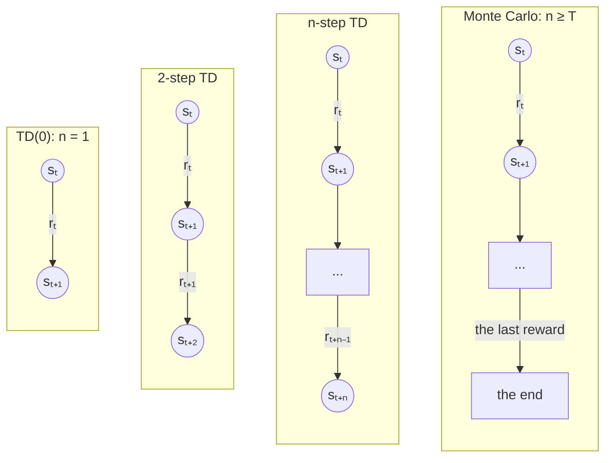
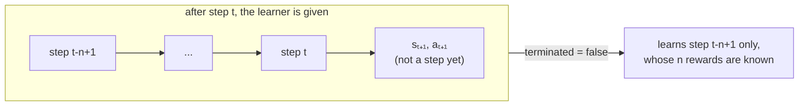

# TD(0), n-step TD and n-step SARSA

Sutton and Barto [1] introduce *temporal difference* learning in Chapter 6 with its simplest form, TD(0),
and in Chapter 7 they stretch it: instead of learning from one reward and the value of the next state,
an *n-step* method learns from the next `n` rewards, and the value of the state reached after them.
With `n = 1` this is TD(0) (or SARSA, for control), and when `n` reaches past the end of the episode
it is Monte Carlo. Basically, `n` slides between the two, and the best `n` is usually somewhere in the middle.



Each column is one update: the value of `sₜ` moves towards the rewards along the arrows, plus the value of the
state at the bottom (the end of an episode is worth 0).

## Prediction, and TD(0)

*Prediction* is learning how much each state is worth, `V(s)`, to an agent whose policy `π` is fixed: there is
nothing to decide, only to find out. Monte Carlo waits until the end of the episode, and moves `V(s_t)` towards
the return `G_t` that followed it. TD(0) does not wait: after one step, it moves `V(s_t)` towards the reward and
its own *estimate* of the next state (Section 6.1):

```math
V(s_t) \leftarrow V(s_t) + \alpha \left[ r_t + \gamma \, V(s_{t+1}) - V(s_t) \right]
```

where `r_t` is the reward received after leaving `s_t` (have a look at the [reward convention](q_learning.md#reward-convention)),
`α` is the learning rate, and `γ` the discount rate. The bracket is the *TD error*, how wrong the estimate was.

relearn keeps values for state/action pairs (the `policy`), so a prediction task has a single action per
state, like `games::random_walk`'s only action, `0`, and `V(s)` is simply the value of `(s, 0)`.

## n-step returns

The *n-step return* of step `t` adds up the next `n` rewards, discounted, and then the value of the state
reached after them (Section 7.1, equation 7.1):

```math
G_{t:t+n} = r_t + \gamma \, r_{t+1} + \dots + \gamma^{n-1} \, r_{t+n-1} + \gamma^n \, V(s_{t+n})
```

If the episode ends first, after `T` steps (so `t + n ≥ T`), there is no state after it, and the n-step return
is simply the return to the end, `r_t + ... + γ^{T-t-1} r_{T-1}`, exactly what Monte Carlo uses.
n-step TD moves each value towards its n-step return:

```math
V(s_t) \leftarrow V(s_t) + \alpha \left[ G_{t:t+n} - V(s_t) \right]
```

### The end of an episode

The n-step return of step `τ` is only known `n` steps later, once `r_{τ+n-1}` and `s_{τ+n}` have been seen.
So the book's algorithm updates step `τ = t - n + 1` at time `t`, and when the episode ends at `T`, it carries on
until it has updated the last steps too, each with the rewards up to the end:

| step τ | its n-step return |
|---|---|
| 0 ... T-n-1 | the next `n` rewards, then `γⁿ V(s_{τ+n})` |
| T-n ... T-1 | the rewards to the end of the episode, and nothing after them |

For example, with `n = 2`, `γ = 0.5` and `α = 0.5`, an episode of three steps, earning 1, 0 and 2, where
the third state is worth 4 (and the others 0) before the episode:

| τ | G_{τ:τ+2} | new value |
|---|---|---|
| 0 | 1 + 0.5 × 0 + 0.25 × V(s₂) = 1 + 0.25 × 4 = 2 | 0 + 0.5 (2 - 0) = 1 |
| 1 | 0 + 0.5 × 2 = 1 (the episode ends) | 0 + 0.5 (1 - 0) = 0.5 |
| 2 | 2 | 4 + 0.5 (2 - 4) = 3 |

The steps are learnt in order, `τ = 0, 1, ...`, each one using the values as they are at that point:
learnt backwards, step 0 would bootstrap from `V(s₂) = 3`, and learn 0.875 instead.

### Pseudocode

This is the book's *n-step TD for estimating V*, written with relearn's `r_t` (the book's `R_{t+1}`):

```
n-step TD prediction

parameters: learning rate α, discount rate γ, number of steps n ≥ 1, the policy π to evaluate

start with V(s) = 0 for every state s (any value will do, but the end of an episode is worth 0)

for each episode:
    s0 ← the start state
    T ← ∞
    for t = 0, 1, 2, ...:
        if t < T:
            take the action π chooses in s_t, and observe the reward r_t and the next state s_t+1
            if s_t+1 ends the episode:
                T ← t + 1
        τ ← t - n + 1                         (the step whose n rewards are now known)
        if τ ≥ 0:
            G ← Σ for i = τ ... min(τ + n, T) - 1 of γ^(i-τ) r_i
            if τ + n < T:
                G ← G + γⁿ V(s_τ+n)
            V(s_τ) ← V(s_τ) + α [ G - V(s_τ) ]
    until τ = T - 1
```

With `n = 1` the sum is the single reward `r_t`, and this is TD(0).

## n-step SARSA

For control, Section 7.2 does the same with the values of state/action pairs, as SARSA does:
the n-step return ends with the value of the pair the agent reached, and the action it chose there:

```math
G_{t:t+n} = r_t + \gamma \, r_{t+1} + \dots + \gamma^{n-1} \, r_{t+n-1} + \gamma^n \, Q(s_{t+n}, a_{t+n})
```

```math
Q(s_t,a_t) \leftarrow Q(s_t,a_t) + \alpha \left[ G_{t:t+n} - Q(s_t,a_t) \right]
```

with, as before, just the rewards to the end when `t + n ≥ T`. With `n = 1` this is SARSA.
Like SARSA it is *on-policy*: it learns the values of the policy the agent follows (e.g. ε-Greedy), exploration included.

```
n-step SARSA

parameters: learning rate α, discount rate γ, number of steps n ≥ 1, exploration rate ε

start with Q(s, a) = 0 for every state s and action a

for each episode:
    s0 ← the start state
    a0 ← an action for s0, chosen ε-greedy on Q
    T ← ∞
    for t = 0, 1, 2, ...:
        if t < T:
            take action a_t, and observe the reward r_t and the next state s_t+1
            if s_t+1 ends the episode:
                T ← t + 1
            else:
                a_t+1 ← an action for s_t+1, chosen ε-greedy on Q
        τ ← t - n + 1
        if τ ≥ 0:
            G ← Σ for i = τ ... min(τ + n, T) - 1 of γ^(i-τ) r_i
            if τ + n < T:
                G ← G + γⁿ Q(s_τ+n, a_τ+n)
            Q(s_τ, a_τ) ← Q(s_τ, a_τ) + α [ G - Q(s_τ, a_τ) ]
    until τ = T - 1
```

Why bother? One-step SARSA only learns about the move it has just made. In a maze where only the goal is
rewarded, the first episode teaches it a single move, the one that reached the goal, whereas n-step SARSA
learns the last `n` moves of the path at once (have a look at the [example below](#example-the-dyna-maze-figure-74)).

## In relearn

There is one learner, `n_step_sarsa`. Since a prediction task has one action per state, n-step TD's update is
exactly n-step SARSA's, so `n_step_td` is simply `n_step_sarsa` under the name of prediction
(with several actions per state, it learns `q_π`, the value of each pair under the policy that played).

```cpp
// TD(0): n = 1
relearn::n_step_td<state,action> td(0.1, 1.0, 1);       // α, γ and n
// n-step SARSA
relearn::n_step_sarsa<state,action> learner;
learner.alpha = 0.1;    // learning rate α
learner.gamma = 0.95;   // discount rate γ
learner.n = 4;          // the number of rewards each update looks ahead
learner(episode, policy);
```

or in short, `auto learner = relearn::n_step_sarsa<state,action>{0.1, 0.95, 4};`.
As with `sarsa`, `learning_rate` can give each pair its own rate (have a look at [schedules.md](schedules.md)).

### After the episode, or after every step

A whole episode is learnt exactly as the pseudocode above learns it, step `τ = 0, 1, ..., T-1` in that order,
so for prediction, learning after the episode (`games::play` then the learner) gives the very same values
as learning after every step. For control it is not quite the same, since the agent then plays a whole
episode with the values it had at its start.

To learn after every step, the learner needs the last `n` steps, not just the last one, so tell
`games::play_online` how many steps to give it, its last argument (1 by default, for the one-step learners):

```cpp
auto r = games::play_online(game, agent, learner, memory, 1000, learner.n);
```

Do bear in mind that nothing checks the window: it must be `learner.n`. With a smaller one, the learner learns no step
until the end of the game, and then only the last few; with a larger one, it learns the same steps again after every step.



When the game ends, `play_online` gives it the last `n` steps with `terminated = true`, and it learns them all.
Do bear in mind that `play_online` must be given the learner's `n`: with the default of 1, an n-step learner
never has `n` rewards in hand before the end, and only learns the last step of each episode.

### Episodes cut short

An episode cut short (by a step limit, `terminated = false`) ends with the state reached and the action chosen
next, which is not a step. A step is learnt only once its `n` rewards are all known, so the last `n - 1` steps of an
episode cut short are not learnt: this is exactly where the book's algorithm would be, if it were stopped there.
It is also the very rule that makes learning after every step work, above.

__note__: with `n = 1` this is what the one-step learners do already, the last link of an episode cut short only
serves as the next state of the step before it.

## Example: the random walk (Example 6.2, Figures 6.2 and 7.2)

`examples/random_walk_td.cpp` learns the random walk (Examples 6.2 and 7.1, see `examples/games/random_walk.hpp`):
the walk starts in the middle state and steps left or right at random until it leaves at either end.
Leaving on the right is worth +1, and with no discount (γ = 1) the true values of the 5-state walk are
1/6, 2/6, ... 5/6. Every value starts at 0.5, and TD(0) with α = 0.1 learns, after 0, 1, 10 and 100 walks:

```
    walks:      0      1     10    100    true
        A:  0.500  0.450  0.339  0.179   0.167
        B:  0.500  0.500  0.456  0.366   0.333
        C:  0.500  0.500  0.481  0.509   0.500
        D:  0.500  0.500  0.526  0.702   0.667
        E:  0.500  0.500  0.705  0.902   0.833
```

The first walk left on the left, so only `A` changed: TD(0) learns from one step, and the other steps of the
walk led to states worth the same, 0.5. The values are still noisy after 100 walks, since a constant α keeps
reacting to the latest walks. Averaged over 100 runs, the error (the root mean square over the states) is:

```
    walks:                  0      1     10     25     50     75    100
    TD(0)       α = 0.05:  0.236  0.229  0.175  0.109  0.051  0.035  0.033
    TD(0)       α = 0.10:  0.236  0.222  0.129  0.053  0.047  0.054  0.050
    TD(0)       α = 0.15:  0.236  0.216  0.096  0.053  0.066  0.070  0.064
    Monte Carlo α = 0.01:  0.236  0.233  0.213  0.183  0.145  0.114  0.095
    Monte Carlo α = 0.02:  0.236  0.231  0.198  0.153  0.111  0.086  0.081
    Monte Carlo α = 0.03:  0.236  0.230  0.189  0.137  0.107  0.092  0.093
    Monte Carlo α = 0.04:  0.236  0.229  0.183  0.130  0.115  0.104  0.107
```

which is the right-hand plot of Example 6.2: TD(0) learns faster than constant-α Monte Carlo (every-visit, `monte_carlo` with a constant
`learning_rate`) at every learning rate tried.

The second part is Figure 7.2: the 19-state walk, where leaving on the left is worth -1 and every value starts at 0.
For each `n` and `α`, the error is averaged over the first 10 walks, and over 100 runs:

```
        α   n =     1     2     4     8    16    32    64   128   256   512
     0.00       0.55  0.55  0.55  0.55  0.55  0.55  0.55  0.55  0.55  0.55
     0.10       0.51  0.47  0.41  0.34  0.31  0.35  0.44  0.52  0.55  0.55
     0.20       0.47  0.40  0.32  0.27  0.31  0.41  0.53  0.60  0.63  0.63
     0.30       0.44  0.35  0.26  0.27  0.36  0.47  0.59  0.66  0.68  0.68
     0.40       0.41  0.31  0.25  0.31  0.40  0.52  0.63  0.69  0.71  0.71
     0.50       0.39  0.28  0.27  0.34  0.45  0.56  0.66  0.72  0.73  0.73
     0.60       0.37  0.27  0.30  0.38  0.49  0.59  0.69  0.74  0.75  0.75
     0.80       0.34  0.31  0.38  0.46  0.56  0.65  0.73  0.77  0.78  0.78
     1.00       0.38  0.43  0.50  0.57  0.64  0.70  0.76  0.80  0.81  0.81
    lowest     0.341 0.269 0.253 0.266 0.300 0.351 0.408 0.463 0.493 0.498
    the best n is 4
```

(the program prints every α from 0 to 1 in steps of 0.05; the lowest errors are over all of them).
As in the book, `n = 4` is best, with an error of about 0.25: TD(0) (`n = 1`) learns too little from each walk,
and a large `n` is close to Monte Carlo, whose returns are noisy. The larger `n`, the smaller the α it needs.

## Example: the Dyna maze (Figure 7.4)

`examples/dyna_maze_n_step.cpp` learns the Dyna maze (Example 8.1, see `examples/games/dyna_maze.hpp`) with n-step SARSA.
Reaching `G` is worth 1 and every other move 0, so γ = 0.95 is what makes shorter paths better; the shortest path
takes 14 moves. The agent explores ε-Greedy (ε = 0.1), learns after every move (α = 0.1), and starts knowing nothing.

First, Figure 7.4. During the first episode every value is 0 until the goal is reached, so the agent wanders at
random (200 moves here). Once it gets there, one-step SARSA has learnt the move that reached the goal, and nothing
else, whereas 10-step SARSA has learnt the last 10 moves (an arrow is a move whose value went up):

```
    one-step     10-step
    .......#G    .......#G
    ..#....#^    ..#....#^
    S.#....#.    S.#..>v#^
    ..#......    ..#..^>v^
    .....#...    .....#.>^
    .........    .........
```

So in the next episodes, n-step SARSA has a far bigger target to find its way to. Averaged over 30 runs,
the moves per episode are:

```
    episode:      1      2      3      4      5     10     20     30     40     50    2 to 10
    n =  1:   737.6  725.0  423.2  364.4  274.1  146.1   48.5   18.8   18.4   17.8      307.2
    n =  2:   737.6  659.3  319.0  152.0  153.8   62.7   19.8   18.2   17.6   19.0      200.2
    n =  4:   737.6  551.2  243.8  228.0   94.9   40.8   20.1   19.5   20.6   19.4      156.9
    n =  8:   737.6  395.5  164.3  103.4  132.1   28.7   22.0   27.7   20.8   19.7      114.0
    n = 16:   737.6  256.7  194.6  310.1   96.4   58.2   31.0   21.7   19.2   24.0      133.2
```

The first episode is a random walk whatever `n` is. In episodes 2 to 10, 8-step SARSA needs well under half the moves
of one-step SARSA. Beyond that it levels off: 16-step SARSA took 133 moves against 114 for `n = 8` here
(and 103 against 115 with Clang's standard library), since it also gives value to more of the wandering moves
that came before the last few.
After 50 episodes, the greedy paths learnt take, in moves:

```
    n =  1: mean 15.3, from 14 to 18
    n =  2: mean 15.6, from 14 to 20
    n =  4: mean 16.9, from 14 to 20
    n =  8: mean 16.6, from 14 to 20
    n = 16: mean 17.8, from 16 to 22
```

Every run reaches the goal, most of them by a path close to the shortest (14 moves). They are not all the shortest:
SARSA learns the values of the path it keeps following, and with ε = 0.1 it rarely tries a better one long enough
to find out, and the larger `n`, the sooner it settles on the first good path it finds.

__note__: the random walk's numbers are the same with GCC's and Clang's standard libraries, but the maze's are not:
`games::epsilon_greedy` draws its random moves with `std::uniform_int_distribution`, whose numbers differ between the two.

## Tests

`tests/n_step_test.cpp` checks:

- n-step returns worked out by hand: at the end of an episode (the table above), a later step bootstrapping from
  a value learnt earlier in the same episode, and an episode cut short, whose last `n - 1` steps are not learnt
- that `n = 1` is `sarsa` to the last bit, that `n ≥ T` is constant-α Monte Carlo, and that learning online with
  `games::play_online(..., n)` gives exactly the same values as learning after each episode, cut short or not
- Example 6.2: TD(0) learns the true values 1/6 ... 5/6 (within 0.06; over 10 seeds the largest error was 0.006 to 0.039)
- Example 6.2 (right): TD(0)'s error after 100 walks (0.033 to 0.041 with α = 0.05, over 10 seeds) is well below the best of
  constant-α Monte Carlo (0.076 to 0.089, with α = 0.02)
- Figure 7.2: over 10 seeds, `n = 4` was always the best, with an error of 0.255 to 0.270, against
  0.341 to 0.348 for `n = 1`, and 0.352 to 0.370 for `n = 32`
- control, against an exact answer: in a slippery corridor, n-step SARSA with ε = 0.1 (n = 1, 2 and 4) learns the
  exact values of the ε-greedy policy, worked out by `tests/solvers.hpp` (worst error at most 0.152 over 10 seeds)
- the Dyna maze: after the first episode, exactly the pairs of the last `n` moves have a value (Figure 7.4), and in
  episodes 2 to 10, 4-step and 8-step SARSA need at most 0.61 of the moves of one-step SARSA (over 10 seeds)

Each threshold was set from 10 seeds, with GCC's standard library and with Clang's (libc++).

## References

1. Sutton, R.S. and Barto, A.G., 2018. [Reinforcement Learning: An Introduction](http://incompleteideas.net/book/the-book-2nd.html), 2nd edition. Cambridge, MA: MIT Press.
   Section 6.1 (TD(0) prediction), Section 6.2 and Example 6.2 (the random walk, and its two plots), Section 7.1
   (n-step TD prediction, Example 7.1 and Figure 7.2), Section 7.2 (n-step SARSA, Figure 7.4), Example 8.1 (the Dyna maze).
