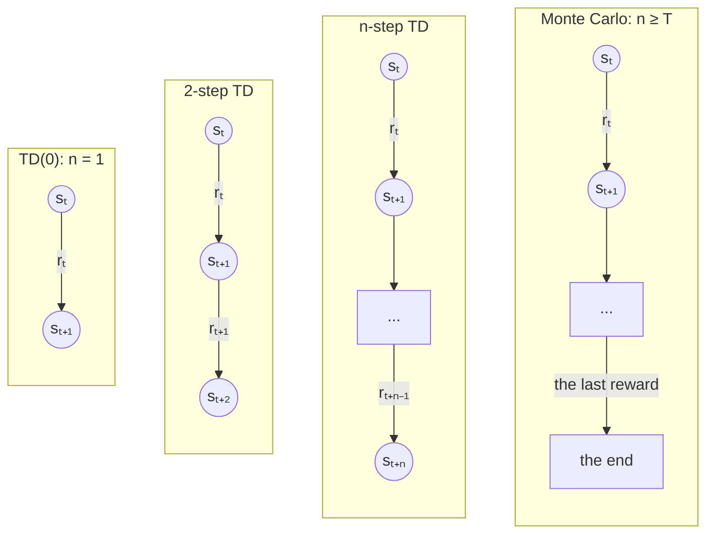
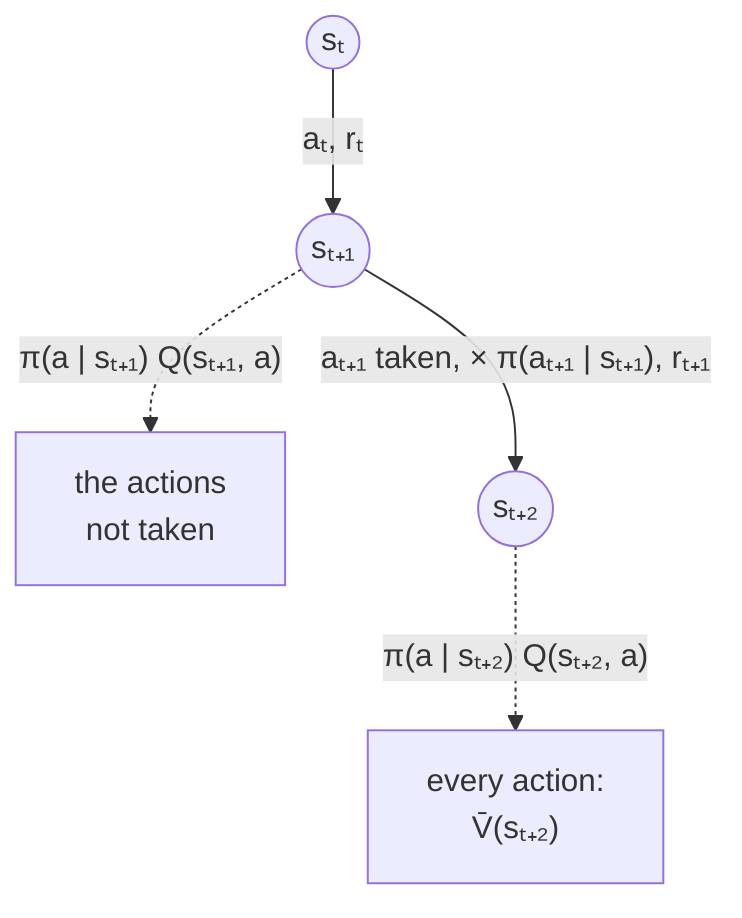
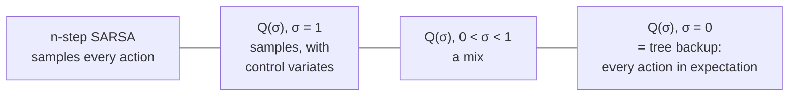
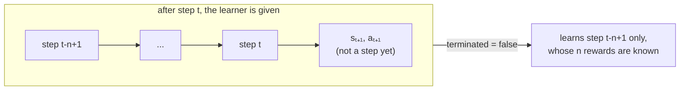

# TD(0) and the n-step methods

Sutton and Barto [1] introduce *temporal difference* learning in Chapter 6 with its simplest form, TD(0),
and in Chapter 7 they stretch it: instead of learning from one reward and the value of the next state,
an *n-step* method learns from the next `n` rewards, and the value of the state reached after them.
With `n = 1` this is TD(0) (or SARSA, for control), and when `n` reaches past the end of the episode
it is Monte Carlo. Basically, `n` slides between the two, and the best `n` is usually somewhere in the middle.

This page has all of Chapter 7: n-step TD and n-step SARSA, n-step Expected SARSA, off-policy n-step SARSA
(importance sampling), the tree backup algorithm, and Q(σ), which unifies them all.



Each column is one update: the value of `sₜ` moves towards the rewards along the arrows, plus the value of the
state at the bottom (the end of an episode is worth 0).

## Prediction, and TD(0)

*Prediction* is learning how much each state is worth, `V(s)`, to an agent whose policy `π` is fixed: there is
nothing to decide, only to find out. Monte Carlo waits until the end of the episode, and moves `V(s_t)` towards
the return `G_t` that followed it. TD(0) does not wait: after one step, it moves `V(s_t)` towards the reward and
its own *estimate* of the next state (Section 6.1):

```math
V(s_t) \leftarrow V(s_t) + \alpha \left[ r_t + \gamma \, V(s_{t+1}) - V(s_t) \right]
```

where `r_t` is the reward received after leaving `s_t` (have a look at the [reward convention](q_learning.md#reward-convention)),
`α` is the learning rate, and `γ` the discount rate. The bracket is the *TD error*, how wrong the estimate was.

relearn keeps values for state/action pairs (the `policy`), so a prediction task has a single action per
state, like `games::random_walk`'s only action, `0`, and `V(s)` is simply the value of `(s, 0)`.

## n-step returns

The *n-step return* of step `t` adds up the next `n` rewards, discounted, and then the value of the state
reached after them (Section 7.1, equation 7.1):

```math
G_{t:t+n} = r_t + \gamma \, r_{t+1} + \dots + \gamma^{n-1} \, r_{t+n-1} + \gamma^n \, V(s_{t+n})
```

If the episode ends first, after `T` steps (so `t + n ≥ T`), there is no state after it, and the n-step return
is simply the return to the end, `r_t + ... + γ^{T-t-1} r_{T-1}`, exactly what Monte Carlo uses.
n-step TD moves each value towards its n-step return:

```math
V(s_t) \leftarrow V(s_t) + \alpha \left[ G_{t:t+n} - V(s_t) \right]
```

### The end of an episode

The n-step return of step `τ` is only known `n` steps later, once `r_{τ+n-1}` and `s_{τ+n}` have been seen.
So the book's algorithm updates step `τ = t - n + 1` at time `t`, and when the episode ends at `T`, it carries on
until it has updated the last steps too, each with the rewards up to the end:

| step τ | its n-step return |
|---|---|
| 0 ... T-n-1 | the next `n` rewards, then `γⁿ V(s_{τ+n})` |
| T-n ... T-1 | the rewards to the end of the episode, and nothing after them |

For example, with `n = 2`, `γ = 0.5` and `α = 0.5`, an episode of three steps, earning 1, 0 and 2, where
the third state is worth 4 (and the others 0) before the episode:

| τ | G_{τ:τ+2} | new value |
|---|---|---|
| 0 | 1 + 0.5 × 0 + 0.25 × V(s₂) = 1 + 0.25 × 4 = 2 | 0 + 0.5 (2 - 0) = 1 |
| 1 | 0 + 0.5 × 2 = 1 (the episode ends) | 0 + 0.5 (1 - 0) = 0.5 |
| 2 | 2 | 4 + 0.5 (2 - 4) = 3 |

The steps are learnt in order, `τ = 0, 1, ...`, each one using the values as they are at that point:
learnt backwards, step 0 would bootstrap from `V(s₂) = 3`, and learn 0.875 instead.

### Pseudocode

This is the book's *n-step TD for estimating V*, written with relearn's `r_t` (the book's `R_{t+1}`):

```
n-step TD prediction

parameters: learning rate α, discount rate γ, number of steps n ≥ 1, the policy π to evaluate

start with V(s) = 0 for every state s (any value will do, but the end of an episode is worth 0)

for each episode:
    s0 ← the start state
    T ← ∞
    for t = 0, 1, 2, ...:
        if t < T:
            take the action π chooses in s_t, and observe the reward r_t and the next state s_t+1
            if s_t+1 ends the episode:
                T ← t + 1
        τ ← t - n + 1                         (the step whose n rewards are now known)
        if τ ≥ 0:
            G ← Σ for i = τ ... min(τ + n, T) - 1 of γ^(i-τ) r_i
            if τ + n < T:
                G ← G + γⁿ V(s_τ+n)
            V(s_τ) ← V(s_τ) + α [ G - V(s_τ) ]
    until τ = T - 1
```

With `n = 1` the sum is the single reward `r_t`, and this is TD(0).

## n-step SARSA

For control, Section 7.2 does the same with the values of state/action pairs, as SARSA does:
the n-step return ends with the value of the pair the agent reached, and the action it chose there:

```math
G_{t:t+n} = r_t + \gamma \, r_{t+1} + \dots + \gamma^{n-1} \, r_{t+n-1} + \gamma^n \, Q(s_{t+n}, a_{t+n})
```

```math
Q(s_t,a_t) \leftarrow Q(s_t,a_t) + \alpha \left[ G_{t:t+n} - Q(s_t,a_t) \right]
```

with, as before, just the rewards to the end when `t + n ≥ T`. With `n = 1` this is SARSA.
Like SARSA it is *on-policy*: it learns the values of the policy the agent follows (e.g. ε-Greedy), exploration included.

```
n-step SARSA

parameters: learning rate α, discount rate γ, number of steps n ≥ 1, exploration rate ε

start with Q(s, a) = 0 for every state s and action a

for each episode:
    s0 ← the start state
    a0 ← an action for s0, chosen ε-greedy on Q
    T ← ∞
    for t = 0, 1, 2, ...:
        if t < T:
            take action a_t, and observe the reward r_t and the next state s_t+1
            if s_t+1 ends the episode:
                T ← t + 1
            else:
                a_t+1 ← an action for s_t+1, chosen ε-greedy on Q
        τ ← t - n + 1
        if τ ≥ 0:
            G ← Σ for i = τ ... min(τ + n, T) - 1 of γ^(i-τ) r_i
            if τ + n < T:
                G ← G + γⁿ Q(s_τ+n, a_τ+n)
            Q(s_τ, a_τ) ← Q(s_τ, a_τ) + α [ G - Q(s_τ, a_τ) ]
    until τ = T - 1
```

Why bother? One-step SARSA only learns about the move it has just made. In a maze where only the goal is
rewarded, the first episode teaches it a single move, the one that reached the goal, whereas n-step SARSA
learns the last `n` moves of the path at once (have a look at the [example below](#example-the-dyna-maze-figure-74)).

## n-step Expected SARSA

Expected SARSA (Section 6.6, have a look at [sarsa.md](sarsa.md)) replaces the action taken next by the value the next
state is *expected* to have, under the policy `π`. Its n-step version does the same at the end of the return
(Section 7.2): the `n` rewards, and then the expected value of the state reached, instead of the value of the pair:

```math
G_{t:t+n} = r_t + \gamma \, r_{t+1} + \dots + \gamma^{n-1} \, r_{t+n-1} + \gamma^n \, \bar{V}(s_{t+n}),
\qquad \bar{V}(s) = \sum_a \pi(a \mid s) \, Q(s, a)
```

With `n = 1` it is Expected SARSA, and like it, it removes the randomness of the last action chosen.

## Off-policy: importance sampling

All of the above learn the values of the policy the agent *plays*. Off-policy learning (Section 7.3) learns the
values of another policy, the *target* policy `π` (typically greedy), from episodes played by a *behaviour* policy
`b` (typically ε-Greedy, which explores). The rewards along the episode are the ones `b`'s actions earned, so each
update is weighted by how much more (or less) likely `π` was to take those actions than `b` was, the *importance
sampling ratio* (equations 7.10 and 7.11):

```math
\rho_{t+1:t+n} = \prod_{k=t+1}^{\min(t+n,\,T-1)} \frac{\pi(a_k \mid s_k)}{b(a_k \mid s_k)}
\qquad
Q(s_t,a_t) \leftarrow Q(s_t,a_t) + \alpha \, \rho_{t+1:t+n} \left[ G_{t:t+n} - Q(s_t,a_t) \right]
```

The first action, `aₜ`, is not in the ratio: `Q(sₜ, aₜ)` is the value of taking it, whoever chose it. Off-policy
n-step Expected SARSA uses one factor less, `ρ_{t+1:t+n-1}`, since the action taken in `s_{t+n}` doesn't matter to its
return. With a greedy `π`, the ratio is 0 as soon as the agent explored, and the step teaches nothing; and when `b`
rarely takes the actions `π` prefers, the ratio is large, and the updates vary a lot. That is why it usually needs a
smaller learning rate (in the tests below, `α ρ` has to stay below 1).

## Tree backup

The n-step tree backup algorithm (Section 7.5, from Precup, Sutton and Singh [2]) learns off-policy *without* importance sampling. At every step of
the return, it takes the values of the actions the agent did *not* take, weighted by their probability under `π`,
and carries on along the action it did take, weighted by its probability too (equation 7.16):

```math
G_{k:t+n} = r_k + \gamma \sum_{a \neq a_{k+1}} \pi(a \mid s_{k+1}) \, Q(s_{k+1}, a) + \gamma \, \pi(a_{k+1} \mid s_{k+1}) \, G_{k+1:t+n}
```

and after the `n` rewards, it ends with the expected value, `G_{t+n-1:t+n} = r_{t+n-1} + γ V̄(s_{t+n})`. Basically each
update is a *tree*: the actions not taken are its leaves, and the actions taken its trunk, which goes on only for as
long as `π` would have taken them.



It never needs `b`: an action `π` would not take has `π(aₖ₊₁ | sₖ₊₁) = 0`, which simply cuts the return there.
With a greedy `π` it is Q-Learning's target, followed for as long as the agent kept to the greedy actions; with `n = 1`
it is Expected SARSA.

## Q(σ): one algorithm for all of them

n-step SARSA *samples* every action of its return (it uses the ones taken), tree backup takes the *expectation* over
them. Q(σ) (Section 7.6, from De Asis et al. [3]) chooses, at every step, how much to do of each: `σ = 1` samples, `σ = 0` takes the
expectation, and anything in between mixes them (equation 7.17):

```math
G_{k:t+n} = r_k + \gamma \, \bar{V}(s_{k+1}) + \gamma \left( \sigma_{k+1} \, \rho_{k+1} + (1 - \sigma_{k+1}) \, \pi(a_{k+1} \mid s_{k+1}) \right) \left[ G_{k+1:t+n} - Q(s_{k+1}, a_{k+1}) \right]
```

ending with `G_{t+n:t+n} = Q(s_{t+n}, a_{t+n})` (or the last reward, if the episode ends first), and with
`ρₖ = π(aₖ | sₖ) / b(aₖ | sₖ)` (1 on-policy). Then the usual `Q(sₜ,aₜ) ← Q(sₜ,aₜ) + α [G - Q(sₜ,aₜ)]`.

- `σ = 0` everywhere is exactly tree backup
- `σ = 1` everywhere is n-step SARSA with *per-decision control variates* (Section 7.4, equation 7.14): it samples every
  action taken, as n-step SARSA does, and adds `V̄(s) - Q(s, a)` at each one, which is 0 on average. So on-policy it
  learns the same values as n-step SARSA; and off-policy, each importance sampling factor weighs its own step only
- with `n = 1`, whatever `σ` is, it is Expected SARSA: the last action of a return is always taken in expectation



## In relearn

For n-step TD and n-step SARSA there is one learner, `n_step_sarsa`. Since a prediction task has one action per state, n-step TD's update is
exactly n-step SARSA's, so `n_step_td` is simply `n_step_sarsa` under the name of prediction
(with several actions per state, it learns `q_π`, the value of each pair under the policy that played).

```cpp
// TD(0): n = 1
relearn::n_step_td<state,action> td(0.1, 1.0, 1);       // α, γ and n
// n-step SARSA
relearn::n_step_sarsa<state,action> learner;
learner.alpha = 0.1;    // learning rate α
learner.gamma = 0.95;   // discount rate γ
learner.n = 4;          // the number of rewards each update looks ahead
learner(episode, policy);
```

or in short, `auto learner = relearn::n_step_sarsa<state,action>{0.1, 0.95, 4};`.
As with `sarsa`, `learning_rate` can give each pair its own rate (have a look at [schedules.md](schedules.md)).

### The rest of the family

The other n-step methods are learners of their own, all called the same way, and all learnt online the same way
(with `games::play_online(..., learner.n)`):

| learner | what it is | needs |
|---|---|---|
| `n_step_expected_sarsa` | n-step Expected SARSA; off-policy if `behaviour` is set | `probabilities` (π) |
| `off_policy_n_step_sarsa` | n-step SARSA with importance sampling | `probabilities` (π) and `behaviour` (b) |
| `n_step_tree_backup` | tree backup: off-policy, no importance sampling | `probabilities` (π) |
| `n_step_q_sigma` | Q(σ), with `sigma` (0.5 by default), or `sigma_of(s, a)` for each step; off-policy if `behaviour` is set | `probabilities` (π) |

`probabilities(s)` returns each action `π` may take in `s`, with its probability, exactly as for `expected_sarsa`;
if it is not set, `π` is the greedy policy on the values learnt (the actions stored for `s`, those of highest value
sharing the probability). `behaviour(s, a)` returns `b(a | s)`, the probability that the policy which played took `a` in `s`,
as for `off_policy_monte_carlo`. For instance, to learn the greedy policy from an ε-Greedy agent with tree backup:

```cpp
relearn::n_step_tree_backup<state,action> learner(0.2, 1.0, 4);      // α, γ and n
learner.probabilities = [&memory](const state & s) {
    // π: greedy on the values learnt (ε = 0), over the legal moves
    return games::epsilon_greedy_probabilities<game_type>(memory, s.trait(), game.actions(s.trait()), 0.0);
};
auto r = games::play_online(game, agent, learner, memory, 1000, learner.n);
```

`π` is the policy being learnt, so it is worked out when each step is learnt, with the values of that moment, as in
the book's algorithms. `b` is not: an importance sampling ratio needs the probability each action was *chosen* with,
and if `b` depends on the values (ε-Greedy on them, as above), reading it again after an update gives another one.
So the learners record `b(a_t | s_t)` for every step before they learn any of it: after an episode played to the end
(`games::play`), that is the policy that played it. Learning online, each step's `b` is recorded when the learner
first sees it, which is just after its action was chosen, and kept for the next `n` calls. This is what the book's
algorithms do too, storing `ρ` when each action is chosen.

__note__: `games::play_online` does not tell the learner that a new episode has started after one cut short, so a new
episode starting with the very steps the last window ended with would keep their recorded `b`. This is rare, and
harmless with a `b` that does not change.

### After the episode, or after every step

A whole episode is learnt exactly as the pseudocode above learns it, step `τ = 0, 1, ..., T-1` in that order,
so for prediction, learning after the episode (`games::play` then the learner) gives the very same values
as learning after every step. For control it is not quite the same, since the agent then plays a whole
episode with the values it had at its start.

To learn after every step, the learner needs the last `n` steps, not just the last one, so tell
`games::play_online` how many steps to give it, its last argument (1 by default, for the one-step learners):

```cpp
auto r = games::play_online(game, agent, learner, memory, 1000, learner.n);
```

Do bear in mind that nothing checks the window: it must be `learner.n`. With a smaller one, the learner learns no step
until the end of the game, and then only the last few; with a larger one, it learns the same steps again after every step.



When the game ends, `play_online` gives it the last `n` steps with `terminated = true`, and it learns them all.
Do bear in mind that `play_online` must be given the learner's `n`: with the default of 1, an n-step learner
never has `n` rewards in hand before the end, and only learns the last step of each episode.

### Episodes cut short

An episode cut short (by a step limit, `terminated = false`) ends with the state reached and the action chosen
next, which is not a step. A step is learnt only once its `n` rewards are all known, so the last `n - 1` steps of an
episode cut short are not learnt: this is exactly where the book's algorithm would be, if it were stopped there.
It is also the very rule that makes learning after every step work, above.

__note__: with `n = 1` this is what the one-step learners do already, the last link of an episode cut short only
serves as the next state of the step before it.

## Example: the random walk (Example 6.2, Figures 6.2 and 7.2)

`examples/random_walk_td.cpp` learns the random walk (Examples 6.2 and 7.1, see `examples/games/random_walk.hpp`):
the walk starts in the middle state and steps left or right at random until it leaves at either end.
Leaving on the right is worth +1, and with no discount (γ = 1) the true values of the 5-state walk are
1/6, 2/6, ... 5/6. Every value starts at 0.5, and TD(0) with α = 0.1 learns, after 0, 1, 10 and 100 walks:

```
    walks:      0      1     10    100    true
        A:  0.500  0.450  0.339  0.179   0.167
        B:  0.500  0.500  0.456  0.366   0.333
        C:  0.500  0.500  0.481  0.509   0.500
        D:  0.500  0.500  0.526  0.702   0.667
        E:  0.500  0.500  0.705  0.902   0.833
```

The first walk left on the left, so only `A` changed: TD(0) learns from one step, and the other steps of the
walk led to states worth the same, 0.5. The values are still noisy after 100 walks, since a constant α keeps
reacting to the latest walks. Averaged over 100 runs, the error (the root mean square over the states) is:

```
    walks:                  0      1     10     25     50     75    100
    TD(0)       α = 0.05:  0.236  0.229  0.175  0.109  0.051  0.035  0.033
    TD(0)       α = 0.10:  0.236  0.222  0.129  0.053  0.047  0.054  0.050
    TD(0)       α = 0.15:  0.236  0.216  0.096  0.053  0.066  0.070  0.064
    Monte Carlo α = 0.01:  0.236  0.233  0.213  0.183  0.145  0.114  0.095
    Monte Carlo α = 0.02:  0.236  0.231  0.198  0.153  0.111  0.086  0.081
    Monte Carlo α = 0.03:  0.236  0.230  0.189  0.137  0.107  0.092  0.093
    Monte Carlo α = 0.04:  0.236  0.229  0.183  0.130  0.115  0.104  0.107
```

which is the right-hand plot of Example 6.2: TD(0) learns faster than constant-α Monte Carlo (every-visit, `monte_carlo` with a constant
`learning_rate`) at every learning rate tried.

The second part is Figure 7.2: the 19-state walk, where leaving on the left is worth -1 and every value starts at 0.
For each `n` and `α`, the error is averaged over the first 10 walks, and over 100 runs:

```
        α   n =     1     2     4     8    16    32    64   128   256   512
     0.00       0.55  0.55  0.55  0.55  0.55  0.55  0.55  0.55  0.55  0.55
     0.10       0.51  0.47  0.41  0.34  0.31  0.35  0.44  0.52  0.55  0.55
     0.20       0.47  0.40  0.32  0.27  0.31  0.41  0.53  0.60  0.63  0.63
     0.30       0.44  0.35  0.26  0.27  0.36  0.47  0.59  0.66  0.68  0.68
     0.40       0.41  0.31  0.25  0.31  0.40  0.52  0.63  0.69  0.71  0.71
     0.50       0.39  0.28  0.27  0.34  0.45  0.56  0.66  0.72  0.73  0.73
     0.60       0.37  0.27  0.30  0.38  0.49  0.59  0.69  0.74  0.75  0.75
     0.80       0.34  0.31  0.38  0.46  0.56  0.65  0.73  0.77  0.78  0.78
     1.00       0.38  0.43  0.50  0.57  0.64  0.70  0.76  0.80  0.81  0.81
    lowest     0.341 0.269 0.253 0.266 0.300 0.351 0.408 0.463 0.493 0.498
    the best n is 4
```

(the program prints every α from 0 to 1 in steps of 0.05; the lowest errors are over all of them).
As in the book, `n = 4` is best, with an error of about 0.25: TD(0) (`n = 1`) learns too little from each walk,
and a large `n` is close to Monte Carlo, whose returns are noisy. The larger `n`, the smaller the α it needs.

## Example: the Dyna maze (Figure 7.4)

`examples/dyna_maze_n_step.cpp` learns the Dyna maze (Example 8.1, see `examples/games/dyna_maze.hpp`) with n-step SARSA.
Reaching `G` is worth 1 and every other move 0, so γ = 0.95 is what makes shorter paths better; the shortest path
takes 14 moves. The agent explores ε-Greedy (ε = 0.1), learns after every move (α = 0.1), and starts knowing nothing.

First, Figure 7.4. During the first episode every value is 0 until the goal is reached, so the agent wanders at
random (200 moves here). Once it gets there, one-step SARSA has learnt the move that reached the goal, and nothing
else, whereas 10-step SARSA has learnt the last 10 moves (an arrow is a move whose value went up):

```
    one-step     10-step
    .......#G    .......#G
    ..#....#^    ..#....#^
    S.#....#.    S.#..>v#^
    ..#......    ..#..^>v^
    .....#...    .....#.>^
    .........    .........
```

So in the next episodes, n-step SARSA has a far bigger target to find its way to. Averaged over 30 runs,
the moves per episode are:

```
    episode:      1      2      3      4      5     10     20     30     40     50    2 to 10
    n =  1:   737.6  725.0  423.2  364.4  274.1  146.1   48.5   18.8   18.4   17.8      307.2
    n =  2:   737.6  659.3  319.0  152.0  153.8   62.7   19.8   18.2   17.6   19.0      200.2
    n =  4:   737.6  551.2  243.8  228.0   94.9   40.8   20.1   19.5   20.6   19.4      156.9
    n =  8:   737.6  395.5  164.3  103.4  132.1   28.7   22.0   27.7   20.8   19.7      114.0
    n = 16:   737.6  256.7  194.6  310.1   96.4   58.2   31.0   21.7   19.2   24.0      133.2
```

The first episode is a random walk whatever `n` is. In episodes 2 to 10, 8-step SARSA needs well under half the moves
of one-step SARSA. Beyond that it levels off: 16-step SARSA took 133 moves against 114 for `n = 8` here
(and 103 against 115 with Clang's standard library), since it also gives value to more of the wandering moves
that came before the last few.
After 50 episodes, the greedy paths learnt take, in moves:

```
    n =  1: mean 15.3, from 14 to 18
    n =  2: mean 15.6, from 14 to 20
    n =  4: mean 16.9, from 14 to 20
    n =  8: mean 16.6, from 14 to 20
    n = 16: mean 17.8, from 16 to 22
```

Every run reaches the goal, most of them by a path close to the shortest (14 moves). They are not all the shortest:
SARSA learns the values of the path it keeps following, and with ε = 0.1 it rarely tries a better one long enough
to find out, and the larger `n`, the sooner it settles on the first good path it finds.

__note__: the random walk's numbers are the same with GCC's and Clang's standard libraries, but the maze's are not:
`games::epsilon_greedy` draws its random moves with `std::uniform_int_distribution`, whose numbers differ between the two.

## Example: Cliff Walking, 4 steps at a time

`examples/cliff_walking_n_step.cpp` plays Cliff Walking (Example 6.6, have a look at [sarsa.md](sarsa.md)) with every
learner of this page, `n = 4`, α = 0.2, γ = 1, the agent ε-greedy with ε = 0.1, in 20 runs of 1000 episodes:

```
    learner                         exploring   reached   the edge    error
  on-policy (π is the ε-greedy policy played):
    n-step SARSA                        -26.6      20/20        0/20
    n-step Expected SARSA               -25.9      19/20        0/20
    n-step Q(σ), σ = 0.5                -22.7      20/20        0/20
    n-step tree backup                  -21.6      20/20        0/20
  off-policy (π is greedy, b the ε-greedy policy played):
    tree backup, n = 1 (Q-Learning)     -49.6      20/20       20/20      0.0
    off-policy n-step SARSA             -26.2      20/20        0/20      8.7
    n-step Expected SARSA               -25.4      20/20        0/20      9.6
    n-step Q(σ), σ = 0.5                -32.8      20/20        1/20      3.7
    n-step tree backup                  -33.6      20/20        3/20      1.9
```

*exploring* is the average return whilst exploring (episodes 101 to 1000), *reached* the runs whose greedy policy
reaches the goal, *the edge* those whose greedy policy takes the shortest path, right along the cliff (13 moves),
and *error* the average `|Q - q*|` of the 13 moves of that path, for the learners of `q*`.

On-policy, all of them learn a safe path away from the edge, as one-step SARSA does, and the more a learner uses
expectations instead of the actions taken, the more it earns whilst exploring: Q(σ) and tree backup earn the most.

Off-policy, the less importance sampling, the closer to `q*`: tree backup (none at all) is nearest, then Q(σ) (on half
of each step), then n-step Expected SARSA and off-policy n-step SARSA, whose updates are cut each time the agent
explored. None of them is as quick here as one-step Q-Learning, which has learnt `q*` along the edge in every run:
every move costs -1, so looking 4 rewards ahead brings little, whereas cutting the return at every exploring move
costs a lot. Given enough episodes they all get there (tree backup has `q*` along the edge exactly after 20000
episodes with α = 0.1), but in the same 1000 episodes, the importance sampling learners haven't even started to
prefer the edge. n-step methods shine where the rewards are far apart, as in the [Dyna maze](#example-the-dyna-maze-figure-74).

__note__: the numbers are GCC's; with Clang's standard library (libc++), whose random numbers differ, the errors are
0.0, 9.6, 8.2, 3.9 and 1.4, in the same order. n-step Expected SARSA and off-policy n-step SARSA swap places, so the
program only checks that the errors of Q-Learning, tree backup, Q(σ) and off-policy n-step SARSA come in that order,
and that on-policy, Q(σ) and tree backup earn more whilst exploring than n-step SARSA.

## Tests

`tests/n_step_test.cpp` checks:

- n-step returns worked out by hand: at the end of an episode (the table above), a later step bootstrapping from
  a value learnt earlier in the same episode, and an episode cut short, whose last `n - 1` steps are not learnt
- that `n = 1` is `sarsa` to the last bit, that `n ≥ T` is constant-α Monte Carlo, and that learning online with
  `games::play_online(..., n)` gives exactly the same values as learning after each episode, cut short or not
- Example 6.2: TD(0) learns the true values 1/6 ... 5/6 (within 0.06; over 10 seeds the largest error was 0.006 to 0.039)
- Example 6.2 (right): TD(0)'s error after 100 walks (0.033 to 0.041 with α = 0.05, over 10 seeds) is well below the best of
  constant-α Monte Carlo (0.076 to 0.089, with α = 0.02)
- Figure 7.2: over 10 seeds, `n = 4` was always the best, with an error of 0.255 to 0.270, against
  0.341 to 0.348 for `n = 1`, and 0.352 to 0.370 for `n = 32`
- control, against an exact answer: in a slippery corridor, n-step SARSA with ε = 0.1 (n = 1, 2 and 4) learns the
  exact values of the ε-greedy policy, worked out by `tests/solvers.hpp` (worst error at most 0.152 over 10 seeds)
- the Dyna maze: after the first episode, exactly the pairs of the last `n` moves have a value (Figure 7.4), and in
  episodes 2 to 10, 4-step and 8-step SARSA need at most 0.61 of the moves of one-step SARSA (over 10 seeds)
- n-step Expected SARSA, off-policy n-step SARSA, tree backup and Q(σ): returns, ratios and updates worked out by hand,
  on one small episode (on-policy and off-policy, with σ = 0.5, σ = 1, and σ chosen per step); and an episode cut short
- that a step with a ratio of 0 is not learnt, nor counted as an update; that a greedy `π` cuts the tree backup's return
  at the first other action, and follows it whilst the actions were greedy
- that `b` is the probability each action was chosen with: with a `b` that changes as the values are learnt, a state
  visited twice keeps the `b` it had when it was played, after an episode and online (a `b` counting its calls gives
  each step the number of the call it was first seen in); and off-policy n-step SARSA learnt online is the book's
  algorithm, storing `b` when each action is chosen, to 1e-12 (ε-Greedy `b`, greedy `π`, `n` = 2 and 3)
- cross-checks on random corridor episodes: off-policy n-step SARSA with `b = π` is `n_step_sarsa` to the last bit;
  Q(σ) with σ = 0 is tree backup, and with `n = 1` (any σ, on or off-policy) it is `expected_sarsa`, as is n-step
  Expected SARSA with `n = 1` (to 1e-12); and learning online is the same as learning after each episode, to the last bit
- control, against exact answers, in the slippery corridor: on-policy, ε-Greedy (ε = 0.1), n-step Expected SARSA, tree
  backup and Q(σ) (σ = 0.5 and 1) learn the values of the ε-greedy policy (worst error at most 0.157 over 10 seeds);
  off-policy, from an agent that moves right with 0.7 whatever it has learnt, all four learn `q*`, the values of the
  greedy policy (worst error at most 0.102)
- every one of 18 mutations of the new learners (a wrong factor, a ratio of one factor too many or too few, σ and 1 - σ
  swapped, the wrong end of the return, `b` read again after the updates, and so on) makes at least one of these tests fail

Each threshold was set from 10 seeds, with GCC's standard library and with Clang's (libc++).

## References

1. Sutton, R.S. and Barto, A.G., 2018. [Reinforcement Learning: An Introduction](http://incompleteideas.net/book/the-book-2nd.html), 2nd edition. Cambridge, MA: MIT Press.
   Section 6.1 (TD(0) prediction), Section 6.2 and Example 6.2 (the random walk, and its two plots), Section 7.1
   (n-step TD prediction, Example 7.1 and Figure 7.2), Section 7.2 (n-step SARSA and n-step Expected SARSA, Figure 7.4),
   Section 7.3 (off-policy learning by importance sampling), Section 7.4 (per-decision methods with control variates),
   Section 7.5 (the tree backup algorithm), Section 7.6 (Q(σ)), Example 6.6 (Cliff Walking), Example 8.1 (the Dyna maze).
2. Precup, D., Sutton, R.S. and Singh, S., 2000. Eligibility traces for off-policy policy evaluation. *ICML*, where the
   tree backup algorithm comes from.
3. De Asis, K., Hernandez-Garcia, J.F., Holland, G.Z. and Sutton, R.S., 2018. Multi-step reinforcement learning: a unifying
   algorithm. *AAAI*, where Q(σ) comes from.
