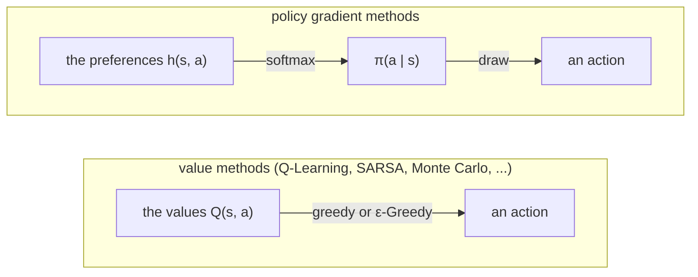
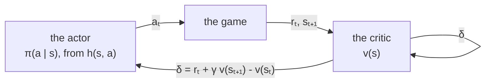

# Policy gradient methods: REINFORCE and Actor-Critic

All the other learners in relearn learn *values*, how good each action is, and the agent then picks
the best one (greedy, or ε-Greedy). Policy gradient methods, described by Sutton and Barto [1] in Chapter 13,
learn the **policy itself**: how likely the agent is to take each action, in each state.
They move those probabilities a little after every episode (or every step), uphill, in the direction
which makes the agent earn more. That direction is the *gradient* of what it earns, hence the name.

Why bother, when the values work so well? Basically, because a policy can do things that "be greedy on
the values" can't:

- it can be **stochastic**, and stay that way: sometimes the best thing to do is to flip a (biased) coin,
  for example when the agent cannot tell two situations apart, as in the short corridor below
- it changes smoothly: a tiny change in the values can flip the greedy action, whereas a tiny change in the
  policy only changes the probabilities a tiny bit
- it explores by itself, since every action keeps some chance of being taken



## The softmax policy

The policy needs parameters to learn, which Sutton and Barto call `θ`. In relearn they are a **preference**
`h(s, a)` for every state and legal action (Section 13.1), stored in an ordinary `relearn::policy`, and the
policy is their *softmax*:

```math
\pi(a \mid s) = \frac{e^{h(s,a)}}{\sum_b e^{h(s,b)}}
```

where `b` goes over the legal actions of `s`. The action with the highest preference is the most likely,
by as much as its preference is higher than the others. All preferences start at 0, which is the uniform
random policy.

To climb, the methods below need the gradient of `ln π(a | s)`, which says how to move the preferences
so that `a` becomes more likely in `s`. For the softmax, it is simply (equation 13.9, with one feature per
state and action):

```math
\frac{\partial \ln \pi(a \mid s)}{\partial h(s,b)} = \mathbb{1}[a = b] - \pi(b \mid s)
```

so a step along it raises the preference of `a` by `1 - π(a | s)`, and lowers every other action `b` of `s`
by `π(b | s)`. The preferences of the other states do not change.

For example, with `h(s, right) = ln 3` and `h(s, left) = 0`, `π(right | s) = 3 / (3 + 1) = 0.75`, and
the gradient of `ln π(left | s)` is `+0.75` for left and `-0.75` for right.

### In relearn

```cpp
relearn::softmax_policy<state,action> pi;
// the legal actions of a state: required, the softmax is over them
pi.legal_actions = [](const state & s) {
    return std::vector<action>{action("left"), action("right")};
};
relearn::policy<state,action> preferences;            // h(s, a), 0 until learnt
double p = pi.probability(s, action("right"), preferences);  // π(right | s)
auto all = pi.probabilities(s, preferences);          // every legal action, with π(a | s)
action a = pi.sample(s, preferences, prng);           // an action drawn from π(· | s)
auto gradient = pi.log_gradient(s, a, preferences);   // ∇ ln π(a | s), for every legal action
```

- The learners below are all softmax policies too, so the agent simply asks its learner:
  `learner.sample(s, preferences, prng)`, `learner.probability(s, a, preferences)`, and so on.
- relearn does not know which actions are legal in your problem, so `legal_actions` must be set
  (have a look at `dyna_q`, which takes the same function for Dyna-Q+).
- The softmax subtracts the highest preference before taking `e^h`, which changes nothing in `π`
  but keeps `e^h` from overflowing (preferences of 1000 work just as well as preferences of 1).
- `games::greedy` and `games::epsilon_greedy` do not apply here: the preferences are not values.
  Do bear in mind that the agent must play **by π**, drawing its actions with `sample`.

## REINFORCE

REINFORCE (Williams [2], Section 13.3) is Monte Carlo for policies. The agent plays a whole episode by `π`,
and then, for each step `t` in turn, it makes the action it took more likely, in proportion to the
return `G_t` that followed it:

```math
G_t = r_t + \gamma \, r_{t+1} + \dots + \gamma^{T-1-t} \, r_{T-1}
\qquad
\theta \leftarrow \theta + \alpha \, \gamma^t \, G_t \, \nabla \ln \pi(a_t \mid s_t, \theta)
```

(in relearn's [reward convention](q_learning.md#reward-convention), `r_t` is the reward received after `a_t`,
the book's `R_{t+1}`). Basically, actions followed by large returns are pushed up a lot, and actions followed by
small (or very negative) returns are pushed up less, or down. On average, this is exactly the gradient of what
the policy earns from the start (the *policy gradient theorem*, Section 13.2), which is why it works.

### The γ^t factor

The book's pseudocode has a `γ^t` in the update, which is easy to miss. What REINFORCE climbs is the value of
the **start** state, `v_π(s_0)`. Seen from the start, a step taken at time `t` only counts discounted by `γ^t`,
so its update is scaled by `γ^t` too, and the later steps of a long episode move `θ` less. Do bear in mind
that many implementations leave it out; they then no longer follow the gradient of `v_π(s_0)`.
With `γ = 1`, as in the short corridor below, `γ^t` is simply 1 and changes nothing.

### Pseudocode

This is Sutton and Barto's *REINFORCE: Monte-Carlo Policy-Gradient Control (episodic)*:

```
REINFORCE

parameters: step size α, discount rate γ

start with the preferences h(s, a) = 0 for every state s and action a

for each episode:
    play an episode by π:  s0, a0, r0, s1, a1, r1, ..., sT-1, aT-1, rT-1
    for t = 0, 1, ..., T-1:
        G ← r_t + γ r_{t+1} + ... + γ^(T-1-t) r_{T-1}
        for every legal action b of s_t:
            h(s_t, b) ← h(s_t, b) + α γ^t G ( 1[a_t = b] - π(b | s_t) )
```

Do bear in mind that `θ` changes from one step to the next, so `π(b | s_t)` is worked out from the preferences
left by the step before, just as in the book (it matters when a state comes back within an episode).

### In relearn

```cpp
relearn::reinforce<state,action> learner;
learner.alpha = std::pow(2.0, -13);   // step size α
learner.gamma = 1.0;                  // discount rate γ
learner.legal_actions = legal;        // the legal actions of each state
// play by π: each action drawn with learner.sample(s, preferences, prng)
learner(episode, preferences);
```

or in short, `relearn::reinforce<state,action> learner(alpha, gamma, legal);`.

- REINFORCE needs the real return, so like `monte_carlo` it **only learns episodes that ended**:
  `learner(episode, preferences, false)` learns nothing.
- Learn once the episode has ended: `games::play` then the learner.

## REINFORCE with a baseline

REINFORCE is right on average, but very noisy. In the short corridor every reward is -1, so every return is
negative, and *every* action taken is pushed down; the good ones are only pushed down less. A **baseline**
fixes that (Section 13.4): compare each return with what was expected in that state, `v(s_t)`, and push by the
difference. The state values are learnt alongside the policy, by Monte Carlo (here a table, one value per state):

```math
\delta = G_t - v(s_t)
\qquad
v(s_t) \leftarrow v(s_t) + \alpha^w \, \delta
\qquad
\theta \leftarrow \theta + \alpha^\theta \, \gamma^t \, \delta \, \nabla \ln \pi(a_t \mid s_t, \theta)
```

An action which did better than usual is pushed up, one which did worse is pushed down. The baseline does not
depend on the action, so it does not change the direction of the update on average, but it removes most of the
noise, and the policy can use a far larger step size: Figure 13.2 uses `α^θ = 2^-9`, sixteen times REINFORCE's `2^-13`.

### Pseudocode

This is Sutton and Barto's *REINFORCE with Baseline (episodic)*:

```
REINFORCE with a baseline

parameters: step sizes α^θ and α^w, discount rate γ

start with h(s, a) = 0 and v(s) = 0 for every state s and action a

for each episode:
    play an episode by π:  s0, a0, r0, s1, a1, r1, ..., sT-1, aT-1, rT-1
    for t = 0, 1, ..., T-1:
        G ← r_t + γ r_{t+1} + ... + γ^(T-1-t) r_{T-1}
        δ ← G - v(s_t)
        v(s_t) ← v(s_t) + α^w δ
        for every legal action b of s_t:
            h(s_t, b) ← h(s_t, b) + α^θ γ^t δ ( 1[a_t = b] - π(b | s_t) )
```

### In relearn

```cpp
relearn::reinforce_with_baseline<state,action> learner(std::pow(2.0, -9),   // α^θ
                                                       std::pow(2.0, -6),   // α^w
                                                       1.0,                 // γ
                                                       legal);
learner(episode, preferences);
double v = learner.value(s);   // the baseline learnt for s
```

The state values are kept inside the learner, and start at 0. As with REINFORCE, only episodes that ended are learnt.

## One-step Actor-Critic

REINFORCE, with or without a baseline, waits for the end of the episode. **Actor-Critic** (Section 13.5) learns
after every step, as TD(0) and SARSA do: it replaces the return with the reward plus the discounted value of the
state reached. The policy is the *actor*, the state values are the *critic*, and the critic's TD error `δ` tells
the actor whether the action it just took turned out better or worse than expected:

```math
\delta = r_t + \gamma \, v(s_{t+1}) - v(s_t)
\qquad
v(s_t) \leftarrow v(s_t) + \alpha^w \, \delta
\qquad
\theta \leftarrow \theta + \alpha^\theta \, I \, \delta \, \nabla \ln \pi(a_t \mid s_t, \theta)
\qquad
I \leftarrow \gamma \, I
```

where `v(s_{t+1}) = 0` once the episode has ended, and `I = γ^t` is the same factor as REINFORCE's, which starts
at 1 in every episode.



### Pseudocode

This is Sutton and Barto's *One-step Actor-Critic (episodic)*:

```
One-step Actor-Critic

parameters: step sizes α^θ and α^w, discount rate γ

start with h(s, a) = 0 and v(s) = 0 for every state s and action a

for each episode:
    s ← the start state
    I ← 1
    repeat until the episode ends:
        a ← an action drawn from π(· | s)
        take action a, and observe the reward r and the next state s'
        δ ← r + γ v(s') - v(s)            (with v(s') = 0 if the episode ended)
        v(s) ← v(s) + α^w δ
        for every legal action b of s:
            h(s, b) ← h(s, b) + α^θ I δ ( 1[a = b] - π(b | s) )
        I ← γ I
        s ← s'
```

### In relearn

```cpp
relearn::actor_critic<state,action> learner(alpha_theta, alpha_w, gamma, legal);
auto agent = [&](const auto & s, const auto & legal_moves) {
    return learner.sample(state(s), preferences, prng).trait();
};
auto r = games::play_online_actor_critic(game, agent, learner, preferences, 1000);
```

- Actor-Critic learns **after every step**, from two links: `(s_t, a_t)` with its reward, and the state reached,
  `learner(window, preferences, false)`, then the last step alone, `learner({last}, preferences, true)`.
  `games::play_online_actor_critic` does exactly that. It is `games::play_online` with one difference: SARSA learns
  from the next action, so `play_online` chooses it *before* learning, whereas Actor-Critic draws each action from
  the policy just updated, so `play_online_actor_critic` chooses it *after*, as in the pseudocode above.
- The learner keeps `I` from one call to the next (`learner.discount()`), multiplies it by `γ` after every step,
  and puts it back to 1 at the end of an episode. An episode cut short does not end, so call
  `learner.start_episode()` before the next one (`play_online_actor_critic` always does).
- A whole episode can also be learnt in one call, `learner(episode, preferences)`, with the same updates in the same
  order; only the actions were then drawn from an older policy.
- The critic's values are kept inside the learner: `learner.value(s)`.

### When the critic cannot tell the states apart

`δ` is only as good as the critic. In the short corridor below, the three cells look the same, so the critic has a
single value `v` for all of them. The TD error of every step that does not reach the goal is then
`δ = -1 + v - v = -1`, *whatever action was taken*: on average it does not move the policy at all. Only one step is
different, going right in the third cell, which reaches the goal: `δ = -1 + 0 - v`, more than the -1 of going left
there as soon as `v < 0`. So the actor keeps making right more likely, past the best probability, all the way
towards 1, where the agent goes back and forth around the second cell for ever. REINFORCE does not have this
problem, since it uses the real returns.

Basically, a critic that bootstraps (that learns from its own estimates) is biased when it cannot tell states apart,
and the actor follows it. When the agent is shown which cell it is in, Actor-Critic learns the best policy easily.

## Example 13.1: the short corridor with switched actions

`examples/games/short_corridor.hpp` is Sutton and Barto's small corridor:

```
[S] [x] [ ] [G]      start in S, every step is worth -1 until G
```

- In the first and third cells, left and right do what they say (left in the first cell bumps into the wall).
  In the second cell, `x`, they are switched: right moves left, and left moves right.
- The agent **cannot tell the cells apart**: it always sees the same state. All it can choose is the probability
  `p` of going right, the same in every cell.

Always going right gets stuck around `x` (right, then right again goes back), and always going left never leaves `S`,
so the best policy is stochastic. With `p` the probability of right, the values of the three cells satisfy

```math
v_1 = -1 + p \, v_2 + (1-p) \, v_1
\qquad
v_2 = -1 + p \, v_1 + (1-p) \, v_3
\qquad
v_3 = -1 + (1-p) \, v_2
```

and solving them gives the value of the start, which is best where its derivative is 0, at `p² - 4p + 2 = 0`:

```math
v(S) = \frac{2p - 4}{p (1 - p)}
\qquad
p^* = 2 - \sqrt{2} \approx 0.5858
\qquad
v^*(S) = -(6 + 4 \sqrt{2}) \approx -11.657
```

The ε-greedy policies of Example 13.1 (ε = 0.1) are far worse: `p = 0.95` is worth -44.2, and `p = 0.05` is worth -82.1.
`games::short_corridor::start_value` gives `v(S)` for any `p` (or for a different `p` in each cell), and
`tests/games_test.cpp` checks it against the iterative policy evaluation of `tests/solvers.hpp`.
With `game.show_position(true)` (off by default) the agent sees its cell, and the best policy is right, left, right,
worth -3.

### The three methods compared (Figures 13.1 and 13.2)

`examples/short_corridor.cpp` learns the corridor with the three methods, each in 100 runs of 1000 episodes, `γ = 1`,
with the step sizes of Figures 13.1 and 13.2: `α = 2^-13` for REINFORCE, and `α^θ = 2^-9`, `α^w = 2^-6` for
REINFORCE with a baseline and for Actor-Critic. The book does not say where `θ` starts; every run here starts from
`π(right) = 0.05`, the ε-greedy-left policy of Example 13.1, worth -82.1. Each episode is cut short after 1000 steps.
The average total reward per episode, over the 100 runs, is:

```
    episodes      REINFORCE   with baseline   Actor-Critic
       1 to   10      -74.5           -57.9          -76.6
      11 to   50      -53.8           -20.1          -31.1
      51 to  100      -36.1           -12.6          -12.3
     101 to  200      -25.5           -12.1          -17.0
     201 to  500      -16.9           -12.0          -55.2
     501 to 1000      -13.0           -12.1         -401.0
```

and the policy learnt after 1000 episodes, in the median run, with its exact value:

| learnt with | π(right) | worth |
|---|---|---|
| REINFORCE | 0.479 | -12.192 |
| REINFORCE with a baseline | 0.580 | -11.838 |
| Actor-Critic | 0.998 | -1260.680 |

REINFORCE climbs slowly from -82 towards the best value of -11.657, as in Figure 13.1, and after 1000 episodes it is
still coming up to `p* = 0.5858` from below. With a baseline it gets there within about 100 episodes, as in
Figure 13.2, and then stays around it. Actor-Critic passes close to the best policy too, around episode 100, but its
critic cannot tell the cells apart, and it goes on to right almost always, as explained above (its rewards are
capped near -1000 per episode by the cut at 1000 steps; the real value of its policy is far lower).

With the cells shown, Actor-Critic (`α^θ = 2^-4`, `α^w = 2^-3`, from `π(right) = 1/2` in every cell) learns
`π(right) = 0.993, 0.004, 0.996` in the three cells after 1000 episodes, in the median run of 100: right, left, right,
worth -3.023, against the best -3.

__note__: these numbers come from `ex_short_corridor`. They are the same with GCC's standard library and with Clang's
(libc++): the learners only draw `std::uniform_real_distribution<double>` numbers from `std::mt19937`, which both
work out the same way.

__note__: REINFORCE can, now and then, jump to an extreme policy. In one run of the 500 of the test's seed sweep,
an unlucky early episode of 651 steps, mostly bumping into the wall, had returns so large that its updates pushed `p`
from 0.055 to 1 in one go. From there every episode is cut short at 1000 steps, and never learnt again (with no cut,
as in the book, the episodes from there would practically never end). The smaller the step size, the rarer this is.

## Tests

`tests/policy_gradient_test.cpp` checks:

- the softmax: `π(a | s)` from the preferences, preferences of 1000 without overflowing, `∇ ln π`, and that `sample`
  draws each action as often as `π` says
- updates worked out by hand: one REINFORCE episode with `γ = 0.5` (so the `γ^t` factor counts), the preferences
  changing from one step to the next within an episode, two episodes of REINFORCE with a baseline, and two of
  Actor-Critic (`I = γ^t` included), learnt step by step and all at once, and episodes cut short
- the short corridor, against the exact value of the policy learnt, over a seed sweep (10 seeds, the same numbers
  with libstdc++ and with libc++):
  - REINFORCE (Figure 13.1, 50 runs of 1000 episodes): the median run learnt `p` = 0.470 to 0.486, worth -12.29 to
    -12.12, and every run but one (the note above) was worth more than -13.8
  - REINFORCE with a baseline (Figure 13.2, the same 50 runs): after 200 episodes, the median run's policy was worth
    -11.92 to -11.73, against -21.59 to -20.65 without a baseline; after 1000, `p` = 0.577 to 0.617, worth -11.84 to -11.73
  - Actor-Critic with the cells shown (20 runs): every run learnt a policy worth -3.039 to -3.014
  - Actor-Critic with the cells looking the same (5 runs): every run learnt `p` = 0.9981 to 0.9986

`tests/games_test.cpp` checks the rules of the corridor, and `start_value` against `tests/solvers.hpp`.

## References

1. Sutton, R.S. and Barto, A.G., 2018. [Reinforcement Learning: An Introduction](http://incompleteideas.net/book/the-book-2nd.html), 2nd edition. Cambridge, MA: MIT Press.
   Section 13.1 (the softmax in action preferences), Section 13.2 (the policy gradient theorem), Section 13.3 (REINFORCE),
   Section 13.4 (REINFORCE with a baseline), Section 13.5 (Actor-Critic), Example 13.1, Exercise 13.3, Figures 13.1 and 13.2.
2. Williams, R.J., 1992. Simple statistical gradient-following algorithms for connectionist reinforcement learning.
   *Machine Learning*, 8(3-4), pp. 229-256.
