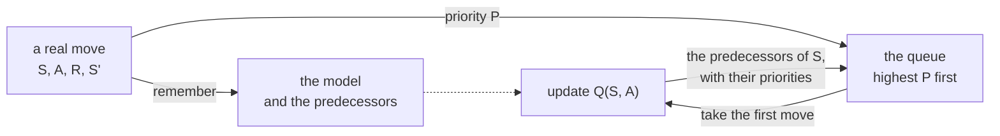

# Prioritized sweeping

Prioritized sweeping, described by Sutton and Barto [1] in Section 8.4 (after Moore and Atkeson, 1993 [2],
and Peng and Williams, 1993 [3]), plans like Dyna-Q (have a look at [dyna.md](dyna.md) first),
but it is choosy about *what* it plans with.

Dyna-Q imagines moves picked at random from its model. Early on, nearly all of them change nothing: every value is 0,
and replaying a move from 0 to 0 teaches nothing. Only the moves next to something that has just changed are worth
replaying. Basically, when the agent finds the goal, the move that reached it is worth updating, then the moves that
lead to *that* one, then the moves that lead to those, and so on back. Prioritized sweeping keeps a queue of the moves
whose values would change, the largest change first, and works backwards from every change.

## Why random planning wastes updates

The corridor of [dyna.md](dyna.md), walked once, with only the last move earning a reward (γ = 0.9, α = 1):

```
                        s0 ──→ s1 ──→ s2 ──→ s3 ──→ end, r = 1
prioritized sweeping:   0.729  0.81   0.9    1      after 4 updates
```

The first three moves change nothing, so they are not even queued. The last one is, and once its value is 1,
the move that leads to it, `(s2, right)`, would change by 0.9: it joins the queue, and so on back to the start.
Four updates, one for each move, and every one of them useful. Dyna-Q's test gives it 200 imagined moves after each
real one to get the same values, since most of the moves it picks at random change nothing.

## The queue

After each real move `(S, A, R, S')`, the model remembers it, as Dyna-Q's does,
and it also remembers that `(S, A)` is a *predecessor* of `S'`, a move that leads to it:

```math
\text{Model}(S,A) \leftarrow R,\; S'
```

Then the move's *priority* is how much its value would change if it was updated now:

```math
P = \left| R + \gamma \max_a Q(S',a) - Q(S,A) \right|
```

and if `P` is more than a small threshold `θ`, the move joins the queue with priority `P`.
Then it plans, up to `n` times while the queue is not empty: it takes the first move `(S, A)` of the queue,
the one of highest priority, asks the model what it gives, `R, S' = Model(S, A)`, and updates it:

```math
Q(S,A) \leftarrow Q(S,A) + \alpha \left[ R + \gamma \max_a Q(S',a) - Q(S,A) \right]
```

The value of `S` may have changed, and so may the values of the moves that lead to it.
So for every predecessor `(S̄, Ā)` of `S`, with the reward `R̄` the model remembers for it:

```math
P = \left| \bar{R} + \gamma \max_a Q(S,a) - Q(\bar{S},\bar{A}) \right|
```

and if `P > θ`, it joins the queue too. As always, a move that ended the episode has no next state,
so its target is simply `R`.



### Pseudocode

This is Sutton and Barto's *Prioritized sweeping for a deterministic environment*:

```
Prioritized sweeping

parameters: learning rate α, discount rate γ, exploration rate ε, planning steps n, threshold θ

start with Q(s, a) = 0 for every state s and action a, an empty model, and an empty queue

for each episode:
    s ← the start state
    repeat until the episode ends:
        a ← an action for s, chosen ε-greedy on Q
        take action a, and observe the reward r and the next state s'
        Model(s, a) ← r, s'
        P ← | r + γ max over b of Q(s', b) - Q(s, a) |
        if P > θ: insert (s, a) into the queue with priority P
        repeat n times, while the queue is not empty:
            S, A ← the first move of the queue (and take it out)
            R, S' ← Model(S, A)
            Q(S, A) ← Q(S, A) + α [ R + γ max over b of Q(S', b) - Q(S, A) ]
            for every (S̄, Ā) the model says leads to S:
                R̄ ← the reward the model says (S̄, Ā) gives
                P ← | R̄ + γ max over b of Q(S, b) - Q(S̄, Ā) |
                if P > θ: insert (S̄, Ā) into the queue with priority P
        s ← s'
```

(for a move that ends the episode, drop the `γ max Q` term)

### In relearn

```cpp
relearn::prioritized_sweeping<state,action> learner;
learner.alpha = 1.0;            // learning rate α (1 suits a deterministic world)
learner.gamma = 0.95;           // discount rate γ
learner.planning_steps = 5;     // n, the most updates from the queue after each real move
learner.theta = 0.0001;         // θ, the smallest change worth queueing
learner(episode, policy);
```

or in short, `auto learner = relearn::prioritized_sweeping<state,action>{1.0, 0.95, 5, 0.0001};` (α, γ, n and θ).

It is used just like `dyna_q`, `learner(episode, policy, terminated)`, and is meant to plan after every move,
with `games::play_online`.

- As in the book's box, a real move is **only** learnt through the queue: it is remembered and queued,
  and its value changes when planning takes it. With `planning_steps = 0` nothing is ever learnt.
- When a move already in the queue is queued again, it keeps the higher of its two priorities, so each move is in the
  queue once. The book's box does not show it, but the text of Section 8.4 says so. Moves of equal priority
  leave the queue in the order they joined it.
- `learner.updates()` is the number of updates made so far (one for each move taken from the queue), `learner.steps()`
  the real moves learnt, `learner.queued()` the moves waiting in the queue, and `learner.priority(s, a)` the priority of
  one of them. `learner.plan(policy)` runs up to `planning_steps` updates on its own, e.g. to empty the queue at the end:
  `while (learner.queued() > 0) learner.plan(policy);`
- `learner.remembers(s, a)` says whether the model knows the move, and `learner.predecessors(s)` lists the moves it
  says lead to `s`. The model keeps the **last** outcome of each move, so it assumes the world is deterministic;
  when a move leads somewhere new, it stops being a predecessor of the state it used to lead to.
- Do bear in mind the learning rate. An update moves `α` of the way to its target, and the box only queues the
  *predecessors* of the move it updates, not the move itself. So with `α < 1`, a move updated once waits, half way
  there, until its next real step, or until the state it leads to changes. In a deterministic world, `α = 1` makes
  every update exact, as the example below shows.

## Example 8.4: mazes of increasing size

`examples/dyna_maze_prioritized.cpp` follows Sutton and Barto's Example 8.4: the maze of Example 8.1, at a finer and finer
resolution. At scale `k`, every cell becomes a block of `k × k` cells (`games::dyna_maze(games::dyna_maze::maze, 1000, k)`),
so the maze has the same shape, `47 k²` cells, and a shortest path of `14 k` moves. At scale 2:

```
..............##G.
..............##..
....##........##..
....##........##..
S...##........##..
....##........##..
....##............
....##............
..........##......
..........##......
..................
..................
```

Both agents play ε-Greedy (ε = 0.1) with γ = 0.95, and make at most n = 5 updates after each real move (θ = 0.0001).
For Dyna-Q that is one real update and 5 imagined ones, for prioritized sweeping up to 5 from the queue.
After every episode the greedy policy walks the maze, and the program counts the updates made until its path is a good one,
at most 20% longer than the shortest. The mean of 10 runs (built with GCC):

| scale | cells | shortest path | Dyna-Q | prioritized sweeping | fewer updates |
|---|---|---|---|---|---|
| 1 | 47 | 14 | 10167 | 165 | 61.5 times |
| 2 | 188 | 28 | 37345 | 745 | 50.1 times |
| 3 | 423 | 42 | 94491 | 2183 | 43.3 times |
| 4 | 752 | 56 | 160321 | 2570 | 62.4 times |
| 5 | 1175 | 70 | 352178 | 4380 | 80.4 times |

and the same, with α = 0.5 for both:

| scale | Dyna-Q | prioritized sweeping | fewer updates |
|---|---|---|---|
| 1 | 9172 | 1583 | 5.8 times |
| 2 | 41797 | 9083 | 4.6 times |
| 3 | 89426 | 48293 | 1.9 times |
| 4 | 160539 | 49480 | 3.2 times |
| 5 | 383062 | 93919 | 4.1 times |

Sutton and Barto write that in maze tasks prioritized sweeping often finds the optimal solution 5 to 10 times faster
than Dyna-Q, and they do not give α. With α = 0.5 the gap is close to that; with α = 1, which suits a maze where every move always ends the same way,
each update from the queue is exact, and the gap is far larger. Dyna-Q hardly cares about α: its random updates repeat
every move many times anyway.

The program finishes by drawing the greedy path of prioritized sweeping after its first run at scale 2,
once it has emptied its queue (610 updates to find a good path, and 126 more to empty the queue):

```
. . . . . . . . . . . . . . # # G .
. . . . . . . . . . . . . . # # * .
. . . . # # . . . . . . . . # # * .
. . . . # # . . . . . . . . # # * .
S * . . # # . . . . . . . . # # * .
. * . . # # . . . . . . . . # # * .
. * . . # # * * * * * * * * * * * .
. * * * # # * . . . . . . . . . . .
. . . * * * * . . . # # . . . . . .
. . . . . . . . . . # # . . . . . .
. . . . . . . . . . . . . . . . . .
. . . . . . . . . . . . . . . . . .
```

28 moves, a shortest path: once the queue is empty, the values are exact for everything the model knows.

__note__: with Clang's standard library (libc++, as on macOS) the random numbers differ, and so do the numbers above:
prioritized sweeping needs 61.8 to 80.8 times fewer updates with α = 1, and 3.0 to 15.1 times fewer with α = 0.5.
Its path at the end takes 32 moves: in that run, the model never made the moves of a shortest path.

__note__: why "a good path", rather than the shortest one, as the book has it? Prioritized sweeping settles its values
as soon as it has found a way to the goal, and from then on the ε-Greedy agent only leaves that way by chance.
A shorter way it has never walked can take it a great many episodes to stumble on, which is down to exploring, not
planning. The test below checks the shortest path with an agent that tries every move (playing at random).

## Tests

`tests/prioritized_sweeping_test.cpp` checks:

- the corridor above, worked out by hand: 4 updates, and the values `0.729, 0.81, 0.9, 1`
- that planning stops after `n` updates, with the rest of the queue waiting for the next real move,
  that a change of θ or less is not queued, the learning rate, and a fall in value swept back as well as a rise
- the queue: the highest priority first, a move queued once at its higher priority but learnt from its latest outcome,
  and two paths swept back through the predecessors
- the model and the predecessors, as the world changes, and that the last link of a cut-short episode is not learnt
- the Dyna maze at scales 1 and 2, learnt from random play (α = 1, θ = 1e-9): every value is the exact one, worked out by
  the value iteration of `tests/solvers.hpp`, and the greedy path is a shortest one (14 and 28 moves), over 10 seeds
- Example 8.4 at scales 1, 2 and 3, over 10 runs each: prioritized sweeping needs at least 3 times fewer updates than
  Dyna-Q in every run, and 10 times fewer in all. Over 10 groups of 10 runs, with GCC's and Clang's standard libraries,
  it was 7.5 to 332 times fewer in each run, and 33 to 94 times fewer in each group

`tests/games_test.cpp` checks the scaled mazes: the same maze at scale 1, `47 k²` cells and a shortest path of `14 k` moves.

## References

1. Sutton, R.S. and Barto, A.G., 2018. [Reinforcement Learning: An Introduction](http://incompleteideas.net/book/the-book-2nd.html), 2nd edition. Cambridge, MA: MIT Press.
   Section 8.4 (prioritized sweeping) and Example 8.4.
2. Moore, A.W. and Atkeson, C.G., 1993. Prioritized sweeping: Reinforcement learning with less data and less time.
   *Machine Learning*, 13(1), pp. 103-130.
3. Peng, J. and Williams, R.J., 1993. Efficient learning and planning within the Dyna framework.
   *Adaptive Behavior*, 1(4), pp. 437-454.
