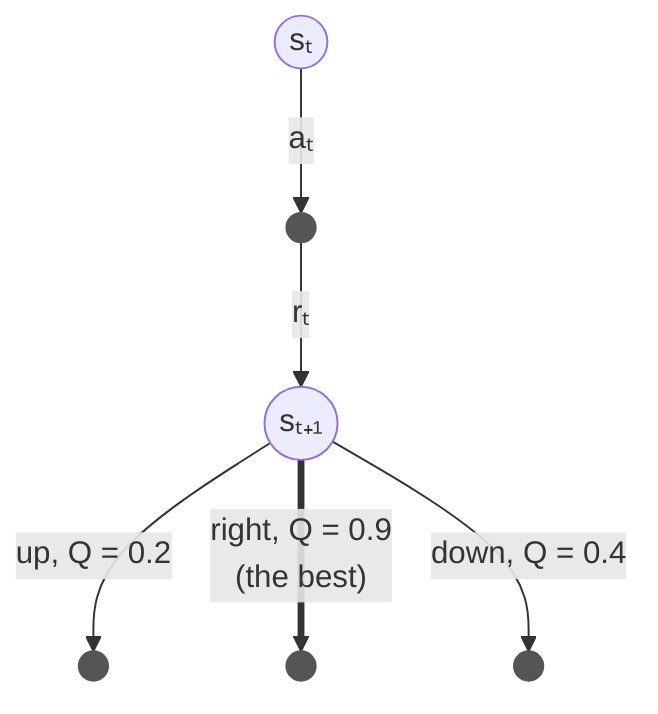
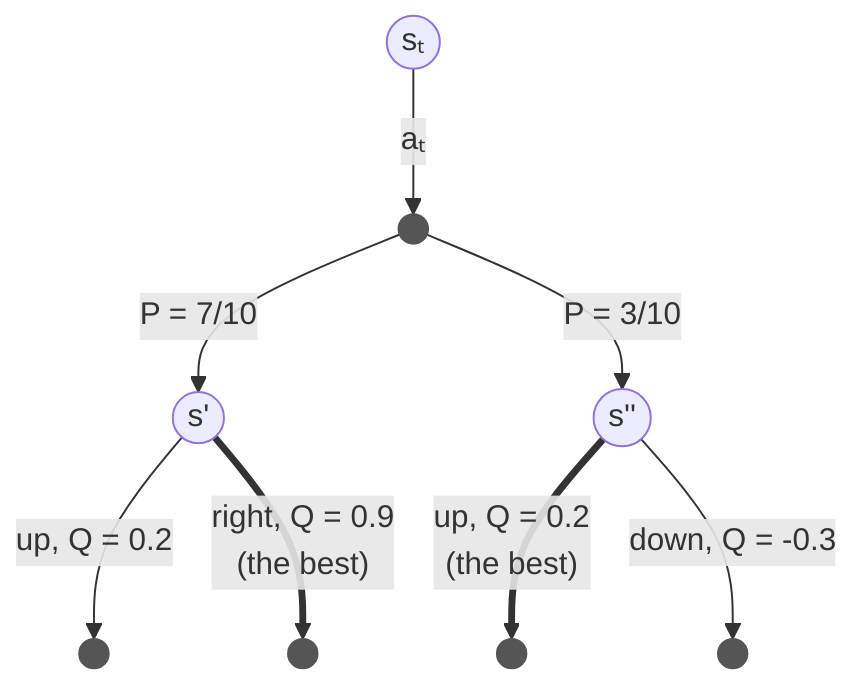

# Q-Learning

Q-Learning is the classic *off-policy* temporal difference algorithm, described by Sutton and Barto [1]
in Section 6.5 (after Watkins, 1989 [2]).
The library implements two versions of it:

- `q_learning`: the classic Q-Learning, for deterministic systems, and for non-deterministic ones
  provided the learning rate decays (see below).
- `q_probabilistic`: Q-Learning for non-deterministic systems, which *observes* the transition
  probabilities and the expected reward, and needs no learning rate at all.

## Q-Learning

The Q-Learning update rule (for both offline and online policy updates) is:

```math
Q(s_t,a_t) \leftarrow Q(s_t,a_t) + \alpha \left[ r_t + \gamma \max_a Q(s_{t+1},a) - Q(s_t,a_t) \right]
```

and for the last step of an episode, where there is no next state:

```math
Q(s_t,a_t) \leftarrow Q(s_t,a_t) + \alpha \left[ r_t - Q(s_t,a_t) \right]
```

where:
- `α` is the learning rate
- `γ` is the discount rate
- `r_t` is the reward received *after* taking action `a_t` in state `s_t` (see [reward convention](#reward-convention) below)

This simply states that the value of taking `a_t` in `s_t` is moved a little towards the reward received,
plus the discounted value of the **best** action of the next state.
Because it always uses the best action, whatever action the agent actually took next,
Q-Learning learns the values of the *optimal* policy, even whilst the agent explores: this is why it is called *off-policy*.

The diagram below shows one update (Sutton and Barto call these *backup diagrams*):
an open circle is a state, a filled dot is an action, and the thick arrow is the value Q-Learning learns from.
Whichever move the agent then makes in `s_{t+1}`, Q-Learning learns from the best one, here `right`,
so its target is `r_t + γ 0.9`:



The same next state appears in [sarsa.md](sarsa.md) and [double_q_learning.md](double_q_learning.md),
so you can compare which value each algorithm learns from.

In a deterministic system you can use any constant learning rate above 0 and up to 1, even `α = 1`, since the same
action in the same state always has the same outcome.
Do bear in mind that a rate which *decays* still needs the first condition below, even in a deterministic system:
the values of the next states keep changing as they are learnt, and a rate that decays too fast stops learning first.
In a non-deterministic system (e.g., when taking the same action in the same state does not always lead to the
same next state, or earn the same reward) the values only converge if every state/action pair keeps being visited,
and the learning rates used on its visits satisfy:

```math
\sum_{n=1}^{\infty} \alpha_n = \infty \qquad \text{and} \qquad \sum_{n=1}^{\infty} \alpha_n^2 < \infty
```

For example `α = 1/n^0.6` for the n-th update of a pair.
A learning rate that decays too fast, such as `α = 1/n²`, stops learning before the values are reached.
`q_learning` can give each state/action pair its own decaying learning rate, have a look at [schedules.md](schedules.md).

### The policy decision

The policy decision is entirely up to you to decide; in the case of a deterministic system,
usually the options are to either stay on policy, taking the action of highest value:

```math
a_t = \pi(s_t) = \arg\max_a Q(s_t,a)
```

or if using online explorative-greedy (ε-Greedy), take a random action with some (often *decaying*) probability ε,
and the action of highest value otherwise.
It is for this reason that there is no implementation of `on_policy` or `e_greedy` in the library,
those are very simple algorithms, and are application-specific.
The games show one way of writing them (`games::greedy` and `games::epsilon_greedy` in `examples/games/game.hpp`).

### Pseudocode

```
Q-Learning

parameters: learning rate α, discount rate γ, exploration rate ε

start with Q(s, a) = 0 for every state s and action a

for each episode:
    s ← the start state
    repeat until the episode ends:
        a ← an action for s, chosen ε-greedy on Q
        take action a, and observe the reward r and the next state s'
        if s' ends the episode:
            Q(s, a) ← Q(s, a) + α [ r - Q(s, a) ]
        else:
            Q(s, a) ← Q(s, a) + α [ r + γ max over b of Q(s', b) - Q(s, a) ]
            s ← s'
```

### In relearn

```cpp
relearn::q_learning<state,action> learner;
learner.alpha = 0.9;    // learning rate α
learner.gamma = 0.9;    // discount rate γ
learner(episode, policy);
```

or in short, `auto learner = relearn::q_learning<state,action>{0.9, 0.9};`.

The episode is a `markov_chain` (by default an `std::deque<relearn::link<state,action>>`),
where each link `(s_t, a_t)` holds the reward `r_t` in `s_t.reward()`.
You can replay the same episodes many times (as the offline gridworld does), or learn each episode
as soon as it has been played (as the online gridworld does).

Do bear in mind how relearn takes `max_a Q(s_{t+1}, a)`: over the actions **stored** for `s_{t+1}` in the policy,
that is the actions it has learnt a value for (and 0 if there are none yet). The book starts every action at
`Q = 0`, so an action never tried there counts 0 in its maximum. The two only differ when every action stored
for a state is worth less than 0: then relearn's target is lower than the book's, until the other actions have
been tried. Both end up with the same values, and since a lower target makes the agent explore a little less,
it does no harm in the tasks of this library (on Cliff Walking, for example, it learns the same path). The same
holds for every relearn learner that takes a maximum: `q_probabilistic`, Dyna-Q, Double Q-Learning, Expected
SARSA without its probabilities, Watkins's Q(λ) and the greedy test of off-policy Monte Carlo.
(Dyna-Q+ is given every legal action, and plans the ones not tried yet, so they soon have values of their own.)

## Q-Learning for non-deterministic systems

For Q-Learning in a non-deterministic system (e.g., when the certainty of transitioning from one state to another
is not constant), `q_probabilistic` takes a different approach: instead of moving the values a little at a time,
it remembers what happened after every state and action it has seen:

- how many times `n(s_t,a_t)` the action `a_t` was taken in state `s_t`,
- the mean reward `r̄(s_t,a_t)` received after it,
- how many times `n(s_t,a_t,s_{t+1})` each next state `s_{t+1}` followed.

The probability of a transition `s_t → s_{t+1}` for action `a_t` must be **observed** after being taken:

```math
P(s_{t+1} \mid s_t,a_t) = \frac{n(s_t,a_t,s_{t+1})}{n(s_t,a_t)}
```

This probability quantifies the *likelihood* of ending up in state `s_{t+1}` when taking action `a_t` in state `s_t`.
Therefore, the update rule for probabilistic systems is:

```math
Q(s_t,a_t) = \bar{r}(s_t,a_t) + \gamma \sum_{s_{t+1}} P(s_{t+1} \mid s_t,a_t) \max_a Q(s_{t+1},a)
```

This simply states that the value is the *expected reward* of taking `a_t` in `s_t`, plus the discounted value
of the best action of every next state, weighted by how likely that next state is.
For example, if `a_t` was taken 10 times in `s_t`, and led 7 times to `s'` and 3 times to `s''`:



```math
Q(s_t,a_t) = \bar{r}(s_t,a_t) + \gamma \left( 0.7 \times 0.9 + 0.3 \times 0.2 \right) = \bar{r}(s_t,a_t) + \gamma \, 0.69
```

An episode that ends after `(s_t, a_t)` has no next state, and adds nothing to the sum.
No learning rate is needed: the estimates become exact as more episodes are observed, provided every pair keeps
being visited. Do bear in mind that each episode only works Q out again for the pairs it visits, so a pair not seen
for a while keeps the value it had then.

### Pseudocode

```
Q-Learning for non-deterministic systems

parameters: discount rate γ

start with no observations, and Q(s, a) = 0 for every state s and action a

for each episode:
    for each step (s, a, r, s') of the episode:
        n(s, a) ← n(s, a) + 1
        r̄(s, a) ← r̄(s, a) + (r - r̄(s, a)) / n(s, a)
        if the episode did not end after this step:
            n(s, a, s') ← n(s, a, s') + 1
    for each step (s, a) of the episode:
        Q(s, a) ← r̄(s, a) + γ Σ over s' of  n(s, a, s') / n(s, a)  max over b of Q(s', b)
```

### In relearn

```cpp
relearn::q_probabilistic<state,action> learner(0.9);   // discount rate γ
learner(episode, policy);
```

The `blackjack`, `frozen_lake`, `gamblers_problem` and `random_walk` games use it,
since in all of them the same decision may lead to different outcomes.

## Reward convention

In an episode, each link `(s_t, a_t)` carries in `s_t.reward()` the reward received **after** taking `a_t` in `s_t`.
This is the `r_t` above, which Sutton and Barto (2nd edition) write as `R_{t+1}`: the same reward, a different index.
The last link of an episode is the final decision, and its state holds the final reward.
With this convention both learners converge to the expected discounted return:

```math
Q(s,a) = E\left[ r_t + \gamma r_{t+1} + \gamma^2 r_{t+2} + \dots \mid s_t = s, a_t = a \right]
```

which `tests/convergence_test.cpp` verifies against a Monte Carlo estimate, on small stochastic MDPs.

Put each reward on the link of the decision that earned it.
Placing a reward on a *later* link delays it by one step, and changes the values: for example, putting the final
reward on an extra terminal-state link with a dummy action, instead of on the last decision.
When the only reward is the final one, this scales the Q values by γ and leaves the policy unchanged,
but in general delaying rewards changes both the values and the policy.
Appending a link with zero reward changes nothing.

## Episodes cut short

An episode cut short before the game ended (e.g., by a step limit) is not finished: pass
`false` as the learner's third argument, `learner(episode, policy, false)`.
Its last link is then not learnt as the end of the game, and only provides the next state for the link before it.
`games::play` ends such an episode with one extra link holding the state reached, so that the last step
taken is still learnt.

## Examples and tests

- the two gridworld examples (`examples/gridworld_offline.cpp` and `examples/gridworld_online.cpp`) use `q_learning`,
  see the [README](../README.md#gridworld)
- `examples/windy_gridworld.cpp` compares `q_learning` with a constant and with a decaying learning rate,
  and `q_probabilistic`, in random wind
- `examples/blackjack.cpp` learns Blackjack with `q_probabilistic`, and prints the strategy in the layout of
  Sutton and Barto's Figure 5.2
- `tests/convergence_test.cpp` checks that both learners reach the exact values of two small stochastic MDPs,
  and `tests/games_test.cpp` checks them on the games, against exact solutions

## References

1. Sutton, R.S. and Barto, A.G., 2018. [Reinforcement Learning: An Introduction](http://incompleteideas.net/book/the-book-2nd.html), 2nd edition. Cambridge, MA: MIT Press.
   Section 6.5 (Q-Learning), Section 2.5 and equation 2.7 (conditions on the learning rate).
2. Watkins, C.J.C.H., 1989. *Learning from Delayed Rewards*. PhD thesis, University of Cambridge.
