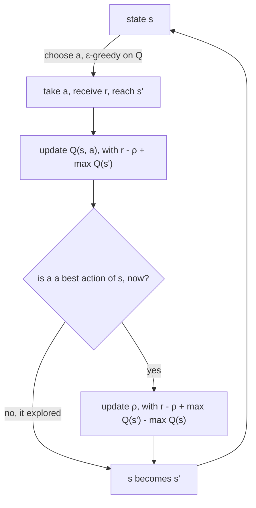
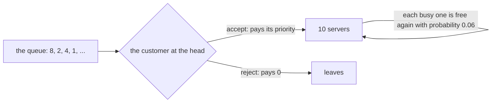

# R-Learning and differential Sarsa

Every other learner in relearn learns from episodes: a game is played to its end, and then another one starts.
Plenty of real tasks never end though. A server farm, a lift, a traffic light or a thermostat keeps running for as long
as it is switched on, and Sutton and Barto [1, 2] call these *continuing* tasks.

R-Learning, by Schwartz [3], described by Sutton and Barto in Section 6.7 of their 1st edition [1], learns such a task
without discounting. Instead of adding up rewards, it learns `ρ`, the reward the agent earns **per step** on average,
and values every action by how much more than `ρ` it earns from then on.
The 2nd edition [2] drops R-Learning, and puts *differential Sarsa* (Section 10.3) in its place, which learns the same
two things in a slightly different way. relearn has both: `r_learning` and `differential_sarsa`.

## Tasks that never end

In an episodic task, the value of an action is the sum of the rewards that follow it, until the end.
In a continuing task that sum never stops growing, so it is infinite (or, with a discount `γ < 1`, it is finite,
but then a reward far in the future is worth almost nothing, which is often not what we want).

Instead, a policy `π` is judged by its *average reward*, the reward per step it earns in the long run:

```math
\rho(\pi) = \lim_{n \to \infty} \frac{1}{n} \sum_{t=1}^{n} \mathbb{E}_\pi \left[ r_t \right]
```

Every policy earns some `ρ` per step, so what tells two actions apart is how much more than `ρ` they earn
from then on. This is the *relative* (or *differential*) value of an action:

```math
Q(s,a) = \mathbb{E} \left[ \sum_{k=0}^{\infty} \left( r_{t+k} - \rho \right) \;\middle|\; s_t = s,\ a_t = a \right]
```

and the best ones satisfy a Bellman equation just like the discounted one, with `- ρ` in place of `γ`:

```math
Q^*(s,a) = \sum_{s',r} p(s', r \mid s, a) \left[ r - \rho^* + \max_{a'} Q^*(s',a') \right]
```

where `ρ*` is the best average reward of all. Basically, every step costs `ρ`, and an action is good if it earns
back more than it costs.

__note__: only the *differences* between relative values mean anything. Add the same number to every `Q(s, a)`,
and the equation above still holds. Keep this in mind, it comes back below.

## R-Learning

R-Learning learns both `Q` and `ρ`, after every step. After taking `a_t` in `s_t`, receiving `r_t` and reaching
`s_{t+1}`, it first updates `Q`, much as Q-Learning does, but with `- ρ` in place of the discount:

```math
Q(s_t,a_t) \leftarrow Q(s_t,a_t) + \alpha \left[ r_t - \rho + \max_a Q(s_{t+1},a) - Q(s_t,a_t) \right]
```

and then, **only if `a_t` is a greedy action**, that is if `Q(s_t, a_t) = max_a Q(s_t, a)`, it updates `ρ`:

```math
\rho \leftarrow \rho + \beta \left[ r_t - \rho + \max_a Q(s_{t+1},a) - \max_a Q(s_t,a) \right]
```

The second error says how much better this step went than `ρ` predicted. Exploring steps are left out,
since a random action earns less than the greedy policy would, so `ρ` learns what the **greedy** policy earns,
not what the agent earns whilst it explores. R-Learning is *off-policy*, just like Q-Learning.
`β` is usually smaller than `α`: `ρ` is a single number, shared by every state, which every greedy step moves.



### Pseudocode

This is Sutton and Barto's Figure 6.16 (1st edition):

```
R-Learning

parameters: learning rates α and β, exploration rate ε

start with ρ = 0 and Q(s, a) = 0 for every state s and action a

s ← the first state
repeat forever:
    a ← an action for s, chosen ε-greedy on Q
    take action a, and observe the reward r and the next state s'
    Q(s, a) ← Q(s, a) + α [ r - ρ + max over b of Q(s', b) - Q(s, a) ]
    if Q(s, a) = max over b of Q(s, b):
        ρ ← ρ + β [ r - ρ + max over b of Q(s', b) - max over b of Q(s, b) ]
    s ← s'
```

Do bear in mind the order: the test of whether `a` is greedy comes *after* `Q(s, a)` has been updated,
and uses its new value, and so does the update of `ρ`. relearn follows the figure exactly. So an action that was not
the best one when it was chosen, but becomes the best after its update, does move `ρ`; and the best action, if its
update makes it worse than another one, does not. The two cases only differ from "the greedy action was taken"
when an update changes which action is the best, and `tests/r_learning_test.cpp` checks both.

## Differential Sarsa

The 2nd edition's method (Section 10.3) is on-policy, like SARSA. It learns from the action `a_{t+1}` the agent
actually takes next, and both `Q` and `ρ` (which the 2nd edition writes `R̄`) learn from the same error, on every step:

```math
\delta_t = r_t - \rho + Q(s_{t+1},a_{t+1}) - Q(s_t,a_t)
```

```math
\rho \leftarrow \rho + \beta \, \delta_t \qquad Q(s_t,a_t) \leftarrow Q(s_t,a_t) + \alpha \, \delta_t
```

The book writes it with function approximation, as *differential semi-gradient Sarsa*. With one value per state and action,
as in relearn, the gradient is 1 for the pair being updated and 0 for every other one, which gives the update above.

```
Differential Sarsa (tabular)

parameters: learning rates α and β, exploration rate ε

start with ρ = 0 and Q(s, a) = 0 for every state s and action a

s ← the first state
a ← an action for s, chosen ε-greedy on Q
repeat forever:
    take action a, and observe the reward r and the next state s'
    a' ← an action for s', chosen ε-greedy on Q
    δ ← r - ρ + Q(s', a') - Q(s, a)
    ρ ← ρ + β δ
    Q(s, a) ← Q(s, a) + α δ
    s ← s'
    a ← a'
```

### How they differ

| | R-Learning | differential Sarsa |
|---|---|---|
| the value of the next state | `max_a Q(s', a)`, the best action | `Q(s', a')`, the action taken |
| `ρ` learns | on greedy steps only, from its own error | on every step, from `δ` |
| `ρ` is the average reward of | the greedy policy (off-policy) | the policy the agent follows, exploration included (on-policy) |
| in Sutton and Barto | 1st edition, Section 6.7, Figure 6.16 | 2nd edition, Section 10.3 |
| settings of the access-control example | `α = 0.1`, `β = 0.01`, `ε = 0.1` | `α = 0.01`, `β = 0.01`, `ε = 0.1` |

## In relearn

```cpp
relearn::r_learning<state,action> learner;
learner.alpha = 0.1;      // α, the learning rate of Q
learner.beta  = 0.01;     // β, the learning rate of ρ
learner.rho   = 0;        // ρ, the average reward per step, learnt as it goes
learner(window, policy);  // learns from (s_t, a_t, r_t) and the next link (s_{t+1}, a_{t+1})
```

or in short, `relearn::r_learning<state,action> learner(0.1, 0.01);` (α, β, and optionally the first ρ),
and the same for `relearn::differential_sarsa<state,action> learner(0.01, 0.01);`.

A task that never ends has no episodes to hand to a learner, so both learn **one step at a time**,
and fit relearn the same way the TD learners do when they learn online:

- `learner(episode, policy)` learns each link of `episode` from the link after it, in order.
  By default, the last link is **not** learnt, and only gives the next state (and, for differential Sarsa,
  the next action) of the link before it: a continuing task does not end, so `terminated` is `false` by default.
  If your task does end, `learner(episode, policy, true)` learns the last link too, with a next state worth 0,
  as the other learners do (this is relearn's choice, the book's methods never end).
- `games::play_online` does exactly this: after every step, it hands the learner the link just played and the
  next one, with `terminated = false` (have a look at [sarsa.md](sarsa.md#learning-after-every-step)).
- A continuing game must not start again when `play_online` calls its `reset()`. The access-control game's
  `reset()` simply returns the state the queue is in, so you play it in pieces, each one carrying on where the last stopped:

  ```cpp
  games::access_control queue;
  for (std::size_t done = 0; done < 2000000; done += 1000) {
      games::play_online(queue, agent, learner, memory, 1000);
  }
  ```
  which also keeps the recorded steps (`played.episode`) to 1000 at a time.
- `ρ` is part of the learner, in `learner.rho`, and you may set where it starts. Do bear in mind that it moves with
  every step: with `β = 0.01` it only averages about the last hundred steps' worth, so to read it, average it over a
  while (the example averages it over the second half of the run).
- The maxima, `max_a Q(s, a)`, are taken over the actions stored for `s` in the policy. As in Dyna-Q+,
  you can give `r_learning` every legal action of a state with `legal_actions`, and then the actions not tried yet
  count 0, as they do for `games::greedy`. Otherwise an action not tried yet is left out, which makes a difference
  to whether the action taken is greedy.
- Both learn with a constant `alpha` and `beta` (there is no `learning_rate` schedule).

## Example: the access-control queue

`examples/access_control.cpp` learns Sutton and Barto's access-control queuing task (1st edition Example 6.7,
2nd edition Example 10.2). There are 10 servers, and a queue of customers that never empties. Each customer has a
priority of 1, 2, 4 or 8, all equally likely. At each step, the customer at the head of the queue is either
**accepted**, takes a free server, and pays its priority as the reward, or **rejected**, and pays nothing
(a customer is also rejected when every server is busy). Then each busy server becomes free again with probability 0.06,
and the next customer comes to the head. The agent sees the number of free servers and the priority at the head,
44 states in all, and with no free server its only action is to reject.



So should the agent accept a customer who pays 1? Only if no better customer will want that server soon.

### The exact answer

`tests/solvers.hpp` solves the task exactly, from its rules, by *relative value iteration* [4]: it repeats the Bellman
equation above on differential state values, keeping them relative to one state, until the bounds it gives on `ρ*` meet.
It works out `ρ* = 2.7476` per step, and the optimal policy (as the example prints it, A for accept and R for reject):

```
priority \ free servers:  1  2  3  4  5  6  7  8  9 10
                      8:  A  A  A  A  A  A  A  A  A  A
                      4:  A  A  A  A  A  A  A  A  A  A
                      2:  R  R  R  A  A  A  A  A  A  A
                      1:  R  R  R  R  R  R  R  R  R  R
```

Accepting everyone earns only 2.1814 per step. Do bear in mind that accepting a customer of priority 1 with all 10 servers
free is worse by only 0.003, so that one is nearly a tie.

To judge what an agent has learnt, the example (with `games::access_control::average_reward`) and the tests
(with `solvers::tabular::policy_average`) work out **exactly** what its greedy policy earns per step, from the
rules: they solve for how often the policy visits each state in the long run, and average the rewards.
Sampling can be misleading in a task that never ends, as we'll see.

### Results

With ε-Greedy (ε = 0.1), for 2000000 steps each, the example prints (with GCC's standard library; Clang's libc++
draws other random numbers, so its numbers differ, and for the first learner by a lot, as we'll see below):

| learner | ρ at the end | ρ, mean over the 2nd half | earned whilst exploring | greedy policy earns, exactly |
|---|---|---|---|---|
| R-Learning, α = 0.1, β = 0.01 | 2.8460 | 2.7554 | 2.6009 | 2.7187 |
| R-Learning, α = 0.01, β = 0.01 | 3.0752 | 2.7425 | 2.6417 | 2.7381 |
| differential Sarsa, α = 0.01, β = 0.01 | 2.3488 | 2.6320 | 2.6383 | 2.7439 |

for an optimal `ρ* = 2.7476`. A few things stand out:

- `ρ` at the end of the run is all over the place, from 2.35 to 3.08: it follows the luck of the last hundred steps or so.
  Averaged over the second half, it is spot on.
- R-Learning's `ρ` is the average reward of the **greedy** policy, 2.75, although the agent itself, still exploring,
  earns only 2.60 to 2.64. Differential Sarsa's `ρ` is what the agent really earns, exploration included, 2.63.
- All three greedy policies earn within 0.03 of the optimal one.

The policy R-Learning learnt with the book's settings, α = 0.1, in the layout of Figure 6.17
(lower case marks the states seen fewer than 1000 times in the 2000000 steps), and the value of the best action of each state:

```
priority \ free servers:  1  2  3  4  5  6  7  8  9 10
                      8:  A  A  A  A  A  A  A  a  a  a
                      4:  A  A  A  A  A  A  A  a  r  r
                      2:  R  R  A  A  R  A  R  r  r  r
                      1:  R  R  R  A  R  A  R  r  r  r

value of the best action, free servers:
priority:      0      1      2      3      4      5      6      7      8      9     10
       8:  -81.3  -72.0  -69.8  -67.5  -64.9  -62.2  -61.4  -58.2  -55.9  -48.7  -26.3
       4:  -80.3  -75.7  -72.5  -70.9  -68.3  -67.1  -65.0  -63.0  -59.5  -49.2  -26.1
       2:  -80.3  -75.9  -75.5  -72.4  -69.3  -69.6  -67.9  -64.7  -59.1  -47.0  -26.3
       1:  -80.3  -76.0  -75.2  -72.3  -71.5  -70.3  -67.8  -65.0  -56.7  -49.7  -24.8
```

and with differential Sarsa, in the layout of Figure 10.5:

```
priority \ free servers:  1  2  3  4  5  6  7  8  9 10
                      8:  A  A  A  A  A  A  a  a  a  r
                      4:  R  A  A  A  A  A  a  a  a  a
                      2:  R  R  R  A  A  A  a  a  a  r
                      1:  R  R  R  R  R  A  a  a  a  r

value of the best action, free servers:
priority:      0      1      2      3      4      5      6      7      8      9     10
       8:   -9.5   -1.6    2.1    4.6    6.6    8.3   10.1   10.7    4.5    0.2    0.0
       4:   -9.2   -5.9   -2.1    0.8    2.8    4.4    6.2    6.9    2.7    0.1    0.0
       2:   -9.6   -6.3   -3.5   -1.1    0.8    2.8    4.3    5.3    2.1    0.1    0.0
       1:   -9.5   -5.8   -3.4   -0.9    0.7    2.3    3.1    4.3    1.4    0.0    0.0
```

Both learnt the shape of the book's policy where they have been often: always accept 8, accept 2 only when enough
servers are free, and reject 1. With α = 0.1 R-Learning's values are noisy, so it gets some of the closer decisions wrong
(it accepts 1 with 4 and 6 servers free, and 2 with 3, but rejects 2 with 5 and 7), which costs it 0.03 per step.

### The states rarely seen

Look at the right of both tables. The agent hardly ever has many servers free, because it keeps accepting customers:
under the optimal policy, 9 or 10 servers are free in only 56 steps in a million (`tests/r_learning_test.cpp` works it out).
So those states are rarely learnt, and their values stay near where they started, 0 (differential Sarsa) or lag far
behind the others (R-Learning).

Now remember that only the differences between relative values mean anything. Nothing holds R-Learning's values in
place: with α = 0.1 they all drift together, here down to -50 to -80, and the states rarely seen are left behind,
around -26. To a state seen often, a state left behind then looks like a good place to go, so with many servers
free, rejecting customers (and so keeping many servers free) looks better than it is.

This matters more than it seems. A policy that rejects every customer once all 10 servers are free never accepts
anyone again, once the queue gets there: in the long run it earns **0** per step, however good it is everywhere else
(the tests check this, exactly). Built with Clang and libc++, the very same example shows it: R-Learning with
α = 0.1 learns `ρ` well (2.7548 over the second half), but its greedy policy rejects most customers with 8 or more
servers free:

```
priority \ free servers:  1  2  3  4  5  6  7  8  9 10
                      8:  A  A  A  A  A  A  A  r  r  r
                      4:  A  A  A  A  A  A  R  a  a  r
                      2:  R  R  A  R  A  A  A  r  r  r
                      1:  R  R  R  R  R  R  R  r  r  r
```

and it earns exactly 0.0000 per step (0.0201 playing it for 1000000 steps, the queue empties early on).
In the seed sweep of `tests/r_learning_test.cpp` (R-Learning with the book's settings,
1000000 steps, 10 seeds with each standard library), its greedy policy fell into this, or nearly, in 13 runs of 20, and
earned 2.34 to 2.75 less than the optimal policy, whilst in the other 7 runs it earned 0.0091 to 0.1416 less.
Taking the optimal action in the states seen fewer than 1000 times, and the learnt one everywhere else, it earned
0.0031 to 0.1393 less than the optimal policy in all 20. Its `ρ` was within 0.02 of `ρ*` in every run.

So, basically: a greedy policy is only as good as the states it has learnt. A smaller learning rate keeps the values
from drifting apart: above, R-Learning and differential Sarsa with α = 0.01 kept theirs between -12 and 11.

__note__: the example starts the queue with every server free. Since those states are hardly ever
seen again, you may want to make sure the agent keeps visiting them (with more exploration, or by starting again
from an empty queue now and then) before trusting its policy there.

## Tests

`tests/r_learning_test.cpp` checks:

- single updates of R-Learning worked out by hand: a greedy step (`Q`, then `ρ`), that `ρ` does not move after a
  non-greedy action, that the greedy test uses the value just updated (both ways round), a step back to the same state,
  several steps in order, the last link of an episode that ended, and `legal_actions`
- single updates of differential Sarsa worked out by hand: `ρ` and `Q` move with the same `δ`, worked out with the old `ρ`,
  it uses the action taken next rather than the best one, and `ρ` learns from exploring steps too
- the rules of the queue, and the exact solution: `ρ* = 2.7476` and the optimal policy above, the game's own exact
  average reward against the solver's, and 1000000 steps of accepting everyone against the exact 2.1814
- Example 6.7 (R-Learning, α = 0.1, β = 0.01, ε = 0.1, 1000000 steps): `ρ` (averaged over the second half) is within 0.05
  of `ρ*`, and above what the agent earns whilst exploring; priority 8 is accepted in every state seen often; and the greedy
  policy, with the optimal action in the states seen fewer than 1000 times, earns within 0.2 of `ρ*`, exactly.
  Over 10 seeds, with GCC's and with Clang's standard library, `ρ` was 2.7427 to 2.7663, and the policy within 0.14 of `ρ*`
- Example 10.2 (differential Sarsa, α = 0.01, β = 0.01, ε = 0.1, 1000000 steps): `ρ` is within 0.04 of what the agent
  earns, and below `ρ*`; and the greedy policy earns within 0.08 of `ρ*`, exactly. Over the same seeds, `ρ` was within
  0.017 of what the agent earned, and the greedy policy within 0.047 of `ρ*`

## References

1. Sutton, R.S. and Barto, A.G., 1998. Reinforcement Learning: An Introduction, 1st edition. Cambridge, MA: MIT Press.
   Section 6.7 (R-Learning), Figure 6.16, Example 6.7 and Figure 6.17.
2. Sutton, R.S. and Barto, A.G., 2018. [Reinforcement Learning: An Introduction](http://incompleteideas.net/book/the-book-2nd.html), 2nd edition. Cambridge, MA: MIT Press.
   Section 10.3 (differential semi-gradient Sarsa), Example 10.2 and Figure 10.5.
3. Schwartz, A., 1993. A reinforcement learning method for maximizing undiscounted rewards.
   In *Proceedings of the Tenth International Conference on Machine Learning*, pp. 298-305.
4. Puterman, M.L., 1994. *Markov Decision Processes: Discrete Stochastic Dynamic Programming*. New York: Wiley.
   Chapter 8 (average reward, relative value iteration).
