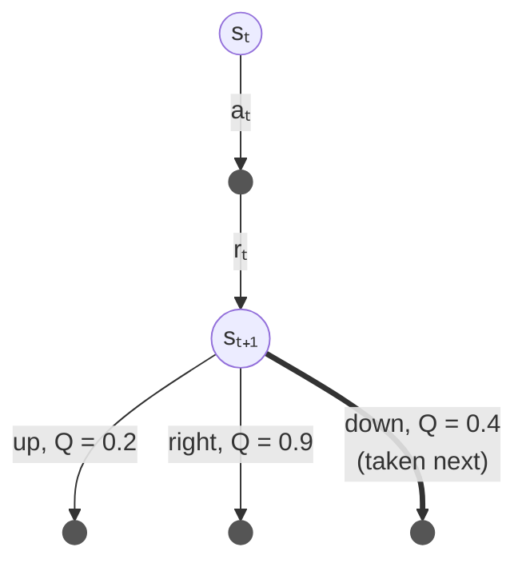
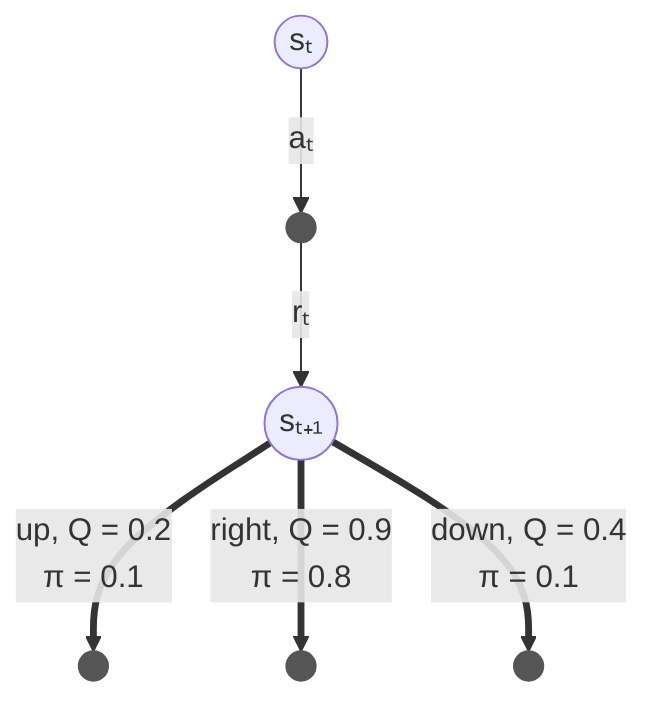
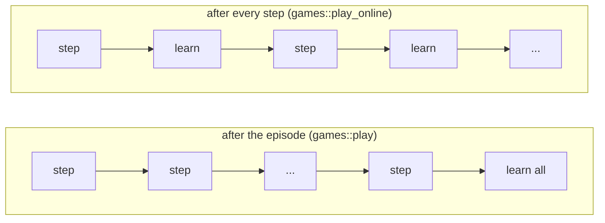

# SARSA and Expected SARSA

SARSA and Expected SARSA are two *temporal difference* (TD) control algorithms,
described by Sutton and Barto [1] in Sections 6.4 and 6.6.
Like Q-Learning, they learn the value `Q(s,a)` of taking action `a` in state `s`, one step at a time,
from the reward received and the value of the state that follows.
They differ from Q-Learning only in **which** value of the next state they learn from,
but that small difference changes what they learn.

## On-policy and off-policy

An agent that learns must also explore: every now and then it takes a move it believes is worse,
in case it is actually better than it thinks.
A common way of doing this is ε-Greedy: with probability ε take a random move, otherwise take the move of highest value.

- **Q-Learning is off-policy.** It learns the values of the *best* policy, whatever moves the agent
  actually takes whilst exploring.
- **SARSA and Expected SARSA are on-policy.** They learn the values of the policy the agent *follows*,
  exploration included.

When exploring is dangerous, this matters a lot. On the Cliff Walking grid, Q-Learning learns the shortest path,
right along the edge of the cliff, and its random moves keep throwing it off.
SARSA learns that walking along the edge is dangerous *for an agent that explores*,
and takes a safer path further away.

## SARSA

SARSA learns from the five things that happen in one step: the state `s_t`, the action `a_t`,
the reward `r_t`, the next state `s_{t+1}`, and the action `a_{t+1}` taken next.
This quintuple `(s, a, r, s', a')` is where the name comes from.
Where Q-Learning uses the *best* action of the next state, SARSA uses the action the agent *actually* took next:

```math
Q(s_t,a_t) \leftarrow Q(s_t,a_t) + \alpha \left[ r_t + \gamma \, Q(s_{t+1},a_{t+1}) - Q(s_t,a_t) \right]
```

and for the last step of an episode, which has no next state:

```math
Q(s_t,a_t) \leftarrow Q(s_t,a_t) + \alpha \left[ r_t - Q(s_t,a_t) \right]
```

where:
- `α` is the learning rate
- `γ` is the discount rate
- `r_t` is the reward received *after* taking action `a_t` in state `s_t` (see the [reward convention](q_learning.md#reward-convention))

The diagram below shows one step (Sutton and Barto call these *backup diagrams*):
an open circle is a state, a filled dot is an action, and the thick arrow is the value SARSA learns from.
Say the agent is in `s_{t+1}`, where moving `right` has the highest value (0.9), but whilst exploring it moves `down`:



SARSA's target is then `r_t + γ 0.4`, whereas Q-Learning's would be `r_t + γ 0.9`.
This simply states that SARSA counts the cost of its own exploring moves.
Because the next action `a_{t+1}` was chosen by the agent's own policy, random moves included,
SARSA learns `q_π`: the value of following that policy.
If the policy slowly becomes greedy (e.g., ε decays towards 0) then SARSA learns the best policy too,
have a look at [schedules.md](schedules.md).

### Pseudocode

```
SARSA, learning the values Q of the policy the agent follows

parameters: learning rate α, discount rate γ, exploration rate ε

start with Q(s, a) = 0 for every state s and action a

for each episode:
    s ← the start state
    a ← an action for s, chosen ε-greedy on Q
    repeat until the episode ends:
        take action a, and observe the reward r and the next state s'
        if s' ends the episode:
            Q(s, a) ← Q(s, a) + α [ r - Q(s, a) ]
        else:
            a' ← an action for s', chosen ε-greedy on Q
            Q(s, a) ← Q(s, a) + α [ r + γ Q(s', a') - Q(s, a) ]
            s ← s'
            a ← a'
```

Do bear in mind that the next action `a'` is chosen **before** `Q(s, a)` is updated,
and that it is the action the agent then takes: SARSA learns from the move it really makes.

### In relearn

```cpp
relearn::sarsa<state,action> learner;
learner.alpha = 0.5;    // learning rate α
learner.gamma = 1.0;    // discount rate γ
learner(episode, policy);
```

An episode is a sequence of links `(s_t, a_t)`, where each link holds the reward `r_t` in `s_t.reward()`.
The link after `(s_t, a_t)` holds `s_{t+1}` and the action `a_{t+1}` the agent took there,
which is all SARSA needs.

The episodes must be played by the policy being learnt (ε-Greedy on the values in `policy`),
since that is what makes SARSA on-policy.

## Expected SARSA

SARSA's target depends on which action happened to be chosen next, and that choice is random.
Expected SARSA removes this randomness: instead of the action taken next, it uses the value
the next state is **expected** to have under the policy `π` the agent follows,
that is the average of its action values, each one weighted by the probability that `π` takes it:

```math
Q(s_t,a_t) \leftarrow Q(s_t,a_t) + \alpha \left[ r_t + \gamma \sum_{a} \pi(a \mid s_{t+1}) \, Q(s_{t+1},a) - Q(s_t,a_t) \right]
```

and, as before, for the last step of an episode:

```math
Q(s_t,a_t) \leftarrow Q(s_t,a_t) + \alpha \left[ r_t - Q(s_t,a_t) \right]
```

For an ε-Greedy policy over the actions `A(s)` of a state, the probabilities are:

```math
\pi(a \mid s) = \frac{\varepsilon}{|A(s)|} + \begin{cases} \dfrac{1 - \varepsilon}{n_{best}} & \text{if } a \text{ is one of the } n_{best} \text{ actions of highest value} \\ 0 & \text{otherwise} \end{cases}
```

Take the same next state as before, with ε = 0.3 and three actions: each action gets 0.3/3 = 0.1,
and the best one (`right`) also gets the remaining 0.7, so 0.8 in total.
Expected SARSA learns from **all** of them, each arrow weighted by its probability:



```math
\sum_{a} \pi(a \mid s_{t+1}) \, Q(s_{t+1},a) = 0.1 \times 0.2 + 0.8 \times 0.9 + 0.1 \times 0.4 = 0.78
```

so its target is `r_t + γ 0.78`, whichever move the agent then makes.
Expected SARSA does a little more work per step (a sum over the actions),
but it learns more steadily than SARSA, and can use larger learning rates.
If `π` is the greedy policy, the sum is simply the best value, and Expected SARSA is Q-Learning.

### Pseudocode

```
Expected SARSA, learning the values Q of the policy π the agent follows

parameters: learning rate α, discount rate γ, the policy π (e.g. ε-greedy on Q)

start with Q(s, a) = 0 for every state s and action a

for each episode:
    s ← the start state
    repeat until the episode ends:
        a ← an action for s, chosen by π
        take action a, and observe the reward r and the next state s'
        if s' ends the episode:
            Q(s, a) ← Q(s, a) + α [ r - Q(s, a) ]
        else:
            v' ← Σ over the actions b of s' of  π(b | s') Q(s', b)
            Q(s, a) ← Q(s, a) + α [ r + γ v' - Q(s, a) ]
            s ← s'
```

### In relearn

relearn does not know which actions are legal in your problem, or how your agent explores,
so you have to give Expected SARSA the policy `π`: a function which returns, for a state,
each action the agent may take there, with the probability of taking it.

```cpp
relearn::expected_sarsa<state,action> learner;
learner.alpha = 0.5;
learner.gamma = 1.0;
// π(a | s): each action of s, with the probability of taking it
learner.probabilities = [&](const state & s) {
    relearn::expected_sarsa<state,action>::distribution pi;
    for (const auto & a : legal_actions(s)) {
        pi.push_back({a, probability_of(a, s)});
    }
    return pi;
};
learner(episode, policy);
```

If `probabilities` is not set, the greedy policy is used, and Expected SARSA learns like Q-Learning.
The games provide `games::epsilon_greedy_probabilities`, which returns the probabilities of
`games::epsilon_greedy` (have a look at `examples/games/game.hpp`).

## Learning after every step

TD algorithms are meant to learn **after every step**, whilst the episode is being played,
so that what the agent learns changes how it plays straight away.
relearn's learners take a whole episode, so there are two ways of using them:

- **after every step:** give the learner the last two links after each step, with
  `terminated = false`, so that it learns step `t` from `s_{t+1}` and `a_{t+1}`.
  `games::play_online` does this, and it is how the pseudocode above works.
- **after the episode:** play a whole episode with `games::play`, and then give it to the learner.



For Q-Learning the difference is small. For SARSA with a large learning rate, it is not:
on Cliff Walking with α = 0.5 (averaged over 10 runs, episodes 101 to 500) the average return is:

| SARSA learns | α = 0.5 | α = 0.1 |
|---|---|---|
| after every step | -27.6 | -29.9 |
| after the episode | -57.7 | -28.4 |

Learning only at the end of an episode, the agent keeps following the same policy for the whole episode,
however badly it goes, and with a large α the values it then learns swing too far.
So basically, either learn after every step, or use a smaller learning rate.

## Cliff Walking: the three learners compared

`examples/cliff_walking.cpp` reproduces Sutton & Barto's Example 6.6.
The agent starts at `S` and must reach `G`, and every move costs -1.
Stepping onto the cliff (`C`) costs -100 and sends the agent back to `S`:

```
. . . . . . . . . . . .
. . . . . . . . . . . .
. . . . . . . . . . . .
S C C C C C C C C C C G
```

The three learners explore ε-Greedy (ε = 0.1) and learn after every step (α = 0.5, γ = 1),
in 20 runs of 500 episodes each. Their average return whilst exploring is:

| episodes | Q-Learning | SARSA | Expected SARSA |
|---|---|---|---|
| 1 to 50 | -111.0 | -108.4 | -92.1 |
| 101 to 500 | -38.7 | -28.4 | -21.6 |

and the greedy paths they learn (first run) are:

```
Q-Learning              SARSA                   Expected SARSA
............            ************            ............
............            *..........*            ************
************            *..........*            *..........*
SCCCCCCCCCCG            SCCCCCCCCCCG            SCCCCCCCCCCG
```

Q-Learning learns the shortest path, in the row right next to the cliff, but falls off whilst exploring.
In this run SARSA learns to walk along the top row, two rows further from the cliff,
and Expected SARSA one row further.
The paths vary a little from run to run, so what the tests check is the return whilst exploring.
`tests/sarsa_test.cpp` checks this ordering over 10 runs, and checks on a small slippery corridor that
SARSA and Expected SARSA converge to the exact values of the policy followed, `q_π`,
whilst Q-Learning, on the same episodes, converges to the values of the best policy, `q*`.

## Episodes cut short

An episode cut short by a step limit has not ended, so pass `false` as the learner's third argument:
`learner(episode, policy, false)`. Its last link is then not learnt, and only provides
the next state (and, for SARSA, the next action) of the link before it.
`games::play` and `games::play_online` end such an episode with the state reached and the action
the agent would take next, so that all three learners can use it.

## References

1. Sutton, R.S. and Barto, A.G., 2018. [Reinforcement Learning: An Introduction](http://incompleteideas.net/book/the-book-2nd.html), 2nd edition. Cambridge, MA: MIT Press.
   Section 6.4 (SARSA), Section 6.5 (Q-Learning), Section 6.6 (Expected SARSA), Example 6.6 (Cliff Walking).
