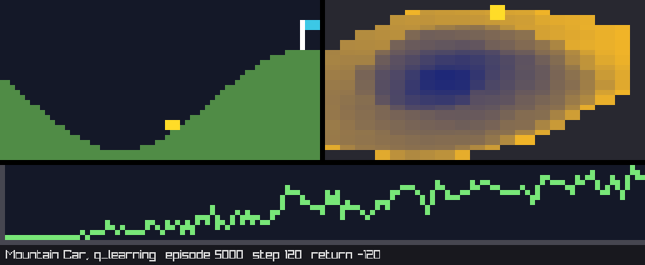
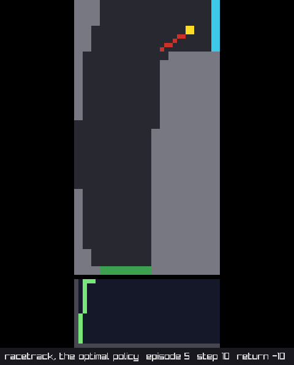

# Watching the agents play

Every example prints what its agent learnt: a path drawn with asterisks, a table of returns. That shows the result,
not the learning. The watch mode shows the learning: the agent moving about the game, step by step, the cells
coloured by the values it has learnt so far, and a learning curve growing underneath. It is drawn in the terminal,
in colour, as small pixels, with no library beyond the standard one, so it works wherever relearn does.

```bash
./ex_cliff_walking --watch
./ex_mountain_car --watch --delay 10      # faster: 10 ms between frames
./ex_dyna_maze --watch --every 5          # one frame every 5 steps
```

The seven examples that take `--watch` are `cliff_walking`, `windy_gridworld`, `dyna_maze`, `frozen_lake`,
`racetrack`, `mountain_car` and `cart_pole`. The six that learn by playing watch a few episodes, not all of them: the
first three, to see the agent wander, then one every so often, to see it improve, and the rest are played as fast as
before; the racetrack, which plans from its model, drives five races with the optimal policy once value iteration has
found it. Without `--watch`, every example runs and prints exactly as it did.

## How a game is drawn

The terminal has no pixels, but it has the upper half block, `▀`, and two colours per character: the text's and the
background's. So each character cell holds two pixels, one above the other, and since a character is about twice as
tall as it is wide, the pixels come out roughly square. A picture of 48 x 16 pixels, Cliff Walking's, takes 48
columns and 8 rows of the terminal; with the blank row and the 16 of the learning curve under it, and the status line,
its frame is 18 rows.

The colours are written as escape sequences. A terminal with 24-bit colour (`COLORTERM` set to `truecolor` or
`24bit`, as iTerm2, kitty, GNOME Terminal and the Windows Terminal do) gets them exactly; any other gets the nearest
of the 216 colours of the 256-colour palette (whose levels are xterm's 0, 95, 135, 175, 215 and 255, so each
component goes to the nearest of those), which is good enough to tell the cliff from the floor. macOS's Terminal.app
is one of the latter.

The screen is cleared when the first frame is drawn, and each frame is drawn from its top-left corner over the frame
before, so nothing scrolls as long as the frame fits the terminal; the cursor is hidden whilst the game plays, and
shown again at the end, or when the program is interrupted with Ctrl-C. The status line ends with a newline, so
whatever the example prints between two watched episodes goes below the picture. The examples read the terminal's
height: if the frame does not fit with the learning curve, the curve is dropped, and if it does not fit even so, a
note says how tall the terminal must be. The racetrack's frame is the tallest, 42 rows with the curve and 33
without; FrozenLake's and Mountain Car's are 26 and 17, Windy Gridworld's 24 and 15.

## What is drawn

| Game | The picture | With the values |
|---|---|---|
| Cliff Walking, Windy Gridworld, the Dyna maze, FrozenLake | the grid, 4 pixels to a cell: the start in green, the goal in blue, the cliff and the holes in red, the walls in grey, and the agent as a yellow square; the wind shades the columns of the gridworld | each cell is coloured by its best value, from dark blue (the lowest) to yellow (the highest), so the learning can be seen spreading back from the goal |
| the racetrack | the track, 2 pixels to a cell, the start and finish lines, and the car with its velocity as a red tail behind it; the finish line lights up when the car crosses it | the cells at rest, coloured as above |
| Mountain Car | the hill, `sin(3x)`, the car on it, and the flag at the goal | the (position, velocity) plane next to it, each cell of the grid coloured by its best value: the book's Figure 10.1, with the colours the other way round, since the values are minus the cost-to-go |
| cart-pole | the track, the cart, and the pole leaning as it does | |

Under every picture, a learning curve: the return of every episode so far, oldest on the left, scaled from the
lowest to the highest. And a status line: the learner, the episode, its steps and its return so far.

## How it works

Everything is in `examples/games/watch.hpp` and `examples/games/views.hpp`; the library itself knows nothing about
it. The pieces, from the bottom up:

**`games::rgb`** is a colour, and `games::colours` the few the games use. **`games::gradient(t, from, to)`** mixes
two of them.

**`games::truecolour`** and **`games::colour_256`** are the two ways of writing a colour for the terminal. They are
*policies*: each has `foreground(c)` and `background(c)`, returning the escape sequence, and `colour_256::index(c)` is
the nearest palette colour, `16 + 36 r + 6 g + b` with each component taken to the level, 0 to 5, of the nearest of
the cube's values. `truecolour::available()` reads `COLORTERM`.

**`games::canvas`** is the picture: `width() x height()` pixels, with `plot`, `fill`, `line` (Bresenham's, drawn the
same whichever end comes first) and `at`. A pixel outside the canvas is ignored, so a view can draw without checking
its edges. `render<palette>()` turns it into text, two pixels per character; the palette is a template parameter,
chosen at run time from `COLORTERM`:

```cpp
games::canvas c(48, 16);
c.fill(0, 0, 4, 4, games::colours::agent);
std::cout << (games::truecolour::available() ? c.render<games::truecolour>() : c.render<games::colour_256>());
```

**`games::plot_curve`** draws a learning curve on a canvas, averaging the values into the columns when there are
more values than pixels.

**`games::view<game_type>`** says how a game is drawn. It is a class template that is only declared: each game that
can be watched specialises it, with the picture's size and a `draw`:

```cpp
template <>
struct games::view<my_game>
{
    static unsigned int width();
    static unsigned int height();
    static void draw(games::canvas & c,
                     const my_game & game,
                     const my_game::state_type & at,                  // the state the game is in
                     const games::types<my_game>::policy * memory);   // the learnt values, or null
};
```

**`games::has_view<game_type>`** is true when such a specialisation exists. It is the usual detection idiom: a
partial specialisation on `void_t<decltype(view<game_type>::width())>`, which only compiles when `view<game_type>` is
complete and has a `width()`. C++14 has no `std::void_t`, so `watch.hpp` defines one.

**`games::heat<game_type>`** colours states by their best value: given the learnt policy and the states to consider,
it finds the lowest and the highest value, and `of(s, otherwise)` returns the colour of `s` on the way from
`colours::cold` to `colours::hot`, or `otherwise` if `s` has no value yet. **`games::grid_view`** is what the grid
games share: the scale, drawing the cells, and the agent as a square inside its cell.

**`games::watched<game_type>`** is the game that draws itself. It wraps a game, and is a game itself: `reset()`,
`step()` and `actions()` are forwarded, so `games::play` and `games::play_online` take it as they take any game, and
nothing in the examples' learning changes. After `reset()` and after every step it draws a frame, if `on`, every
`every` steps (and always the last step of an episode), and waits `delay` milliseconds. It counts the episodes, their
steps and their returns, for the status line and the curve, whether or not it is drawing; an episode's return goes on
the curve as it ends, so its last frame shows it. Given `terminal_rows`, it drops the curve, or writes a note, when
the frame does not fit. `static_assert(has_view)` says plainly, at compile time, when a game has no view.

```cpp
using rules     = games::cliff_walking;
using game_type = games::watched<rules>;
using types     = games::types<game_type>;          // the same states, actions and policy as the game's

game_type game{rules()};
types::policy memory;
game.memory = &memory;                              // colour the cells by the values
game.title  = "SARSA";
for (unsigned int i = 0; i < 500; i++) {
    game.on = i < 3 || (i + 1) % 50 == 0;           // watch some episodes, play the others as fast as ever
    games::play_online(game, agent, learner, memory, 1000);
}
```

**`games::watch_options`** reads `--watch`, `--delay` and `--every` from the command line, and `apply(game)` sets a
watched game up accordingly.

## A view for a new game

Three steps: specialise `games::view<your_game>` as above (for a grid, `games::grid_view::cells` and `::agent` do
most of it, and `games::heat` the colouring); if the game has a continuous state and is learnt through
`games::discretised`, the generic `view<discretised<game_type>>` already draws it from `raw()`, so nothing more is
needed unless you want the plane of values, as Mountain Car has; and in the example, wrap the game in
`games::watched`, give it the options and the policy, and set `on` for the episodes to show.

## Tests

`tests/watch_test.cpp` checks the pieces one by one, worked out by hand (the window's layout and the screens
included; opening a window is the one thing not tested, since the CI has no display, which only builds the window
examples, on Linux and on macOS):

- the colours: equality, the gradient, the two palettes' escape sequences, whether `COLORTERM` says 24-bit colour,
  the six levels of the 256-colour cube and the boundaries between them (47 is level 0, 48 is level 1), and the
  indices of black (16), white (231), red (196), blue (21), two greys, the floor and the sky
- the canvas: pixels, those outside ignored, rectangles, lines drawn forwards and backwards (the same pixels), and
  the exact text a 1 x 2 and a 2 x 1 canvas render to, in both palettes
- the learning curve: the axes, the lowest value just above the axis and the highest at the top, equal values along
  the middle, and more values than columns averaged
- the heat: the lowest value cold, the highest hot, one in the middle half way, states without a value left alone,
  and no values at all
- every view, pixel by pixel: the cliff, the goal, the start and the agent of Cliff Walking, the wind's shades, the
  maze's walls at scale 1 and 2, FrozenLake's holes on both lakes, the racetrack's lines, the car and its tail, and
  the finish line lit once the car has crossed it, the hill, the car and the flag of Mountain Car and its plane of
  values, the cart and the leaning pole, and that a discretised game is drawn as the game inside it; and on every
  grid, the values colouring the coldest and the hottest cell, and leaving the walls, the goal and the holes alone
- `watched`: that an episode played through it, with the same seed, is the very same episode as the game's, and
  that SARSA learns the very same values through it; that it counts episodes, steps and returns; that it writes
  nothing whilst off, and when on hides the cursor and clears the screen once, draws a frame at the start and after
  every step (or every n-th, and the last one always), each with the status line, and shows the cursor again at the
  end, and not when nothing was drawn; that the frame is, byte for byte, the view drawn with the values, the curve
  of the returns under it and the status line, in each of the two palettes; and that it fits the terminal's height
- the screens: the terminal's rows and the lines a frame takes, its note, the exact text of its first and second
  frame, its rendering in both palettes and the cursor shown again when it goes; a recording screen through
  `watched`, given the very drawing, the status and the title, and closing after three frames, upon which the
  watching stops and the game plays on; and the window's layout, the pixel size for each example's frame, the
  window's size, the band, the centred picture and the pixels as bytes
- the command line options, and their defaults, applied to screens with and without rows and a snapshot

## In a window

The same frames can go to a window instead, drawn with [raylib](https://www.raylib.com) as retro pixels: every
canvas pixel a sharp square, the status line in a band underneath, and the learnt values and the curve exactly as in
the terminal, since the views draw into the same canvas. It is an optional sub-project, off by default, so that
`relearn.hpp` and the default build keep no dependencies:

```bash
brew install raylib                   # macOS; for Linux, see below
cmake .. -DBUILD_WINDOW=On
make win_racetrack
./win_racetrack --watch               # the same options as the terminal's, in a window
./win_mountain_car --watch --delay 10 --snapshot last.png
```

On Linux, `sudo apt install libraylib-dev` works on the newest Ubuntu releases only (24.04 does not have it), and
elsewhere raylib builds from source in a minute, which is what the CI does:

```bash
sudo apt install libgl1-mesa-dev libx11-dev libxrandr-dev libxinerama-dev libxcursor-dev libxi-dev
git clone --depth 1 --branch 6.2 https://github.com/raysan5/raylib.git
cmake -S raylib -B raylib/build -DBUILD_SHARED_LIBS=ON -DBUILD_EXAMPLES=OFF -DGLFW_BUILD_WAYLAND=OFF
cmake --build raylib/build -j4 && sudo cmake --install raylib/build && sudo ldconfig
```

The seven examples that take `--watch` are built again as `win_<game>`, and for them `--watch` opens a window.
Whilst it is open, space pauses and resumes, S saves a screenshot (`relearn-<n>.png`, in the current directory),
and closing the window, or Escape, stops the watching for the rest of the program, which goes on without it. The
window stays open on the last frame when its game is over, until space is pressed or it is closed (with `--snapshot`
nobody is assumed to be watching, and it closes by itself). The window is only looked after whilst a frame is being shown: between two watched episodes the program is busy learning
and the window sits still until the next one, so the system may call it unresponsive for a while. `--snapshot file.png` saves
the last frame when the window closes, which is how the two pictures below were taken.





### How the window works

`watched` takes a second template parameter, the *screen*, which is where its frames go: `terminal_screen`, the
default, or `window_screen`. A screen is any class with three members, so a third kind (a file of frames, a test's
recorder) is a few lines:

```cpp
bool fits(unsigned int lines) const;                 // does a frame of so many rows fit? (a window: always)
void too_tall(unsigned int lines);                    // say so, before any frame, if it does not
bool show(const games::canvas & c,                    // one frame: false once the screen is closed
          const std::string & status,
          const std::string & title);
```

`watch_options::apply` tells a screen what it can take and no more: the terminal's height goes to a screen with
`rows`, the snapshot's file to one with `snapshot`, each through the same expression-SFINAE overload pair the games
use for `start_episode()`.

`examples/window/layout.hpp` is the geometry, with no raylib in it, so that it is tested with everything else:
`window_layout` picks the screen pixels to a canvas pixel (the most that keep the window within 960 x 640, between 2
and 16), gives the window's size with the band, keeps it at least 480 wide with the picture centred, and turns a
canvas into the bytes a texture takes. `examples/window/window.hpp` is the only header that includes `raylib.h`:
`window_screen` opens the window at the first frame, loads the canvas as a texture with point filtering, updates it
every frame, and draws it scaled with the status under it.

The examples choose their screen at compile time: built by the sub-project they are compiled with `RELEARN_WINDOW`
defined, and `using screen = games::window_screen;` instead of the terminal, so the same source gives `ex_<game>`
and `win_<game>`. The sub-project finds raylib through its CMake config (Homebrew, vcpkg, a source build), or as a
plain library and header.

## What is next

The games that have no view yet, and, for the window, a `view3d` hook for the games that want a camera.

## References

1. Sutton, R.S. and Barto, A.G., 2018. [Reinforcement Learning: An Introduction](http://incompleteideas.net/book/the-book-2nd.html), 2nd edition. Cambridge, MA: MIT Press. Figure 10.1, the cost-to-go of Mountain Car.
2. Bresenham, J.E., 1965. Algorithm for computer control of a digital plotter. *IBM Systems Journal*, 4(1), pp. 25 to 30.
